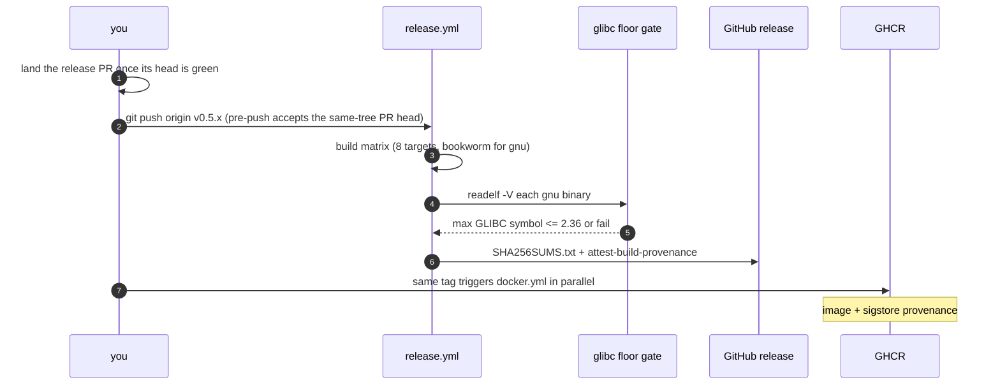
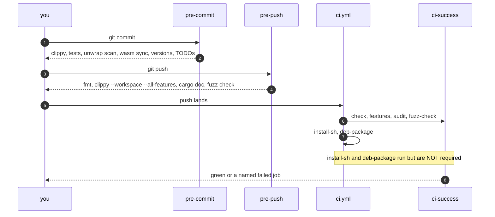

# Build, CI and release

This page covers four things:

- What compiles.
- What gates a merge.
- What runs on a tag.
- Which of those you can safely ignore.

## Features

`Cargo.toml`'s `[features]` table has fourteen entries.

- The thirteen named features below.
- Plus `default`, which is `native, tui, audio, metrics`.

`full` is everything except `wasm` and `bpf`.
That is not the whole story of what ships.

`bpf` sits outside `full` for one reason.

- Building it needs a nightly toolchain and `bpf-linker` for the kernel object.
- This project cannot demand either of a contributor.

The RELEASE has both.

- `release.yml` builds the four `*-linux-gnu` matrix
  entries with `--features full,bpf`.
- It installs the two tools.
- It sets `SIPNAB_BPF_REQUIRED=1`.
  - So a runner missing either tool fails the build.
  - It does not publish a binary that advertises the feature and refuses at runtime.

The musl and macOS artifacts do NOT carry it, for two different reasons.

- musl:
  - `bpf` costs +589,952 bytes.
  - The published 0.5.117 x86_64 musl binary is 12,252,424 bytes.
  - Under the 12 MB ceiling that left 330,488 bytes of headroom, and it did not fit.
  - The ceiling `release.yml` enforces has risen several times since.
    `binary_size_ceiling_mb` in [`website/config.toml`](../../website/config.toml) holds the current figure.
    So it would fit now.
  - musl still excludes it.
    What a static artifact carries is a decision about the artifact, not about bytes.
    Raising a ceiling does not make that decision.
- macOS:
  - `Cargo.toml` declares `aya`
    under `[target.'cfg(target_os = "linux")'.dependencies]`.
  - So the feature would compile to nothing while `--version` claimed it.

On those binaries `--uprobe-backend bpf` still refuses.

- `sipnab --version` is how you tell which build you hold.
- It lists every compiled feature, `bpf` and `plugins` included.

| Feature | Implies | Gates |
|---|---|---|
| `native` | — | Everything that cannot compile to WASM: libpcap capture, clap, the pcap file writer, the tracing subscriber. Most other features imply it. |
| `tui` | `native` | The ratatui/crossterm terminal UI. |
| `tls` | — | TLS/SRTP decryption: `ring`, `rustls`, keylog parsing, and `zeroize` for key material. **Does not imply `native`** — decryption is useful in the WASM analyzer too. |
| `hep` | `native` | HEP/EEP capture source, with HMAC auth. |
| `metrics` | `native` | The standalone Prometheus `/metrics` listener. Raw TCP and threads, deliberately independent of `api` — you can ship metrics without the axum stack. |
| `audio` | — | The `sipnab-audio` plugin loader for TUI playback. **Does not imply `native`**; it is a `dlopen` of a separate cdylib. |
| `api` | `native` | The axum REST API. |
| `mcp` | `native` | The MCP server over stdio. |
| `mcp-http` | `mcp` + `api` | Streamable-HTTP MCP transport; depends on `api` so both share one axum stack rather than duplicating it. |
| `plugins` | `native` | The `wasmi` WASM plugin host. **Non-default on purpose** — someone who does not want an interpreter inside their capture tool does not get one. See [`../design/wasm-plugin-api.md`](../design/wasm-plugin-api.md), which measures the cost at +1.56 MB and 15 crates. |
| `wasm` | — | The browser analyzer bindings. Lib-only: its test and bin targets are meaningless on the host. |
| `vcon` | `native` | vCon export: one observed dialog as an unsigned OBSERVER conversation container. **Non-default on purpose** — the stock build gains no conversation-container writer at all. It sits INSIDE `full`, so the pre-commit hook's `cargo test --features full` covers it. sipnab writes the container as an observer: nothing signed, a party `name` only from a `From` or `To` display name and never vouched for, and no `url` — retained audio travels INLINE as base64url or not at all, under a measured size budget the emitter refuses out loud. |
| `bpf` | `native` | The eBPF uprobe backend — the only one that can report the peer address a TLS session went out to, because it pairs each write with its `tcp_sendmsg`. **Outside `full`**: the kernel half needs nightly and `bpf-linker`. Shipped on the four `*-linux-gnu` release artifacts, not on musl or macOS. |
| `full` | everything but `wasm` and `bpf` | What the pre-commit hook and most local testing use. The released gnu binaries add `bpf` on top. |

The implications that surprise people:

- **`tls` and `audio` do not pull in `native`**.
- `mcp-http` pulls in *both* `mcp` and `api`.

So a green `--features full` says nothing about whether `--features tls` alone
compiles.
That is exactly why CI has a feature matrix.

## The nineteen workflows

| Workflow | Trigger | What it does |
|---|---|---|
| `ci.yml` | push, PR | The merge gate. See below. |
| `cert-expiry.yml` | daily at 07:10 UTC, and on changes to itself | Reads the EDGE and the ORIGIN certificates for sipnab.com and fails with three weeks to spare. Both, because the public name resolves to the CDN: on 2026-09-11 the edge certificate was healthy with 85 days left while the origin had expired and every visitor got a 526. It also refuses a CNAME that disagrees with `base_url`, which is what had been dropping the certificate on every deploy. Its step that checks the live page names `published_version` runs on the schedule and a manual run only, never on a push: the push that moves `published_version` comes before the deploy that makes the page name it |
| `quality.yml` | push to main, PR, weekly cron (Wednesdays 04:23 UTC) + manual | Line coverage (`cargo-llvm-cov`), clippy SARIF upload, and the prose gates below on push and PR. Branch coverage (nightly) runs on the schedule, where it is the only job, and on a manual run, alongside the rest. Not required by `ci-success`. |
| `codeql.yml` | push to main, PR, weekly cron (Tuesdays 02:34 UTC) | GitHub's static analysis. |
| `fuzz.yml` | weekly cron (Mondays 05:17 UTC) + manual | Coverage-guided `cargo-fuzz` runs; crash reproducers upload as artifacts. |
| `clusterfuzzlite.yml` | daily (batch 02:23 UTC, pruning 05:23 UTC), weekly (coverage Sundays 06:23 UTC) + manual | Continuous fuzzing with a corpus that survives between runs, which `fuzz.yml` cannot do: batch fuzzing grows it, pruning keeps it minimal, and the coverage job reports which code it reaches. Builds in the OSS-Fuzz Rust builder image from `.clusterfuzzlite/`, which compiles the targets the way ClusterFuzzLite runs them. No pull-request fuzzing: without continuous builds on every push it would report pre-existing crashes as though the change introduced them. |
| `docker.yml` | push to main, `v*` tags, pull requests that change the Dockerfile, the workflow or the files its `paths:` list names | Builds the image natively on an amd64 and an arm64 runner, smoke-tests and scans each, pushes each by digest, and joins them into one manifest list on GHCR with sigstore provenance. `latest` moves only on a release tag, and `edge` follows main. Each tag has one writing trigger: the tag push writes the version tags and `latest`, the push to main writes `edge` and `sha-<commit>`, and the `manifest` job reads its list back by the run's own tag (`sha-<commit>` on main, the full version on a tag). On a pull request it logs in nowhere and pushes nothing to GHCR: each leg hands its image to the `manifest` job, which assembles and checks the list in a registry it starts on localhost. |
| `pages.yml` | push to main (path-filtered) | Builds and deploys the Zola website, with the homepage test count taken from CI's run of the same commit. |
| `scorecard.yml` | push to main, weekly cron (Mondays 07:20 UTC), branch-protection change | OpenSSF Scorecard posture analysis → Security tab. Report-only. |
| `wiki-sync.yml` | push to main (path-filtered) | Regenerates the wiki from `docs/` via [`scripts/build-wiki.py`](../../scripts/build-wiki.py). |
| `release.yml` | `v*` tags | The release. See below. |
| `sanitizers.yml` | weekly cron (Tuesdays 06:11 UTC) + manual + on its own path | ThreadSanitizer over the threaded integration suites. Nightly as a tool, not as the toolchain. |
| `memcheck.yml` | weekly cron (Wednesdays 07:23 UTC) + manual + on its own path | Runs sipnab under Valgrind across its offline, archive, HEP, MCP and REST paths, built with `--cfg sipnab_tsan` so it allocates through the C library's heap, the only heap Valgrind sees. A definitely or indirectly lost block, or an invalid read, write or free, fails the job ([`scripts/memcheck-verdict.py`](../../scripts/memcheck-verdict.py)), and so does a log with no leak summary. Valgrind must first report a probe program's one known 4,096-byte leak, or the job fails. Runs on the local runners. |
| `self-hosted-smoke.yml` | manual (`workflow_dispatch`) | Proves the self-hosted runner can build sipnab before any production job runs on it. Fires on no automatic event, so no PR can execute on the box. |
| `pr-text.yml` | `pull_request_target`: PR opened, edited, reopened or pushed to | Checks the text a pull request publishes for the lab's private identities and for AI attribution with [`scripts/check-message-identity.sh`](../../scripts/check-message-identity.sh), the script the `commit-msg` hook runs. The `Commit messages and PR title name no private identity` job reads the title, the branch name and every commit message in the pull request's range, which is what a merge puts on `main`, and fails on a finding. The `PR description names no private identity (advisory)` job reads the description, which stays on the pull request page, and reports a finding as a warning without failing. Both jobs check out the base branch (no checkout names a ref, which Scorecard's Dangerous-Workflow check would report), so main's workflow, script and test judge the pull request, and the job fetches the pull request's commits from `refs/pull/N/head` as data and never checks them out or runs them; the fetched head must equal the event's head SHA. `contents: read` at the workflow level and no cache, because a `pull_request_target` run otherwise holds a write token and a cache it saves is restorable on main. Every value from the event reaches the shell only through `env:`. The pull request that added the workflow was not checked by it, because main had no `pr-text.yml` yet. Not required by `ci-success`. |
| `osv-scanner.yml` | push to main, PR, weekly cron (Wednesdays 05:41 UTC) + manual | Vulnerability matching against osv.dev for EVERY lockfile, not just the crate graph. Not redundant with `cargo audit`: that reads Cargo.lock and RustSec only, so advisories against the Actions pins, the Dockerfiles or the fuzz workspace are invisible to it. It also queries a service rather than keeping a local advisory clone, so it does not share the stale-cache failure that broke every `cargo audit` for a day on 2026-08-09. |
| `bench.yml` | daily cron (03:29 UTC) + manual | 4-core offline reconstruction against the baseline in [`bench/baseline.json`](../../bench/baseline.json), failing below 80% of it. Exists because a 40% regression shipped in four releases with every test green. Nightly and wide-banded on purpose: the reference host also serves CI, so a per-push wall-clock gate would measure contention. |
| `reproducible.yml` | weekly cron (Thursdays 04:37 UTC), manual, and PRs touching the build's inputs | Builds the aarch64 gnu release binary twice from one commit, in two directories with two `$CARGO_HOME`s, on the self-hosted runner, and fails unless the stripped binaries and symbol files are identical. See [Reproducible builds](#reproducible-builds). |
| `rerun-not-acquired.yml` | when a `CI` or `Release` run completes without success; manual, which prints the decision for one run and re-runs nothing | Re-runs the failed jobs of a run in which every job that did not succeed has the conclusion `skipped` or never started, because no hosted runner took it. See [A job no runner took](#a-job-no-runner-took). |

### ThreadSanitizer

`sanitizers.yml` runs the threaded integration suites under
`-Zsanitizer=thread`, weekly.
It exists because nothing else in the suite can see a data race.

- The tests exercise the capture thread, the channel, and the
  processing thread.
- But to `cargo test`, a test that passes and a test that raced are
  indistinguishable.

The borrow checker does not help here either.

- It stops at `unsafe`.
- Most of this crate's 153 `unsafe` blocks are libc FFI.
- They concentrate in privilege dropping ([`privilege.rs`](../../src/privilege.rs)
  and [`process_isolation.rs`](../../src/process_isolation.rs)) and capture setup.
- Recount with `grep -rc 'unsafe {' src/` rather than trusting that figure.
  This sentence said 49 until 2026-09-06, when the tree held 92.

Three things about it are deliberate.

**Nightly is a tool, not the toolchain.**

- `-Zsanitizer` is nightly-only, and so is `cargo-fuzz`.
- Both run in their own workflow.
  The release build stays on the pinned stable version.
- Moving the build to nightly would break three things:
  - the toolchain pin
  - the MSRV promise
  - the reproducibility of a released binary

**`-Zbuild-std` is mandatory, not optional.**

- Without it, the standard library is not rebuilt with instrumentation.
- Then TSan sees `std`'s synchronization as opaque.
- It reports the channel itself as a race.
- That noise is what gets a race detector switched off.

**The scope is a sample, and the workflow says so.**

- Five suites run:
  - the REST API and its token path
  - HEP
  - MCP stdio
  - the CLI behavior tests
- Nothing finds a race in a path outside that list.
- Add the suite rather than assuming coverage.

[`ops/tsan/suppressions.txt`](../../ops/tsan/suppressions.txt) silences libpcap, libasound and the dynamic loader.
TSan cannot instrument them.

- Each entry carries the reason it is not a real race.
- An unexplained suppression turns a race detector into a race ignorer.

**The sanitizer build drops mimalloc.**

- `RUSTFLAGS` carries `--cfg sipnab_tsan`.
- [`src/main.rs`](../../src/main.rs) skips its `#[global_allocator]` under that cfg.
- Why:
  - mimalloc is C compiled by the `cc` crate.
  - So `-Zsanitizer=thread` does not instrument it.
  - TSan sees neither its alloc/free (no shadow reset on a recycled block)
    nor its internal cross-thread synchronization.
  - Every block handed from one thread to another reads as a data race.
- The 2026-07-29 run reported exactly that.
  - Its stacks named `read` and `Vec::append_elements_unreserved`.
  - They had no allocator frame anywhere.
  - So a suppression could not have matched it.
- `docs/design/backlog.md` records the bisect.
- The shipped binary keeps mimalloc.
  Only the sanitizer build differs.

**The verdict reads every process, and classifies.**

The step greps rather than trusting the exit code.
TSan can report a finding and still exit 0 when the test passes.
Two things make that grep mean something.

- `log_path` gives each process its own `tsan.<pid>`.
  - The suites spawn the `sipnab` binary and consume its stderr.
  - Before this, a report from a child reached the log only if some
    test happened to print the child's stderr into an assertion message.
  - The first run's "0 races" meant "nothing printed".
- The verdict names the finding it actually matched.
  - It does not call everything a data race.
  - An earlier draft would have reported a thread leak as one.

`thread leak` is in the fatal set.

- It was briefly written off as expected.
  The reasoning: sipnab exits fail-fast paths through `std::process::exit`,
  which joins nothing.
- That had it backwards.
  - `bootstrap::launch` spawns the capture thread *before* the readiness hand-shake,
    the chroot, and the privilege drop.
  - So every failure from there on abandoned a thread still holding an open
    capture source.
  - `sipnab -I /nonexistent.pcap`, a mistyped filename, was enough to do it.
- Those paths go through `capture::stop_and_join`.
  - It sets the shutdown flag, drops the receiver, and joins.
- The suites report zero leaks.
  The fatal classification is what keeps it that way.

A missing `__tsan_init` in the built binary fails the job outright.
Otherwise a build that quietly lost its instrumentation would report a clean run
forever.

All of that lives in [`ops/tsan/verdict.sh`](../../ops/tsan/verdict.sh), not inline in the workflow.

- [`ops/tsan/test-verdict.sh`](../../ops/tsan/test-verdict.sh) sits beside it.
- A `tsan-verdict` job in `ci.yml` runs it on every push.

The inline version had to move because it was wrong in the direction nobody checks.

- `run:` blocks execute under `bash -e -o pipefail`.
- So its warning loop exited 1 on a tree with **no** findings. The loop was
  `grep -hoE 'WARNING: ThreadSanitizer: [a-z -]+' $LOGS | sort -u | while read -r w; do`,
  and `grep` exits 1 when nothing matches.
- That killed the step before it could report.
- The job failed silently when clean and passed while a thread leak was present.

The instrumentation guard had the mirror of it.

- `grep -q` closed the pipe on a still-writing `nm`.
- It read SIGPIPE as "not instrumented".

Nothing could have caught either without running the logic against a fixture.
That is the whole argument for it being a script.

### The prose gates

`quality.yml`'s `Docs` job runs three tools over `docs/`, [`website/content/`](../../website/content/) and
`README.md`:

- Vale with the Google style package
- codespell
- lychee twice:
  - once over the Markdown
  - once over the site Zola builds from it

The built-site pass matters.

- It is the only place the generated pages get checked.
- It cannot run on this project's own aarch64 hardware, where no Zola binary exists.

`.vale.ini` carries the whole policy, and reading it beats re-deriving it.
It records:

- which rules fail the build
- which ones sit disabled, with the alert count each produced
- which ones a measurement rejected, because the advice did not survive contact
  with this corpus

Five rules fail the build today.
Four more sit off, with their reasoning recorded rather than left for the next reader to rediscover.

**This repo pins the style package to an exact release.**

- `Packages = Google` resolves through the registry to `releases/latest/download`.
- CI runs `vale sync` on every job.
- So that spelling makes every prose gate depend on
  whatever upstream published last.
- A local styles tree is only as fresh as the last manual sync.
  So a green local run says nothing about CI.

Google v0.7.0 landed 2026-07-30 13:43 UTC and rewrote one rule's regex.

- A gate measured and enabled against the older package reported 0 alerts locally and 35 in CI.
- main went red.

`vale_style_package_is_pinned_to_a_release` holds the pin.
To upgrade:

- Change the version.
- Run `vale sync`.
- Re-run Vale and read the diff in alert counts before committing.

### Coverage, and running it before CI does

The `Quality` workflow's coverage job runs `cargo llvm-cov`.
It enforces a line floor with `--fail-under-lines`.

- The floor sits just under the measured figure.
  So it ratchets against decline without failing on noise.
- The workflow comment carries the measurement and the commit it came from.
- Raise it when the real number rises.
- Never lower it to make a build pass.

[`scripts/coverage.sh`](../../scripts/coverage.sh) reproduces that job locally, before a push:

Collect, summarize and enforce the floor:

```bash
scripts/coverage.sh
```

Report the last collection without re-running it:

```bash
scripts/coverage.sh --report
```

It **reads the floor and the scope out of the workflow** rather than repeating them.

- The scope is the workflow-level `COVERAGE_TEST_SKIPS` and
  `COVERAGE_IGNORE_REGEX` in `quality.yml`.
  The workflow states it once, and every `cargo llvm-cov` call there uses it.
- Two copies of a threshold is how a gate and its local rehearsal come to disagree.
  - The rehearsal is the one that gets trusted, because it is the one that answered first.
- [`tests/coverage_gate_test.rs`](../../tests/coverage_gate_test.rs) fails in three cases:
  - the script grows its own floor
  - the two skip different tests
  - someone walks the floor backwards

It is deliberately **not** in the pre-push hook.

- An instrumented build plus the full suite is 30-60 minutes.
  The hook is already around fifteen.
- A gate nobody waits for is a gate people bypass.
- And the claim that one exists is what stops someone adding a real check later.
- A test asserts it stays out.

The two `--skip` flags are technical rather than preferences.

- `cli_goldens` spawns the instrumented binary as 13 parallel child processes.
  They collide on the llvm-cov merge-pool `.profraw`.
- `wasm_plugin_` shells out to a wasm32 build.
  wasm32 ships no `profiler_builtins`, so the nested build fails `E0463`.

Both run in full under the plain `cargo test`.
So the run loses only their coverage contribution.
That is why this total falls short of the whole suite by design.

### Branch coverage

The line job cannot count branches.

- `cargo llvm-cov --branch` needs rustc's `-Z coverage-options=branch`.
- Only nightly accepts that.
- The line gate stays on the pinned stable toolchain.

So `quality.yml` has a second job, `coverage-branch`.

- It runs weekly (Wednesdays 04:23 UTC) and on a manual run only.
- It uses the same nightly pin `fuzz.yml` and `sanitizers.yml` use.
- It collects under the same scope as the line job.
- It uploads to Codecov under the flag `branch`, beside the line report rather than over it.

`cargo llvm-cov` has `--fail-under-lines`, `-regions` and `-functions` but no branch floor.
[`scripts/branch-coverage.py`](../../scripts/branch-coverage.py) reads the
`--json --summary-only` export instead.

- It fails a report that holds no branches at all.
  That means `--branch` never took effect.
- It enforces `--floor` when the job passes one.
- The job passes none yet.
  - The first measurement was a local aarch64 run on 2026-09-30 over the job's scope.
  - It was **77.46%** (13221 of 17069 branches), under OpenSSF Gold's 80%.
- Once the real number clears 80, set the floor just under it.
  This is the same ratchet as the line floor.

### What actually gates a merge

`ci-success` requires every other job in `ci.yml` but the macOS leg of Check — sixteen of them: **`check`,
`test`, `test-results`, `install-sh`, `deb-package`, `rpm-packaging`,
`homebrew-formula`, `tsan-verdict`, `bench-scripts`, `features`,
`crate-package`, `audit`, `fuzz-check`, `code-scanning-clean`,
`symbol-split`, `pre-push-scenarios`**.

`ci_success_gates_every_job` in
[`site_journey_test`](../../tests/site_journey_test.rs) holds the list to that.

- It once named only the four below.
- The comment above it claimed "every other job" at the time.
- So `install-sh` and `deb-package` could both fail with the
  one required check on main still green.

`code-scanning-clean` waits for CodeQL's analysis of the commit, and how long it waits follows the CodeQL workflow run of that commit.

- While the run waits for a runner or runs, the job waits, up to 90 minutes.
- When the run has completed, the job waits 2 more minutes for the upload.
- When GitHub lists no CodeQL run of the commit, the job waits 10 minutes.
- The three times are arguments of [`scripts/code-scanning-clean.py`](../../scripts/code-scanning-clean.py), which the job's step in `ci.yml` passes.
- The job fails with exit 2 when it ends with no verdict, and its last line says which case it was:
  - `still queued or running`: the CodeQL run had not finished. Run the job again when it has.
  - `no CodeQL analysis`: the run completed and uploaded none, or GitHub lists no run. Read the CodeQL run.
  - `could not be read`: the script could not read GitHub's answer.
- An open alert fails the job with exit 1, whatever the state of the run.
- The job once waited a fixed 25 minutes. On 2026-11-10 the CodeQL run of a pull request head waited 46 minutes for a hosted runner,
  and the job failed 147 s before CodeQL uploaded the analysis, with no alert open.
- [`test_code_scanning_wait.py`](../../scripts/tests/test_code_scanning_wait.py) holds the rule.

`ci-success` leaves out the macOS leg of Check, the job `check-macos`, on purpose.

- On 2026-11-02 GitHub canceled Check (macos-latest) on both runs of pull request #601
  (41510139494 and 41514782896) with "The job was not acquired by Runner of type hosted even after
  multiple attempts".
  The rerun of the second took 27 minutes (20:22:04 to 20:49:15 UTC).
- So on a pull request, `CI success` neither waits for macOS nor fails when GitHub cancels the macOS leg.
- `check-macos` still runs on every pull request, which shows its result, and on every push to `main`.
- On `main`, a failed `check-macos` fails the CI workflow run of that commit.
  A failed job fails its run whether or not another job needs it.
  The pre-push hook's tag gate refuses to tag a commit whose CI run is not green,
  so a macOS break on `main` blocks the release.
- The rule lives in one place, `ci-success`'s `needs:` list.
  `the_macos_leg_blocks_main_and_no_pull_request` in
  [`site_journey_test`](../../tests/site_journey_test.rs) holds it:
  - No job `CI success` needs, directly or through another job, runs on macOS only.
  - No job runs on macOS beside another OS: `needs` takes a matrix job whole, so such a job would either block pull requests on macOS or leave its other leg out of the required check.
  - The macOS jobs have no job-level `if:` or `continue-on-error`, and `ci.yml` runs on every push to `main` and every pull request.
  - `check-macos` runs `check`'s steps through the YAML alias `*check-steps`, and `symbol-split-macos` runs `symbol-split`'s through `*symbol-split-steps`, so the legs cannot drift.
- The macOS half of the symbol split is `symbol-split-macos`, by the same rule.
  GitHub canceled it for capacity on pull request #631 (run 41725010284).

The rest of this section describes five of them.
Their contents are worth spelling out.

- **`check`** (Linux; `check-macos` runs the same steps on macOS):
  - `cargo build --all-features`
  - On macOS, `cargo test --all-features`, whole.
    On Linux the suite runs in `test`, below.
  - `cargo clippy --workspace --all-features --all-targets -D warnings`
  - [`scripts/check-rustfmt.sh`](../../scripts/check-rustfmt.sh) (the pinned nightly rustfmt)
  - `cargo doc --no-deps --all-features --workspace`
  - plus the `--ignored` PTY TUI end-to-end tests
  - On Linux it also compiles the Python clients under `clients/python/`.
    It runs `pytest` over their tests and `scripts/tests`.
    The pre-commit hook runs `scripts/tests` on every commit except a release-only one, whatever the commit stages: those tests read documentation pages and workflows too.
- **`features`**: `cargo clippy --no-default-features --features X --tests
  -- -D warnings` across twenty-one feature sets.
  - [`.github/feature-combos.txt`](../../.github/feature-combos.txt) lists the sets, the tests that run beside them, what each needs from the machine, and which sets the pre-push hook lints as well (`hook`).
  - The sets: each of `native`, `tls`, `api`, `mcp`, `hep`,
    `metrics`, then `tls,api`, `native,tui,audio`, the default features
    `native,tui,audio,metrics`, `native,tui,tls,hep,api`,
    `native,hep,api,mcp,mcp-http`, each of `bpf`, `vcon`, `opus`, `audio`,
    `plugins`, `archive` and `g729`, the two reduced sets the release
    publishes, and `wasm`.
  - Two groups build them one after another, through [`scripts/check-feature-matrix.py`](../../scripts/check-feature-matrix.py) `--group I --pool P`.
    Until 2026-11-03 each set was a hosted job of its own, and those 21 jobs queued for the account's 20 concurrent hosted jobs: on pull request #626's runs they queued up to 29 minutes.
    - The groups run on the two aarch64 runners labeled `overflow`, whose services run at CPUWeight=1, IOWeight=1 and Nice=19, so they use only the CPU and I/O the local gates leave idle.
    - The x86_64 runner ran a third, lint-only group on pull request #626's run 41768214411 and does not now.
      A 4-core virtual machine with about 2.5 GB of memory in use and up to 2.2 GB swapped, it took 19 minutes for its first set from a cold build directory, and its 45-minute timeout canceled it during the eighth of its ten.
      The two `overflow` groups finished theirs in 12.3 and 13.6 minutes.
    - `partition` in the script decides which group runs which set, given each group's pool (`GROUPS`) and what each pool has (`POOLS`).
      [`scripts/tests/test_feature_matrix_groups.py`](../../scripts/tests/test_feature_matrix_groups.py) holds it to every set and test CI checked on 2026-11-03.
    - The jobs install nothing on the machine. A group first checks that the machine has what its pool promises, and stops with the name of anything missing.
      The one tool a job fetches, the pinned cargo-nextest that runs the `suite` set, goes into the job's own temporary directory.
    - Each job builds in its own directory under the runner's per-job temporary directory, and its last step removes it, `if: always()`.
    - The RPM packaging job, on the x86_64 runner, refuses to start with less than 25 GiB free ([`scripts/ci-disk-floor.sh`](../../scripts/ci-disk-floor.sh)).
    - The repository's fork pull request approval policy is `all_external_contributors`, so no workflow from a fork reaches these runners before a maintainer approves it.
  - `wasm` is lib-only, and gets a `cargo check` of the library for the
    `wasm32-unknown-unknown` target instead.
  - Clippy, not `cargo check`: it compiles the same code and also denies
    the lints that appear only in one combination.
    Neither `--all-features` nor the no-features clippy step can see those.
    A `return` left as a function's tail once a `#[cfg(feature = "g729")]`
    block vanished failed clippy with the default features while every gate
    passed.
  - `vcon` is in `full`, so `--all-features` already builds it.
    This leg is what proves it also builds without `tui`, `tls`, `api` or `mcp`.
  - The documented headless server recipe (`native,hep,api,mcp,mcp-http`) gets a full `cargo
    test`, not just a compile check.
  - Three legs also run the tests that exist only where a feature is absent.
    No `--all-features` or `--features
    full` run can compile those.
    - `native` runs `feature_gate_test` (no `mcp`, no `hep`).
    - `mcp` runs `app_servers_test` (no `mcp-http`).
    - `native,tui,tls,hep,api` runs `tui_snapshot_test` (no `audio`).
  - `bpf` is here because every published `*-linux-gnu` binary carries it.
    - This leg compiles its userspace half and its test files.
    - `build.rs` takes its degrading default here (no nightly, no
      `bpf-linker` on this runner).
    - The release job is where the kernel half is actually built, under `SIPNAB_BPF_REQUIRED=1`.
  - `--tests` is what makes any of these real.
    Without it the lint compiles no test file at all, and every leg
    goes green over nothing.
- **`test`** and **`test-results`**: the `--all-features` suite on Linux, under cargo-nextest, split into shards.
  See [The suite in shards](#the-suite-in-shards).
- **`audit`**: `cargo-audit` and `cargo-deny`.
- **`fuzz-check`**: the `fuzz/` workspace compiles.

#### The suite in shards

The `test` job runs the Linux suite on two runners at once.

- Measured on run 41620629642 (2026-11-03), before the split:
  - Check (ubuntu-latest) took 20.3 minutes, 12.3 of them in its Test step.
  - In that step, `cargo test` compiled the test binaries for 7 minutes 40 seconds (10:46:56 to 10:54:35 UTC) and ran them until the step ended at 10:59:12.
  - Compiling is the larger half, so each shard compiles only its own targets.
    A split of the run alone would save little.
- [`scripts/parallel-tests.py`](../../scripts/parallel-tests.py) `--shard-index I --shard-count N` is the one rule for what each shard runs.
  - It asks `cargo metadata` for the package's integration-test targets.
  - `partition` puts the library and binary unit tests and the doctests in shard 0, weighed as `UNIT_WEIGHT` test binaries.
  - It gives each target, in name order, to the shard with the least weight so far.
  - The shard runs `cargo nextest run --profile suite --all-features` with one `--test NAME` for each target it holds, and shard 0 adds `--lib --bins` and a `cargo test --doc` run.
  - The `suite` profile in [`.config/nextest.toml`](../../.config/nextest.toml) stops any one test after three 60-second periods.
  - Every shard also builds the examples, as plain `cargo test` does, because `examples_run_test` runs them.
  - The job installs the pinned cargo-nextest through [`.github/actions/nextest`](../../.github/actions/nextest/action.yml) first.
- The `shard:` matrix list is the only place that states N.
  The step reads its index and count from `strategy.job-index` and `strategy.job-total`.
- Each shard uploads its output, a manifest of what it ran and the YANG exports.
- `test-results` runs once both pass.
  - `parallel-tests.py merge` refuses the set unless every shard reported exactly once and every target ran in exactly one shard.
  - It writes the outputs in shard order as one `test-output.txt`.
    The published test count is a sum over every binary's `test result` line, so it equals the count of the same suite run in one job.
  - It validates the YANG module and exports, derives the published test count, and on a push to `main` uploads `suite-output` for `pages.yml`.
- [`scripts/tests/test_parallel_tests_shards.py`](../../scripts/tests/test_parallel_tests_shards.py) holds the rule.
  - It runs `partition` on the real target list for the shard count `ci.yml` gives.
    The union of the shards must be every target, and the shards disjoint, so no shard can miss a new `tests/*.rs` file.
  - Every `tests/*.rs` file must be one of `cargo metadata`'s test targets.
- The shards share one cache family, `cargo-test`, which only shard 0 saves, on `main`.

### A job no runner took

GitHub cancels a job when no hosted runner takes it.
The job ends with the conclusion `"cancelled"`, no steps, and this annotation:
"The job was not acquired by Runner of type hosted even after multiple attempts".
Its run ends as failed although no test ran red.
On 2026-11-12 that happened six times on the hosted macOS runners.
Main's CI turned red three times, and a release waited 43 minutes for a person to re-run one build job.

[`.github/workflows/rerun-not-acquired.yml`](../../.github/workflows/rerun-not-acquired.yml) starts when a `CI` or `Release` run completes without success.
The script looks into a run that concluded `failure` or `"cancelled"`, and leaves every other conclusion.
It runs [`scripts/rerun-not-acquired.py`](../../scripts/rerun-not-acquired.py) from `main`, which reads the jobs of that attempt and their annotations.
The script re-runs the run's failed jobs when every job of the attempt is in one of these states:

- The job succeeded.
- The job has the conclusion `skipped` and lists no steps.
  The jobs that need a job that never started end this way.
- The job never started: its status is `completed`, its conclusion is `"cancelled"`, its list of steps is empty, and one of its annotations has exactly that message.

A run gets at most three attempts this way.
The script re-runs attempts 1 and 2, and leaves attempt 3 as it ended.
The limit is `MAX_ATTEMPTS` in the script, and the workflow file holds no second copy of it.

The script leaves these cases for a person:

- A job that failed or timed out, in a run where another job never started.
- A job canceled after its first step began.
- A run or a job that a person canceled.
  Such a job has no annotation with that message.
- A self-hosted runner that did not take a job.
  Its annotation has another message.
- A run on its third attempt.
- A workflow other than `CI` and `Release`.

The workflow's one job holds `actions: write` and no other permission.
GitHub runs the workflow file of the default branch for a `workflow_run` event, and the checkout names no ref.
The script that runs is the one on `main`, also when the completed run belongs to a pull request.

**See what the script answers for one run.**
Start the workflow by hand with the run's number.
This prints the decision and re-runs nothing:

```sh
gh workflow run rerun-not-acquired.yml -f run_id=<run id>
```

The same answer on a workstation, with a `gh` that can read the repository:

```sh
python3 scripts/rerun-not-acquired.py --repo <owner>/<name> --run-id <run id>
```

The output ends with `decision: rerun:` or `decision: leave:` and the reason, which names each job that blocks a re-run.
Only the `workflow_run` event passes `--apply`.

**When a run that should have been re-run was not.**
Read the log of the `Re-run jobs no runner took` run that followed it.
An `error:` line means the script could not read GitHub's API, and that run fails.
A `decision: leave:` line names the job or the attempt that ruled the re-run out.
A run there whose one job did not start means the completed run concluded `success`.
No run there means the completed run belongs to another workflow.

[`scripts/tests/test_rerun_not_acquired.py`](../../scripts/tests/test_rerun_not_acquired.py) tests the decision against two answers captured from GitHub's API, in [`tests/fixtures/rerun_not_acquired`](../../tests/fixtures/rerun_not_acquired), and against answers built in the same shape.

### Dependabot bumps fail on a generated file, not on an API break

**Every Dependabot pull request fails the same way, and it is almost never a
code break.**

- A script generates `THIRD-PARTY-NOTICES.md` from the dependency graph.
- The `third_party_notices_are_current` gate in [`tests/docs_drift_test.rs`](../../tests/docs_drift_test.rs)
  re-runs [`scripts/build-third-party-notices.py`](../../scripts/build-third-party-notices.py).
  It fails when the committed file differs.
- Dependabot moves `Cargo.lock` and never regenerates what derives from it.

**Merging a batch multiplies this, and the fix moves.**

- Regenerating on one branch does not help the four merged after it.
  - Each merge changes the graph again.
  - The file is only correct for the graph that produced it.
- The shape that works: merge five updates, then regenerate once, at the end, on `main`.
- Doing it per branch and then merging them all leaves `main` red anyway.

The fix is one command on the branch:

```bash
python3 scripts/build-third-party-notices.py
```

**Read the failure signature before you believe the job names.**

- Exactly the jobs that *execute* the suite fail:
  - `check` on both platforms
  - `coverage`
  - the single `features` combination that runs `cargo test`
- Every check-only `features` combination stays green.
- A real compile break fails those too.
- `check` runs the tests, and its name reads like "compiles".

On 2026-08-02 this presented as three pull requests each failing five jobs.

- It looked exactly like three simultaneous major-version API breaks.
- `wasmi` 0.51 to 1.1, `rmcp` 2.2.0 to 3.0.1, and a three-crate group each needed
  **zero** code changes.
- Verifying that cost three separate investigations.
  That is why this section exists.

One caveat on `rmcp` specifically.

- A major bump can be genuinely wide and still touch nothing sipnab uses.
- Diff the actual MCP wire traffic rather than reading the changelog.
  That is what tells you whether behavior moved.

Branch protection sets `required_status_checks.strict: true`.

- So a green pull request shows `BEHIND` whenever `main` moves.
- Arm auto-merge per pull request rather than racing a manual rebase against your own pushes.

**`install-sh` and `deb-package` are in that list.**

- They run on every push:
  - the installer test suite plus shellcheck
  - the `.deb` build for both the full and `noaudio` variants
- A failure in either turns `CI success` red.
  So it blocks a merge like any other job.
- This paragraph used to say the opposite.
  It dates from before `ci_success_gates_every_job` added them.

**`crate-package`** runs `cargo package --locked -p sipnab-bpf-types -p sipnab-g729 -p sipnab`.

- That builds each crate from its own `.crate` file.
- So a file the build reads but the `include` allowlist in `Cargo.toml` does not ship
  fails here rather than at `cargo publish`.
- [`tests/crate_package_test.rs`](../../tests/crate_package_test.rs) is the fast half.
  It packages without compiling on every test run.

### Pinned tool downloads

CI installs Zola, Vale, the Vale Google style, lychee, `pagefind`, cargo-nextest and bpf-linker from GitHub release assets.
The workflows pin each one by version and by sha256.

On 2026-11-08 github.com answered release downloads with HTTP 504 from at least 08:57Z to at least 09:48Z.

- Each install step was one curl download of the archive with five retries 5 seconds apart, which is about 25 seconds of retries.
- main's Pages deploy failed at "Install Zola".
- The Docs, Accessibility and Lighthouse jobs of pull requests #698 and #699 failed at the same step.

Every such download now goes through one rule:

- [`scripts/fetch-pinned.sh`](../../scripts/fetch-pinned.sh) puts the pinned bytes of one file at a destination.
  - It hashes a file already at the destination first.
    On a match it uses that file and fetches nothing.
    On a mismatch it deletes the file with a warning, then fetches it again.
  - It retries HTTP 408, 429 and 5xx, timeouts, refused or reset connections and short transfers.
    The delay starts at 5 seconds and doubles up to 60.
    It retries only while the time spent plus the next delay stays within 300 seconds.
  - curl's time limit bounds each attempt.
  - The exit status names the kind of failure: 1 is an outage, so a re-run can pass.
    3 is bytes that do not match the pin, so a re-run cannot.
    4 is a permanent refusal such as HTTP 404, so the URL or the version is wrong.
  - Each error names the URL and the last HTTP status or curl error.
- [`.github/actions/pinned-download`](../../.github/actions/pinned-download/action.yml) runs that script between an `actions/cache` restore and save.
  - The key is the tool's name, its version and its sha256.
  - The script runs on every run, so it hashes a restored file before anything uses it.
  - The save runs only after a miss, and only on `main`.
  - The directory is the job's own `runner.temp`.
- `release.yml` runs the script for bpf-linker without the cache.
  A release runs on a tag, and an entry a tag run saves is readable only by that tag.
- [`tests/workflow_supply_chain_test.rs`](../../tests/workflow_supply_chain_test.rs) fails a workflow or action step that names a `releases/download/` URL and does not go through the action or the script.
  [`tests/ci_curl_retry_test.rs`](../../tests/ci_curl_retry_test.rs) fails a CI file that runs `curl` itself.
  `no_workflow_uses_an_action_that_fetches_its_tool_unchecked` fails a step that uses `lycheeverse/lychee-action`.
  That action downloads lychee from a release with one `curl` and no checksum, and on 2026-11-08 that download failed the Docs job.
  It also fails a step that uses `taiki-e/install-action` or `sigstore/cosign-installer`, which fetched their tools from GitHub releases
  in one live attempt (RELEASE-FAST D).
- [`.github/actions/pinned-tool`](../../.github/actions/pinned-tool/action.yml) installs those tools instead:
  cargo-audit, cargo-deny, cargo-llvm-cov, clippy-sarif, sarif-fmt, cargo-cyclonedx and cosign.
  - It holds one table, a version and a sha256 per platform for each tool, and fetches through `pinned-download`.
  - `every_pinned_tool_is_fetched_by_the_one_rule` fails a job that runs one of these tools without it.
  - To bump one, change its `_VERSION` and every `_SHA256_` value together, taking each hash from the release's
    checksum file or the asset's `digest` in `gh api repos/<owner>/<repo>/releases/tags/<tag>`.
- [`scripts/tests/test_fetch_pinned.py`](../../scripts/tests/test_fetch_pinned.py) drives the script against a local HTTP server.

To bump a tool:

1. Change its `_VERSION` value in every workflow that pins it.
   `a_tool_installed_by_more_than_one_workflow_is_pinned_identically` fails while two copies differ.
   cargo-nextest's version is in [`.github/actions/nextest/action.yml`](../../.github/actions/nextest/action.yml) and [`.config/nextest.toml`](../../.config/nextest.toml).
2. Download the new archive and hash it:

   ```sh
   # Run all of these, in order.
   curl -fsSL -o archive "<the release asset URL>"
   sha256sum archive
   ```

   Where the release publishes a checksum file, as Vale and cargo-nextest do, compare the two.
3. Put the hash in the matching `_SHA256` value.
   The new version and hash are a new cache key, so the first run on `main` fetches and saves the archive.

During a download outage:

- A run that fails with exit 1 from `fetch-pinned.sh` failed on the network.
  Re-run it once a manual `curl` of the URL succeeds:

  ```sh
  curl -sS -o /dev/null -w '%{http_code}\n' -L "<the URL in the error>"
  ```

- A job whose archive is in the cache does not reach github.com, so an outage reaches only pins `main` has not yet saved.
- An exit 3 means the bytes served differ from the pin.
  Do not re-run.
  Download the asset and compare its hash with the release's own checksum file before changing the pin.
- A warning that a cached file does not match its pin names the entry.
  Delete it with `gh cache delete <key>`, because an entry is never overwritten.

## Hooks

Activate once per clone: `git config core.hooksPath .githooks`.

[`pre-commit`](../../.githooks/pre-commit) runs thirteen numbered gates,
starting at 0, in order:

- [`scripts/check-rustfmt.sh`](../../scripts/check-rustfmt.sh), the pinned nightly rustfmt over every `.rs` file
- vale and codespell over the paths CI gives them
- clippy (`--workspace --all-features --all-targets`, `-D warnings`)
- the full test suite, under cargo-nextest, run by
  [`scripts/parallel-tests.py`](../../scripts/parallel-tests.py)
  - The `suite` profile stops any one test after three 60-second periods and fails it by name.
  - The doctests run after it, with `cargo test --doc`.
  - `SIPNAB_TEST_JOBS` sets nextest's `--test-threads`.
  - `1` runs the tests one at a time.
  - It runs with `SIPNAB_CORPUS` and `SIPNAB_VCON_DATASETS` unset, so every corpus binary skips and prints its `NOTICE`.
    The corpus runs in the pre-push corpus gate instead, under an optimized profile.
    In a debug build at commit time it cost 1,158.7 s of a 1,882.7 s suite (the 2026-10-23 log).
- the `sipnab-bpf-types` crate's own tests and doctests (gate 2b)
  - The suite leaves them out because it tests the sipnab package only.
- no `unwrap()`, `expect()` or abort macro (`panic!`,
  `unreachable!`, `todo!`, `unimplemented!`) in production code, as
  [`scripts/check-unwrap.py`](../../scripts/check-unwrap.py) reads it
  - A `// gate: <macro> because <reason>` line above an abort macro excuses that one site.
  - The four macro names are the only ones that marker takes.
- a generated file staged with the inputs it derives from
- every feature declaring what its own modules import
- the privilege-drop path still dropping privileges
- WASM exports in sync with the site's JS
- the homepage test count still generated, not written into the template,
  plus the site version matching `Cargo.toml`
- no TODO stubs
- an advisory notice when a commit touches a file `docs/internals/` cites without
  touching `docs/internals/` itself

Gate 0 is first because it is the cheapest check in either hook (~1.4s
against clippy's minutes).

A release-only commit runs a smaller set.

- [`scripts/release-only.py`](../../scripts/release-only.py) decides it: the version moves
  forward and every changed line is the version, a Since cell of the CLI reference or the
  one CHANGELOG heading. [`test_release_only.py`](../../scripts/tests/test_release_only.py)
  replays the real 0.5.238 and 0.5.237 release commits against it.
- The hook then skips the failed-tests replay, clippy, the suite and gate 2b, and runs the
  release test targets that `release-only.py tests` prints in place of the suite.
- The pre-push hook skips its tree gates for a push of such commits, as it does for a proven
  tag push, and skips the corpus gate.
- The release pull request's CI still runs every gate on the same tree.
- On 0.5.238 the full hooks took 14 minutes (pre-commit) and 15 minutes (pre-push) on a
  24-line version bump.


- So an unformatted tree fails in seconds rather than after a full lint and test run.
- `pre-push` still checks formatting.
  That copy is the one guaranteeing nothing unformatted reaches the remote.
- What it cannot do is catch the slip early.
  A formatting-only failure discovered at push time costs a whole commit-and-push cycle to undo.

Gate 0b is here for that same reason and arrived the same way.

- The prose gates ran only in `pre-push`.
- So work that satisfied every gate here met them at the push, with the commit already made.
- Each rejection cost a full cycle to redo.
  That happened twice on 2026-08-22, once blocking a release push over a single passive clause.
- Both tools take about a second against gate 2's minutes.
- `pre-push` keeps its copies.
  So the guarantee stands where it did, and this gate is the early warning.

Neither hook restates how those gates work.

- Tool resolution, the version pin and both path lists live in [`scripts/prose-gates.sh`](../../scripts/prose-gates.sh).
- `pre-commit`, `pre-push` and [`scripts/preflight.sh`](../../scripts/preflight.sh) source it.
- Each caller keeps only its own rendering, because the three have different room to print in.

The script returns:

- 0 for a clean run
- 1 for findings
- 2 when the tool did not run at all

Return 2 never renders as a pass.
A missing tool does not block the commit.

- CI still enforces it.
- Blocking would make the hook unusable without both installed.
- But the run says so rather than staying quiet.

Both hooks skip the prose gates entirely when the branch does not carry that
script, and report the skip.

- `core.hooksPath` once held an absolute path into one worktree's `.githooks/`.
- While it did, every worktree and every branch ran that one hook FILE.
- The script it sources is branch CONTENT.
- So a branch cut before the script existed could not commit at all.

The same absolute path let whichever branch that one worktree had checked out
gate every commit, from any worktree.

- On 2026-09-29 that branch's pre-commit lacked the `sipnab-bpf-types` step.
- Commits on `main` went through without it.
- So both hooks now open by checking that they belong to the tree they are checking.
  - They refuse otherwise, naming the fix: `git config core.hooksPath
    .githooks`.
- `SIPNAB_HOOK_ANY_TREE=1` turns that check off and says so.
  - The hook test scripts need it, because they run the repository's hooks against throwaway trees.

[`commit-msg`](../../.githooks/commit-msg) opens with the same check.

- It then runs [`scripts/check-message-identity.sh`](../../scripts/check-message-identity.sh)
  on the commit message.
- That script runs the private-identity rules of
  [`tests/private_identity_test.rs`](../../tests/private_identity_test.rs) over each line.
- It skips with `NOT CHECKED` on a branch that does not carry the script.
- [CONTRIBUTING.md](../../CONTRIBUTING.md#git-hooks) describes:
  - what it checks
  - what `pr-text.yml` checks again in CI
  - how to check a pull request description the same way

Two of the thirteen cannot fail the commit.

- Gate 6 prints `WARN: N TODO/FIXME comments` and falls through.
  It is a count, not a veto.
- Gate 8 prints `REVIEW` and a list and returns zero.
  It is a reminder to check the developer pages still read true, not a claim that they don't.

The gate that *does* fail is [`dev_docs_drift_test`](../../tests/dev_docs_drift_test.rs) in gate 2's test run.
It is broader than dead links: twenty-six tests, covering:

- cited paths that no longer exist
- a `()`-suffixed symbol in link text with no matching `fn` left in the workspace
- an absolute GitHub URL where a relative path belongs
- a page missing from `build-wiki.py` (which would silently never publish)
- three mermaid conventions:
  - `sequenceDiagram` only
  - no markdown links inside a fence
  - a prose line above every one

What it cannot catch is prose that has quietly become false.
That is still a human's job.

A failing gate names what failed.

- Gate 1 prints every clippy diagnostic with its file and line.
- Gate 2 prints, in order:
  - the name of each failing test
  - the panic location and assertion message for the first three
  - the `test result: FAILED` summary
  - a command that re-runs one test on its own

Both gates write the whole capture to a log and print that path.

- The logs are `.git/sipnab-pre-commit-clippy.log` or
  `.git/sipnab-pre-commit-tests.log`.
- Both cap what reaches the terminal at twenty diagnostic lines and twelve lines of panic.
- When the suite fails to compile, gate 2 prints the compile errors instead.
- When it dies without naming a test at all, gate 2 prints the last twenty lines rather than nothing.
- A passing run still prints one line per gate.

Both gates capture their tool's output rather than let it stream.

- Gate 5 reads the test run back to check the homepage count's rule still counts it.
- A streamed clippy would bury the per-gate summary.

Capturing without reporting swallows the answer.
The naming above prevents that.

- A failure that prints only `FAIL` and a "run it yourself" line costs whoever hit it
  a second full suite run to learn the name of the test.
- Until that run finishes, they cannot tell whether the
  break is theirs or already on `HEAD`.
- Settling that one question once cost an extraction of a pristine `HEAD` into a scratch directory.

That means **every commit runs clippy and the whole test suite** and takes
minutes.

The homepage's automated-test count is not in the template.

- It used to be: a number in [`website/templates/index.html`](../../website/templates/index.html)
  that gate 5 held to the run.
- So every pull request that added a test edited the same line.
- Any two such pull requests conflicted on it.

It is now generated at deploy time:

- `ci.yml` runs `cargo test --all-features` on Linux, in the `test` job's shards.
  - The `test-results` job merges their outputs and applies [`scripts/published-test-count.py`](../../scripts/published-test-count.py)
    to the result (step "Derive the published test count").
  - That step fails CI when the script cannot count the run.
  - On a push to `main` it uploads the output as the `suite-output` artifact.
- `pages.yml` waits for that artifact from CI's run of the commit it deploys
  ([`scripts/fetch-ci-suite-output.py`](../../scripts/fetch-ci-suite-output.py)).
  - It applies the same script to it, and writes `website/data/test-count.toml`.
  - It then runs `zola build`.
  - It fails the deploy if the built homepage does not state that number.
- The template loads the file with `load_data(path="data/test-count.toml", required=false)`.
  - A local `zola build` has no file.
  - So it renders "Every PR" on the tile and a sentence with no number in the feature table,
    instead of a stale count.

The script is the one counting rule.

- It sums the `passed` figure of every line that starts with `test result`.
- It refuses a run with a `FAILED` binary, with no result line, or with a total of zero.

Gate 5 checks the mechanism:

- the script still counts the gate 2 run
- the template still loads the file
- no literal count has come back

The data file is in `.gitignore`.
Adding a test needs no edit to the site.

Two checks stay out of the PRE-COMMIT hook on purpose: the feature matrix and
rustdoc.

- That hook already costs minutes, and each of those adds more.
- [`pre-push`](../../.githooks/pre-push) picks up rustdoc before anything leaves the machine.
- CI's Features job builds the matrix.
- Moving them into the pre-commit hook buys nothing.
  It is the same wait, on every commit instead of every push.
- The prose pair used to sit here too, and moved.
  Vale and codespell cost about a second each.
  So gate 0b runs them at the commit, and `pre-push` keeps its copies.

The matrix has moved twice.

- Pre-push once checked three of the combinations and CI ran the rest.
  That left a class of break with a push-and-wait feedback loop.
- [`scripts/check-feature-matrix.py`](../../scripts/check-feature-matrix.py) then ran all of them in the hook.
  - It reads both the combo list and `RUSTFLAGS` out of
    [`.github/workflows/ci.yml`](../../.github/workflows/ci.yml), so the two cannot drift.
- From 2026-09-29 to 2026-10-27 the Features job ran on the project's aarch64 self-hosted runners.
  - The hook stopped repeating it on every push then, and still does not.
- Since 2026-10-27 it runs on GitHub's `ubuntu-24.04-arm`, as described below.
- The script still runs it by hand.
- Pre-push keeps the reduced combinations.
- Since 2026-11-12 pre-push also lints the rows of [`.github/feature-combos.txt`](../../.github/feature-combos.txt) marked `hook`: `native`, the default features and `native,hep,api,mcp,mcp-http`.
  - The command is the one the `features` job runs for the row, `cargo clippy --no-default-features --features X --tests -- -D warnings`.
  - The pre-commit hook builds only `--features full`. In pull request #763 a binding read only under `#[cfg(feature = "hep")]` passed it and would have failed that command in CI for every set without `hep`.
  - [`scripts/check-feature-matrix.py`](../../scripts/check-feature-matrix.py) `--hook-rows` prints each marked row's stamp step, features and command, and `--lint-row` runs one. The hook and [`scripts/gate-cache.py`](../../scripts/gate-cache.py) both read the rows through that script, so each row has a pass stamp of its own.
  - Measured on the aarch64 development host on 2026-11-12, the three rows together took 49 seconds after a change to the library's root source file alone and 163 seconds the first time after edits to test files, at a load average of about 23.
- Pre-push and CI also run clippy on the library with no features:
  `cargo clippy --no-default-features --lib -- -D warnings`.
  - The main clippy gate runs `--all-features`, so a lint that fires only with every feature off never reaches it.
  - On 2026-10-14 main carried one: a `..Self::default()` that does nothing once the feature-gated fields are absent.

The self-hosted jobs keep their builds between runs.

- `actions/checkout` deletes untracked files at the start of every job (`clean: true`, which runs
  `git clean -ffdx`).
- An in-workspace `target/` is untracked.
- So until 2026-10-08 every leg recompiled 279 to 701 crates from nothing.
- The clean stays, because several gates read the disk and must not see another branch's leftovers.
- The build directory moved instead.
  - [`.github/actions/runner-target`](../../.github/actions/runner-target/action.yml)
    sets `CARGO_TARGET_DIR` to `$HOME/.cache/sipnab-ci/<runner name>/target`.
  - That is outside the workspace and one per runner.
  - Cargo locks its build directory, and four runners on one directory would build one at a time.
- Before each build, [`scripts/ci-target-cap.sh`](../../scripts/ci-target-cap.sh) removes that
  directory when it is over 64 GiB.
  - The action's header gives the measurements behind the number.
- `memcheck.yml`, `bench.yml` and `self-hosted-smoke.yml` use it on the self-hosted runners.
- The Features job, the Linux leg of the Check job and the Coverage job carry it too.
  On GitHub's runners it does nothing.
  It stays so that moving one of them back is a change to its `runs-on:` alone.
- Coverage passes `dir: coverage-target`.
  - `cargo llvm-cov` compiles every crate with `-C instrument-coverage`.
  - So its build has its own capped directory beside `target`, and does not invalidate the plain builds.
- `reproducible.yml` does not use the action.
  It exists to build twice in fresh trees.
- [`tests/ci_runner_target_test.rs`](../../tests/ci_runner_target_test.rs) holds
  both the use and that exemption, and drives the cap script.

The workflow-shape test holds each job's runner.

- Every job runs on one GitHub-hosted image, or on `self-hosted` with exactly one pool label.
  - `jetson` is the four aarch64 runners.
  - `overflow` is two of them, whose services run at the lowest CPU and I/O priority.
  - `X64` is the one x86_64 runner, a four-core VM with 6 GB of memory, registered for this repository only.
  - The test refuses a bare `self-hosted`: it takes either pool, so the job's architecture would depend on which was idle.
  - A hardware label names each pool, never a machine's name.
- A self-hosted job says why in a `# Self-hosted because:` comment beside its `runs-on:`.
- On the aarch64 runners: `memcheck.yml` (those runners have valgrind), `bench.yml` (its baseline is a property of that hardware),
  `reproducible.yml` (those runners have bpf-linker) and `self-hosted-smoke.yml` (it exists to prove that runner works).
- On the `overflow` runners: two groups of the feature combinations.
  On a push to `main` the two groups take any of the four aarch64 runners instead.
  On 2026-11-11 a push to `main` waited 34 and 68 minutes for the two `overflow` runners behind pull request runs.
  `test_the_workflow_carries_the_rendered_expression` holds the workflow to that rule.
- On the x86_64 runner: the RPM packaging job.
  The RPM job builds no Rust, and the runner has every package it names, so it installs nothing there.
- Only the four jobs above, and the feature combinations on a push to `main`, may take a `jetson` runner. Every other self-hosted job takes `overflow` or `X64`.
  `a_self_hosted_job_takes_overflow_or_x64_unless_it_needs_the_aarch64_host` holds that, `an_x64_job_refuses_to_start_with_less_than_25_gb_free` the disk floor, and `a_pooled_job_builds_in_its_own_directory_and_removes_it` the build directory.
- Everything else runs on GitHub's runners. The repository is public, so they cost nothing.

The Linux leg of the Check job, the `test` shards and the `Quality` workflow's Coverage job run on GitHub's `ubuntu-24.04-arm`.

- From 2026-10-18 to 2026-10-27 they ran on the aarch64 self-hosted runners.
  - On GitHub's runners they had been among the jobs that set the length of a pull request's run.
  - On pull requests #411 and #410 the Linux Check took 20.2 and 22.1 minutes, and Coverage 15.3 and 21.2.
- The four self-hosted runners share one machine's 14 cores with the local gates' build queue.
  - On 2026-10-27 that queue held about 20 entries with a wait of about two hours.
  - The runners' test jobs were among the busiest processes on the machine.
  - The three jobs moved back to GitHub's runners that day.
- Measured on the self-hosted machine on 2026-10-09, with a load average of 20 to 35 on its 14 cores from other work:
  - The Check job's Test step (`cargo test --all-features`) took 9.9 and 11.9 minutes with a warm build directory.
    It used 30 CPU-minutes and 16.4 GiB peak resident memory.
  - Coverage's collection step took 8.6 minutes warm and 16.0 cold.
  - The directories it left were 31 GiB for the plain builds and 35 GiB for the coverage build.
- `ubuntu-24.04-arm` keeps the aarch64 builds these jobs had.
- Each job keeps the shape that let it run on a self-hosted runner.
  - Steps written for a disposable GitHub VM run only on a hosted runner.
    `free-disk` deletes preinstalled software, which on the self-hosted machine other work uses.
    The cargo cache restore and save would upload that machine's registry.
  - Steps that read the build read it from `CARGO_TARGET_DIR`.
  - Packages change only through `.github/actions/system-deps`, described below.
    The workflow-shape test refuses a bare `apt-get`, `dpkg -i` or `debconf-set-selections` in such a job.
- On a hosted Linux leg the workflow-shape test holds what a fresh VM needs.
  - `free-disk` runs before the first cargo command.
  - The job restores its cargo cache, except Coverage, which keeps none.
  - The job installs each tool a step runs: `yanglint` (`libyang2-tools`; Ubuntu 24.04 has no `libyang3-tools`), `tmux`, `tshark`,
    and `cmake`, which builds libopus for the `opus` feature.
  - Its toolchain step asks for each `rustup` component a step runs: `clippy`, `rustfmt` and `llvm-tools-preview`.
    The minimal profile has none of them, and the self-hosted machine has all three.
- The macOS leg of Check runs on GitHub's `macos-26`.
- Every job names a fixed image: `ubuntu-24.04`, `ubuntu-24.04-arm` or `macos-26`. No workflow and no composite action names `ubuntu-latest`, `macos-latest` or `windows-latest`.
  - GitHub moves a floating label to a newer image on its own schedule. On 2026-11-13 `ubuntu-latest` resolved to Ubuntu 26.04 for some runs and to 24.04 for others, minutes apart, and `macos-latest` had already moved to the macOS 26 image.
  - A job on a floating label changes its image without a commit, so a failure the new image brings has no change to point at.
  - `no_workflow_or_action_names_a_floating_runner_label` in [`tests/ci_runner_target_test.rs`](../../tests/ci_runner_target_test.rs) reads every workflow and composite action and fails on such a label outside a comment: in `runs-on:`, in a matrix, in an expression or in a job name. The test runs in the pre-commit hook's suite and in CI.
  - The value of `matrix.os` is part of a check's name, so the checks are `Check (ubuntu-24.04)` and `Check (macos-26)`. Before 2026-11-13 they were `Check (ubuntu-latest)` and `Check (macos-latest)`, and the dated records on this page keep those names.
  - To move to a newer image, change the label in the workflows and `HOSTED_IMAGES` in that test in one commit, and read the first CI run on the new image before the change lands.

System packages come from `.github/actions/system-deps`.

- It asks `dpkg -s` first and installs only what is missing.
- The self-hosted machine already has every package its jobs name.
  So there the action does nothing.
- Four runner instances share that machine.
  `dpkg` and `debconf` each hold one machine-wide lock.
- So when a package is missing, the action holds a `flock` on one lock file for the whole install.
  Concurrent jobs take turns.
- It waits at most 15 minutes for the lock.
  Then it fails the job with an error that says so.
- A `debconf` answer is an input of the action.
  - An example is the Check job's answer for `wireshark-common`.
  - The action applies it inside the same lock, and only when it installs something.
- No workflow step runs `debconf-set-selections` itself.

[`scripts/runner-listeners.py`](../../scripts/runner-listeners.py) checks that each runner instance on that machine has one listener.

- Why: on 2026-11-10 every job sent to two of the runners failed in 2 s in `actions/checkout`, which reported that a log file of the job already existed.
  - Each of the two runners had two `Runner.Listener` processes, so each job got two workers that wrote one log file.
  - A runner's unit had lost its main process, `run.sh`, eight days earlier. The unit sets `KillMode=process`, so systemd left the listener running outside the unit.
  - `Restart=always` then started a second `run.sh` about every 4 minutes. GitHub refused each one as a second session, 1342 and 1345 times, and then accepted one.
- Before you start: run it on the runner machine, as any user. It needs `ps` and `systemctl`, and no root.
  It changes nothing on that machine or any other: it signals no process and writes no unit file.
- Run `python3 scripts/runner-listeners.py`. It reads the process table and the units' properties, waits 5 minutes, and reads the units again.
- Check that it worked: the last line says each runner directory has exactly one `Runner.Listener`, inside its unit, and that `NRestarts` did not rise. The exit status is 0.
- When something does not work:
  - Exit 1 lists the findings, one per line: a directory with no listener or more than one, a listener that runs outside its unit, or a unit whose `NRestarts` rose between the two reads.
    A listener outside its unit is the process to stop, and stopping it, like changing the unit's `KillMode`, is the machine owner's decision. The script names the PID and does nothing to it.
  - Exit 2 says what the script could not read, or that no unit or directory matched. Its header lists the arguments that name other directories and units.
  - A line that starts `note:` names a unit with `KillMode=process`. It does not change the exit status.
- [`test_runner_listeners.py`](../../scripts/tests/test_runner_listeners.py) holds the rules, and that the script runs only `ps` and two reading `systemctl` commands.

The GitHub-hosted jobs restore their cargo builds from `actions/cache`.
It keeps at most 10 GB per repository and evicts the least recently used entry past that.

- On 2026-10-09 the entries totaled 15.1 GB.
- The Check jobs' caches missed on 11 (Linux) and 12 (macOS) of 14 runs.
  - The Cargo.lock hash in their keys never changed.
  - Every miss saved the entry again and evicted another.
- Pull request runs saved entries that only the same pull request can read.
- The Coverage job saved a 5.0 GB entry that did not shorten the job.
- The x86_64 jobs restored the aarch64 Check leg's entry through a shared restore-key.

Now:

- Each hosted cargo job restores with `actions/cache/restore`.
- It saves with `actions/cache/save` only on `refs/heads/main` and only after a miss.
- Before the save, [`scripts/ci-cache-prune.sh`](../../scripts/ci-cache-prune.sh) removes the
  executables built from the workspace crates.
  Any change to the sources rebuilds them.
  - It also removes the object files (`*.o`) in each profile's `deps/`.
    On macOS the dev profile's split-debuginfo is `unpacked`, so rustc leaves each crate's objects there for a debugger, while the build links the copies inside the `.rlib`.
    The macOS Check entry was 3964 MB compressed on run 41605349593, from a target directory the old prune left at 20356804 KiB.
  - The Check, Test and Symbol split jobs prune on every run, not only before a save, so each run's log shows the size an entry would have and how much of it was object files.
- Each key names the OS, the architecture, the toolchain and Cargo.lock.
- Each restore-key is a prefix of the job's own key.
- The Coverage jobs keep no cargo cache.
- [`tests/ci_cache_policy_test.rs`](../../tests/ci_cache_policy_test.rs) holds those rules.
  It lists the cache families with their measured sizes, and drives the prune script.

Python packages in CI come from PyPI through `pip install` in hash-checking
mode, each from a hash-pinned requirements file.

- `ci.yml` sets `PIP_TIMEOUT` to 60 seconds and `PIP_RETRIES` to 8 at the workflow level.
  So every install in it uses them.
- pip's own defaults are 15 seconds and 5 retries.
- On 2026-10-01 a wheel download that stalled for longer than 15 seconds failed the Check job
  with `ReadTimeoutError`.
- The comment above the two settings gives the
  worst-case time they allow before an unreachable index fails the job.
- [`tests/ci_pip_network_test.rs`](../../tests/ci_pip_network_test.rs):
  - finds every `pip install` in the workflows and composite actions
  - works out which values reach it from a flag or the step, job or workflow `env:`
  - requires both to be above pip's defaults and the same everywhere

CI pulls no container image from Docker Hub.

- Every such pull was anonymous.
- Docker Hub limits anonymous pulls by source address, which GitHub's hosted runners share.
- On 2026-10-09 it failed two workflows on main with
  `429 Too Many Requests` and timeouts from `auth.docker.io`.

Four places pulled from it, and each now does something else:

- The codespell step in `quality.yml`:
  - It was a Docker container action whose image builds `FROM python:3.13-alpine`.
  - It is now a step that installs codespell into a Python virtual environment from the hash-pinned
    [`scripts/requirements-codespell.txt`](../../scripts/requirements-codespell.txt).
  - It runs it through `prose_codespell_run` in
    [`scripts/prose-gates.sh`](../../scripts/prose-gates.sh), the function the hooks call.
  - That file is also where the hooks read the version from.
  - A local codespell of another version reports `NOT CHECKED`, because its
    dictionary is not the one CI uses.
- `docker/setup-buildx-action` in `docker.yml`:
  - It pulled its BuildKit engine, `moby/buildkit:buildx-stable-1`.
  - `driver-opts` now names that engine on `mirror.gcr.io`, pinned by version and digest.
- BuildKit resolved the `Dockerfile`'s `FROM rust:` and
  `FROM debian:` images against Docker Hub.
  - A `[registry."docker.io"]` mirror in `buildkitd-config-inline` sends those pulls to `mirror.gcr.io`,
    Google's cache of Docker Hub.
  - The change leaves the `Dockerfile` text and its digests as they were.
  - So Dependabot and `rust_toolchain_pins_agree` read what they read before.
  - The image content is the same bytes.
- `release.yml` names its `rust:1-bookworm` build containers as
  `mirror.gcr.io/library/rust:1-bookworm` with Docker Hub's digest.

[`tests/ci_docker_hub_test.rs`](../../tests/ci_docker_hub_test.rs) holds all of it:

- no job or service image on Docker Hub
- no action that runs in a container from Docker Hub
  - with a table of what each action runs as, read from its `action.yml` at the pinned commit
- a digest-pinned engine and the mirror on every `docker/setup-buildx-action` step
- no Docker Hub image in what `cross` builds in
- one codespell pin that CI and the hooks share

[`pre-push`](../../.githooks/pre-push) adds seventeen hard gates that `cargo test`
does not cover:

- a check that every pushed commit carries a good signature
- a check that no pushed commit message names a private identity or credits
  an AI assistant, read whole through
  [`scripts/commit-message-check.sh`](../../scripts/commit-message-check.sh)
- [`scripts/check-rustfmt.sh`](../../scripts/check-rustfmt.sh)
- `cargo clippy --workspace --all-features --all-targets
  -D warnings`
- `cargo doc` with `RUSTDOCFLAGS=-D warnings`
- `cd fuzz && cargo clippy --all-targets -- -D warnings`
- `cd bpf && cargo clippy -- -D warnings`, on the nightly in
  [`bpf/rust-toolchain.toml`](../../bpf/rust-toolchain.toml)
- the release-delivery tests
- a check of the reduced feature combinations `tls`, `api` and `wasm`
- CI's clippy command over the feature sets that [`.github/feature-combos.txt`](../../.github/feature-combos.txt) marks `hook`
- a non-Linux compile of the whole tree
- a YANG validation of the `sipnab-diagnosis` module
- a `zola build` of the website
- the two prose linters, Vale and codespell
- for a `v*` tag, a check that a trusted key signed the tag

The commit-signature gate runs first, before the hook looks for `cargo`.

- Branch protection on `main` requires signed commits.
- GitHub applies that only at merge time.
- Pull request #333 carried four unsigned commits.
  It stayed blocked with every check green and no reason shown.

[`scripts/commit-signature-check.sh`](../../scripts/commit-signature-check.sh)
reads the hook's input, one `<local ref> <local sha> <remote ref> <remote sha>`
line per ref.

- A deleted ref pushes nothing to check.
- Any other ref pushes the commits no remote-tracking branch has.
  For an update, they must also be commits that the old remote commit does not reach.
- A commit already on the remote is not the push's to sign.
  - A branch rebased onto a newer `main` reaches main's squash merges.
  - GitHub signs those with its own key.
- For each commit, the letter that `git log --format=%G?` prints decides.
  - The script checks it the way [`scripts/tag-signature-check.sh`](../../scripts/tag-signature-check.sh)
    verifies a tag, against [`.github/allowed_signers`](../../.github/allowed_signers):

| `%G?` | Meaning | Verdict |
|---|---|---|
| `G` | good signature from a listed key | passes |
| `U` | good signature from a key the file does not list | passes, and the hook names the key |
| `N` | no signature | refused |
| `B` | bad signature | refused |
| `E` | signature this machine cannot check | refused |
| `X`, `Y`, `R` | expired signature, expired key, revoked key | refused |

`U` passes for one reason.

- GitHub marks a commit verified from the keys on the GitHub
  account that owns its committer email.
- No file in the repository lists those keys.

The hook names each refused commit and prints both fixes:

- `git commit --amend -S --no-edit` for the last commit
- `git rebase --exec 'git commit --amend --no-edit -S' <base>` for a range

[`tests/commit_signature_gate_test.rs`](../../tests/commit_signature_gate_test.rs)
signs commits with throwaway SSH keys and drives both the script and the hook.

The YANG gate, [`scripts/check-yang.py`](../../scripts/check-yang.py), exists
because a test generates the module under `yang/`.

- [`tests/yang_module_test.rs`](../../tests/yang_module_test.rs)
  proves the committed file is what the analysis's tables produce.
- Only a YANG implementation that did not write it can say the text is valid YANG.

What the gate runs:

- `pyang --lint` and `yanglint` from `libyang` compile it.
- `yanglint -t data` validates every [RFC 7951](https://www.rfc-editor.org/rfc/rfc7951.html) document the CLI, REST and MCP
  doors write for each fixture.
- `pyang --check-update-from` holds each new revision to the last under
  [RFC 7950 section 11](https://www.rfc-editor.org/rfc/rfc7950.html#section-11).

A machine without either tool reports `NOT CHECKED` and names the fix.

The pre-push hook runs the gate only for a tree that has a module: a `yang/` directory that holds a `.yang` file.
For any other tree it prints `YANG: NOT CHECKED` with the reason, and goes on.

- The script validates the tree it lives in. It builds and runs `yang_export_test` there, which took 9 s on the host that measured it.
- The hook's own scenarios in [`scripts/test-pre-push.sh`](../../scripts/test-pre-push.sh) push from a throwaway crate with no module.
  Each hook run of theirs paid those seconds to validate the repository's own module.
- That was most of the 818 s the scenario file took on 2026-11-10. With the rule it took 187 s on the same host, with four more scenarios.

- CI's `check` job installs both (`libyang2-tools`, and `pyang` from the hashed
  [`scripts/requirements-yang.txt`](../../scripts/requirements-yang.txt)).
- It runs the script with `SIPNAB_YANG_REQUIRED=1`.
- So the one place that must check cannot skip.

The release-delivery tests are here for a reason the others are not: nothing
earlier can answer them.

- They compare the tree against the newest tag.
- At pre-commit time the commit under judgement does not exist yet.
- So every one of them reports "nothing past the tag" and passes without looking.

The hook also sets `SIPNAB_RELEASE_GATES_STRICT=1`.

- That turns "git could not tell me" from a skip into a failure.
- Skipping is right in a shallow clone.
- It is wrong here, where git has everything it needs.
- A gate that still cannot answer has a bug rather than a limitation.

Rustdoc lints and the separate fuzz workspace compile independently of the test build.
No cargo command reads prose at all.
So these are exactly the failures that otherwise appear ten minutes later in CI.

The site build arrived on 2026-08-27, for the same kind of cause the prose pair did.

- A Zola template is neither Rust nor prose.
- So a malformed macro in `website/templates/` passed every other gate in this hook and reached CI.
- That happened twice in one afternoon.
  The second error only appears at render, and the first one masked it.

CI does catch it.

- `quality.yml` runs `zola build`.
- Its Build site step is what went red both times.
- The gap this closes is local, not in CI.
  It is the ten-minute round trip, paid twice, for an error a build finds in
  four hundred milliseconds.

Zola publishes no aarch64 Linux binary.

- So on some machines here the gate reports `NOT CHECKED`.
- It names the `cargo install --git` line that fixes it.

The prose pair arrived last, and for cause.

- On 2026-08-03 Vale turned main red with 12 passive-voice errors.
- codespell followed with two spelling hits in `src/` doc comments.
- Only a push found each one.

A missing Vale or codespell binary reports `NOT CHECKED` rather than passing.
So does one whose version is not the one CI pins.
A gate that goes quiet when its tool is absent is worse than no gate.

`SKIP_FMT_HOOK=1` bypasses all of them.
If you use it, expect CI to notice.

After those ten comes one gate that is not hard.
It is the corpus gate below, which runs only when the machine holds the capture corpus.

Those gates let their tool write straight to the terminal instead of capturing it.

- So a failure arrives with the rustfmt diff, the clippy lint or the rustdoc
  warning already on screen.
- Nothing to withhold, and nothing to fix there.

The reduced-combination gate is the least obvious of them.

- Every other check in that hook builds with `--all-features`.
- That cannot see `#[cfg]`-gating rot at all.
- An item that needs a feature-gated module compiles perfectly until
  someone builds without that feature.

It has bitten twice.

- The `features` job below records "at one point 7 of 8 reduced combos failed to build".
- It happened again on the 0.5.61 release commit.
  - A test reflecting over `Cli` (behind `native`) took a whole test target out of every build without it.

Three combinations, not fifteen.

- `tls` and `api` are the ones that *exclude* `native`, where the breakage lives.
- `wasm` is the most distant target.
- The full matrix stays in CI.
- CI skips a combination the crate does not define, the way the
  fuzz gate skips a missing `fuzz/`.

The non-Linux gate sits directly beneath it.
It answers the same question one axis over.

- Feature gating is one way to write a `#[cfg]` nobody local ever compiles.
- `target_os` is the other, and it is worse.
  CI holds the only non-Linux build in this project.

Two macOS breaks reached it hours apart on 2026-08-07.

- First `cannot find value FANOUT_HASH_WITH_ROLLOVER`.
- Then `unused
  variable: fanout_group` under `-D warnings`.
- Every gate above said OK on both.

[`scripts/check-non-linux.sh`](../../scripts/check-non-linux.sh) works on a copy:

- It copies the tree to `target/nonlinux-shim/tree`.
  - It leaves out build output, `.git`, and any checkout nested in the tree, such as a linked worktree under `.claude/worktrees/`.
  - It counts the `target_os` values by the same rule, so another checkout's files are never copied or counted.
- It swaps the `target_os` values there, so that `"linux"` names nothing and `"macos"` names the host.
- It runs CI's own macOS invocation over the result.
- The Linux arms drop out, and the `not(target_os = "linux")` arms compile.
- Both breaks fail the gate by name and line.

It runs **rustdoc** over that shim tree as well as clippy.
That half covers a gap neither CI nor a Linux developer can reach.

- Broken intra-doc links never fire under build or clippy.
- `ci.yml` guards its Docs step with `if: runner.os == 'Linux'`.
- So a doc link into a `#[cfg(target_os = "linux")]` module was visible to exactly one kind of machine.
  - A Mac, at push time.
  - As a hard block on every push, including the one that would have fixed it.
- Links to `capture::uprobe` in [`src/capture/native.rs`](../../src/capture/native.rs) did precisely that.
  They were green in CI the whole time.

The clippy pass costs 50 seconds the first time and 10 seconds after that.

- It touches only the copy, so an interrupt leaves the working tree alone.
- The rustdoc pass is newer than those figures and is not included in them.

Its `target/nonlinux-shim` directory holds 1.3 GB after that first run.

- Then it grows with the number of **distinct source states** it has checked.
- Cargo keeps the artifacts of every version it has already built.
- Across a day of commits it reached **78 GB** on 2026-08-08 and exhausted the disk
  mid-release.
- Delete the directory as routine maintenance, not only when space is tight.
  It is disposable, and the next run rebuilds it in 50 seconds.

The script's header records the four alternatives it replaced and the evidence
against each.

- The FreeBSD cross-check cannot escape mimalloc's C build.
- The wasm check never compiles `capture/` at all.

Two things keep it honest.

- It counts `target_os` predicates before and after the rewrite.
  It refuses when the numbers disagree.
  A pattern that quietly matches nothing would compile an unmodified tree and print OK forever.
- On a non-Linux host it prints `NOT CHECKED` instead of running.
  There, your ordinary `cargo clippy` already is the non-Linux build.

### The corpus gate

The corpus gate differs from the eight hard
gates above in one way: it runs only when it can.

- `SIPNAB_CORPUS` names a directory of real captures.
- These are traffic recorded off live networks, with PII in every packet.
- The rule for that corpus is 100% validation.
- Anything short of 100% counts as a critical failure.

Nothing enforced that rule between one manual run and the next.

- On 2026-08-03 a corpus test turned out to have failed on every real capture for weeks.
- Nobody knew, because no automation ever ran it.

CI cannot close that gap.

- Nobody commits, uploads, or caches those captures.
- They never leave the machine that recorded them.
- So a hosted runner has nothing to validate against.
- The moment before a push is the only enforcement point that remains.
- That is why this one gate lives in a hook and has no CI counterpart
  anywhere in the thirteen workflows above.

**What runs.** One `cargo test` invocation, all features, under the `corpus` profile.

- It covers every top-level `tests/*.rs` that reads the corpus:
  - one that names `SIPNAB_CORPUS` or `SIPNAB_VCON_DATASETS`
  - one that mounts a `tests/support/` file that names either
- The ones with `corpus` in the name are not all of them.
  `input_set_accounting_test`, `rtp_quality_provenance_test` and
  `vacuous_success_test` read the corpus too.
- It is the only place the corpus runs.
  - The pre-commit test pool runs with both variables unset.
  - CI holds neither.
  - So a test that reads the corpus belongs in a `tests/*.rs` binary, never in a unit test under `src/`.
    The gate names test binaries to `cargo test`, and a unit test is not one.
  - [`corpus_push_gate_test`](../../tests/corpus_push_gate_test.rs) works out the readers from the whole tree, `src/` included.
    It fails when the gate misses one.

The hook greps the tree for that list instead of carrying its own copy.

- A hand-kept list cannot catch a *new* corpus binary.
  That is the one thing this gate exists for.
- The first draft did hand-keep the list.
  It went stale inside an hour, when a twelfth binary landed mid-review.

**When it runs.** Last, after the seventeen hard gates.

- Each of those fails in seconds.
- Spending a minute on the corpus only to hear that the tree does not
  compile wastes the minute.

The gate then reaches one of five states: a run, or one of the four reasons not to run.
Each prints its own line:

- **`SIPNAB_CORPUS` resolves to a readable directory.**
  - The gate runs the suite and prints `corpus: N test binaries against <dir> ... VALIDATED`.
  - Push allowed.
- **The same, but a corpus test fails.**
  - The gate prints `FAIL` and names the binary and test that broke.
  - It **blocks the push**.
- **`SIPNAB_CORPUS` unset.**
  - Push allowed.
  - The gate prints `corpus: NOT VALIDATED -- SIPNAB_CORPUS is unset`.
- **`SIPNAB_CORPUS` set to anything other than a readable directory.**
  - Push allowed.
  - The gate prints `corpus: NOT VALIDATED -- SIPNAB_CORPUS is not a readable directory`.
- **No `tests/*.rs` reads the corpus.**
  - Push allowed.
  - The gate prints `corpus: NOT VALIDATED -- no corpus test targets in this crate`.
- **`SKIP_CORPUS_HOOK=1`.**
  - Push allowed.
  - The gate prints `corpus: BYPASSED (SKIP_CORPUS_HOOK=1) -- real captures NOT validated`.

Silence is not one of the options.

- Whoever lacks the corpus still pushes.
- The output still says which of those happened.
- `VALIDATED` and `NOT VALIDATED` are different words on purpose.
  - Silence in a column of `OK` lines reads as a pass.
  - A skipped check nobody knows about is the hole this gate closes.

A directory the process cannot read counts as unreadable, not as empty.

- An unreadable directory walks to zero files.
- A corpus test over zero files passes while proving nothing.

**Naming what failed.** This gate captures cargo's output rather than letting it stream.
So it follows the same discipline as pre-commit gates 1 and 2:

- It prints the binary and test name for each failure.
- It prints the panic location and assertion message for the first three.
- It prints the `test result: FAILED` summary.
- It writes the whole capture to `.git/sipnab-pre-push-corpus.log` and prints that path.
- It caps the terminal at ten names and twelve lines of panic.
- It also prints a single-test reproduce command.
  The alternative costs whoever hit it another full pass over 8.8 GB just to learn which test broke.

That log describes the **last** run and nothing before it.

- A validated run deletes it.
- So a file present in `.git/` always means the most recent corpus gate failed.
- Its absence means the most recent one passed.
- Without that removal, a failure written weeks ago outlives every green push after it.
  - A reader who finds it has no way to date it.
  - That happened, twice, with a `test <name> ... FAILED` line that no run of the real corpus had ever produced.

**Why the `corpus` profile.** Measured on a 14-core machine against an 8.8 GB
corpus of 137 files with a warm page cache.
The first measurements used the targets of the day under the `profiling` profile:

- every corpus binary, one `cargo test` invocation, `profiling` — **87 s**
- the same binaries, one `cargo test` invocation *each*, `profiling` — **379 s**
- the nine `*corpus*` binaries, one invocation, **dev** profile — **460 s**
- a `profiling` rebuild after a library change, then the run — **413 s**

Three decisions come out of those numbers.

- One invocation rather than a loop.
  - The in-process `finished in` times sum to 86 s either way.
  - So the extra 293 s is cargo re-resolving the dependency graph on every start,
    and queueing on the shared package-cache lock.
- An optimized profile rather than dev.
  - 8.8 GB of packets makes the parsers the entire workload.
  - The dev profile pays 460 s of run time on *every* push without ever amortizing anything.
- An unwinding profile, as `release` is too.
  - An aborting test process would die before the test harness prints its `failures:` list.
  - So the gate would block a push and then fail to name what broke.
  - `[profile.corpus]` inherits release and states `panic = "unwind"` itself.

That also settles the question of a subset.

At about three minutes for everything, dropping a binary saves seconds.
It gives up a whole class of real-capture regression:

- diagnosis claims and message retention
- ICMP evidence for signaling and for media separately
- conformance-rule hit rates
- `nat_mismatch` and `no_media` firing only where the capture supports them
- detector clocks against the capture's own timeline
- every documented filter field and alias
- behavioral scanner alerts backed by an outcome
- the two silent-loss fixes
- `-I` input-set accounting
- RTP-quality provenance

Losing any one of those is how the failure above survived for weeks.

The build, not the run, made this gate slow.

- Under `profiling`, release's `lto = true` and `codegen-units = 1` relinked every corpus binary
  with full LTO whenever the library changed.
- `[profile.corpus]` keeps the optimization and drops both.

Measured on 2026-09-29 with the 21 targets:

- rebuild after a library change — `profiling` **827 s**, `corpus` **83 s**
- run, everything already built — `profiling` **161 s**, `corpus` **174 s**

LTO bought 13 s of run and cost 12 minutes on every push that touched the library.

- [`tests/pre_push_build_profile_test.rs`](../../tests/pre_push_build_profile_test.rs)
  holds the gate to a profile that unwinds and skips full LTO.
- `target/corpus` persists between pushes.
  So a push that touches no source pays only the run.
- Building under the `corpus` profile while working moves even the 83 s off the push.
- The gate's own comment in [`.githooks/pre-push`](../../.githooks/pre-push) carries the exact build-only command.

**How to bypass.** `SKIP_CORPUS_HOOK=1 git push` drops this gate and leaves the
other five standing.

That is a second variable rather than a reuse of `SKIP_FMT_HOOK`, and deliberately so.

- `SKIP_FMT_HOOK=1` switches off formatting, clippy, rustdoc, fuzz, and the feature combinations as well.
- That is far too much to give up because a corpus is temporarily unavailable.
- It is also not a variable anybody already has in their shell history.
- Either way the output names the bypass, so a push that took it stays on the record.

Both hooks have their own test scripts:

- [`test-pre-commit.sh`](../../scripts/test-pre-commit.sh)
- [`test-pre-push.sh`](../../scripts/test-pre-push.sh)

CI runs both, in the `Git hook scenarios` job.
That job installs the pinned nightly rustfmt as well as the stable toolchain, because the pre-push scenarios run the real format gate.

[`install-from-source.sh`](../../scripts/install-from-source.sh) has nothing to do with the hooks.

- It is the developer-facing source install (`cargo install --path .
  --bin sipnab`, then `--setup-caps` on Linux).
- It passes `--bin` deliberately.
  Without it, `gen_fixture` also satisfies its `required-features` and lands in
  the caller's `~/.cargo/bin`.

## The toolchain

**Rust 1.99.0**, pinned across seven files and enforced in none of them
locally:

| Location | Form |
|---|---|
| `ci.yml` (5 jobs), `quality.yml` (3 jobs), `release.yml` | `dtolnay/rust-toolchain@<sha> # 1.99.0` |
| `Cargo.toml`, [`crates/sipnab-audio/Cargo.toml`](../../crates/sipnab-audio/Cargo.toml), [`crates/sipnab-bpf-types/Cargo.toml`](../../crates/sipnab-bpf-types/Cargo.toml) | `rust-version = "1.99"` (MSRV) |
| `Dockerfile`, [`harness/sipnab/Dockerfile`](../../harness/sipnab/Dockerfile) | `FROM rust:1.99-slim-trixie@sha256:<digest>` |

A commit SHA pins the action, so the **version lives in the trailing comment**.
That makes the comment load-bearing rather than decorative.

- `rust_toolchain_pins_agree` reads it.
- It also asserts the ref really is a 40-hex SHA.
  Otherwise an edit dropping back to `@1.98.0` would contribute
  nothing to the comparison instead of failing it.
- The Dockerfiles keep the tag beside the digest for the same reason.
  That gate parses `FROM rust:X.Y`.

There is **no `rust-toolchain.toml` governing the crate**.

- So your local `rustup default` is whatever you last set.
- Nothing in the repo corrects it.

[`bpf/rust-toolchain.toml`](../../bpf/rust-toolchain.toml) is the one exception.

- It selects a dated nightly rather than the pin above.
  The kernel half needs `-Z build-std`.
- Dated, not `nightly`, because the release binary embeds the object it builds
  (see [Reproducible builds](#reproducible-builds)).
- It sits inside `bpf/`, so it governs that directory alone and cannot reach a host build.

This is not hypothetical.

- The changelog records CI pinned at 1.94.1 while local development ran 1.97.1.
- Clippy consequently validated against a different compiler than the one gating merges.
- If you add a `rust-toolchain.toml`, update every row above in the same change.

## Releases

**The site advertises the last PUBLISHED release, not the crate version.**
[`website/config.toml`](../../website/config.toml) carries both:

- `version`: the Pages step overwrites it from `Cargo.toml` on every build.
- `published_version`: every download link and version badge draws from it.

They are different facts, and conflating them broke the download page in production.

- The release *commit* bumped the crate version.
- Pages redeployed.
- The whole of `/download` pointed at a tag nobody had pushed yet.
- Every link 404ed, including `SHA256SUMS.txt` and the checksum column.
- On 0.5.61 the release commit went red in CI.
  The v0.5.61 tag went on the commit that fixed it, 31 minutes after the release commit.

So the site advertises a release only **after** it finishes publishing,
and never while cutting one.
Since RELEASE-FAST C no commit has to land for that to happen.
See [Advertising a release](#advertising-a-release) below.

The same split applies to the docs.

- `docs/install.md`'s `SIPNAB_VERSION=`, `VERSION=`, `e.g. <version>`,
  `dnf install ./sipnab-<v>` and `ghcr.io/normb/sipnab:<v>` lines are download
  instructions: 2, 2, 2, 4 and 6 of them.
  - So they track `published_version` too.
  - They must NOT move when the crate version does.
- A blanket `sed s/<old>/<new>/g` over `docs/install.md` at a release commit is exactly the mistake.
  - `docs_current_version_markers_match_cargo` splits its list on this.
  - It fails the commit rather than shipping a documented `curl` that 404s.
- The `sipnab <version> (<hash>)` samples in the same file are the opposite case.
  - They show what a build *of this tree* prints, so they follow `Cargo.toml`.
  - A `--version` line captured from a real build carries that build's tag and commit
    instead of `<hash>`. It says which build produced the output, so it never moves.
- `site_advertises_only_a_released_version` requires a matching `v<x.y.z>` tag.
  So getting this wrong fails the suite instead of the visitor.

The **Since** column of [`docs/cli-reference.md`](../cli-reference.md) moves
in the release commit itself.

- A flag that is in no release tag reads `Unreleased` while `CHANGELOG.md`'s first `## [` heading is
  `[Unreleased]`.
- The release commit renames that heading to `[x.y.z]`.
  It sets `Cargo.toml` to the same version.
  From then on the flag reads `x.y.z`.
- Tagging the commit changes nothing, because the tag's history gives the same `x.y.z`.
- So run `python3 scripts/flag-since.py --write` in the release commit,
  after the rename and the version bump.
- If you forget, `the_since_column_is_what_tagged_history_says` in
  [`tests/cli_flag_since_test.rs`](../../tests/cli_flag_since_test.rs) fails that
  commit in the pre-commit hook, not a later pull request.
- The script refuses a first heading that names a version other than `Cargo.toml`'s.
- The script reads [`src/cli.rs`](../../src/cli.rs) at every `vX.Y.Z` tag.
  - So it needs the tags in the clone (`git fetch --tags`).
  - Without them it refuses rather than calling every flag `Unreleased`.

**Tag a commit whose CI is green.** A tag is not a request to build.
It publishes immediately and irreversibly, whatever that commit contains:

- fourteen installable artifacts (six `.tar.gz`, four `.deb`, four `.rpm`)
- a `.sha256` beside each tarball
- eight symbol files (one per build, see [Symbol files](#symbol-files))
- a combined `SHA256SUMS.txt`
- `SHA256SUMS.txt.sigstore.json`, a Sigstore signature over it
- two SBOMs
- a provenance attestation, also attached as `sipnab-<version>.intoto.jsonl`
- a GHCR image
- a Homebrew formula

That is thirty-three release assets in all.
**Release timeline.** 0.5.238 took 4 h 44 min from start (12:08Z) to the site
advertising it (16:52Z). The second column holds those measurements. The third
holds 0.5.240's, in UTC on 2026-11-09, up to the phase-two commit. The rows
marked "after this table" ran after the commit that carries it. Fill in a
fourth at the next release, from the same sources: the heavy-run log for the
hook steps, the workflow runs for the CI steps, and the tag and Pages times.

| Step | 0.5.238 | 0.5.240 |
|---|---|---|
| Waiting for an unrelated pull request | 42 min | none |
| Release commit: pre-commit hook | 14 min | 387 s (07:53:07 to 07:59:34), release-only |
| Release commit: pre-push hook | 15 min | 30 s (07:59:54 to 08:00:24), release-only |
| Release pull request CI | 33 min | 37 min (08:00:43 to 08:37:53), CodeQL re-run once after a GitHub 504 at about 08:10 |
| Waiting for CI on the merge commit before the tag | 37 min | none: merged 08:38:21, tag push queued 08:38:35 |
| Tag push | 161 s | 37 s, after 434 s queued (08:38:35 to 08:46:26) behind an ordinary commit hook |
| Release workflow | 26 min | 39 min (08:46:28 to 09:25:09), GitHub release 09:20:01 |
| Phase two: pre-commit and pre-push hooks | 16 min and 21 min, 10 min of it queued | after this table |
| Phase two: pull request CI | 31 min | after this table |
| Pages waiting for main CI's test count | 39 min | after this table |
| `.deb` steps queued for the heavy-run main slot | 10 min | none: 09:27:23 to 09:27:51 over SSH, outside heavy-run |
| Merge to site | about 3 h | after this table |

Run a release with [the release train](#the-release-train), which opens and closes the heavy-run release window around the local steps.

The order is therefore:

- Land the release commit.
- Tag the merge commit once the release pull request's head is green.
  The tag gate accepts the head's runs when GitHub reports the same tree for
  the head and the merge commit (see below), so it does not wait for CI's run
  of the merge commit on `main`. That wait cost 37 minutes on 0.5.238.

**crates.io gets the release from the `crates-io` job in `release.yml`, after
the GitHub release exists.**

- A tag push starts every tag workflow at once.
- A crates.io version is permanent.
  `cargo yank` only stops new dependency resolution from choosing it, and nothing removes it.
- So the job `needs: release`.
  A tag whose build fails never reaches crates.io.
- It runs [`scripts/publish-crates.py`](../../scripts/publish-crates.py).

The script:

- checks the tag against `Cargo.toml`
- asks crates.io about every publishable crate before uploading any
- uploads only the versions crates.io answers 404 for
- uploads `sipnab-bpf-types` first, because `sipnab` depends on it

So a re-run after a partial or hand-made publish uploads only what is missing.

The job holds no stored credential.

- `rust-lang/crates-io-auth-action` trades the job's OIDC identity for a crates.io token.
- It revokes the token when the job ends.
- This is crates.io trusted publishing, and crates.io checks two things.
  - The workflow file must be the one that STARTED the run.
    So a workflow that waits for this one through `workflow_run` cannot publish.
    crates.io refuses those outright.
  - The environment must match too.
    - The job runs in the `crates-io` GitHub environment.
    - That environment takes deployments from `v*` tags only and has no required reviewer.
    - So the publish follows a successful release without anyone approving it.
      Pushing the tag is the decision.

Each crate carries this trusted-publisher entry on crates.io (Settings, Trusted
Publishing).
crates.io refuses a token that does not match it:

| Field | Value |
|---|---|
| Repository owner | `NormB` |
| Repository name | `sipnab` |
| Workflow filename | `release.yml` |
| Environment | `crates-io` |

[`tests/crates_io_publish_test.rs`](../../tests/crates_io_publish_test.rs) holds
this table to the workflow.

- Renaming the workflow or the environment fails the suite until this table,
  and the entry on crates.io, change with it.
- Reading crates.io's entry back needs the owner's login.
  So a change made only there shows up when crates.io refuses the next release's job.

To publish by hand, for instance while that entry is missing:

- Run `python3 scripts/publish-crates.py --tag v<version>` from a clean checkout of the tag.
- It needs a token in `~/.cargo/credentials.toml`.

**The site says whether a release landed, and one command says why it has
not.** A green deploy is not the same fact.

- On 2026-09-11 the origin certificate expired.
- The CDN refused an origin it could not validate.
- Every visitor got a 526 while the deploy stayed green.

The step for this used to be

```text
curl -s https://sipnab.com/download/ | grep -c <version>
```

That prints `0` for a page advertising the wrong version.
It also prints `0` for five other situations:

- DNS failure
- a refused connection
- an expired certificate
- an empty body
- a 503

Only one of those answers is about the release. Run

```sh
sh scripts/verify-site-advertises.sh <version>
```

instead.

- It names which of the six is happening.
- It gives each its own exit code.
  "Land the advertisement commit" and "go and change a CDN setting" are different jobs.
- [`scripts/check-cert-expiry.sh`](../../scripts/check-cert-expiry.sh) answers the other half.
- [`.github/workflows/cert-expiry.yml`](../../.github/workflows/cert-expiry.yml) runs both daily,
  so neither waits for somebody to notice a release.

**`main` requires a pull request and a green `CI success`, and the owner
cannot bypass either.**

- Branch protection on `refs/heads/main` asks for a pull request and the `CI success` check.
- `enforce_admins` is ON.
- Measured against the API on 2026-09-29:
  - `required_pull_request_reviews` present
  - `required_status_checks.contexts` `["CI success"]`
  - `enforce_admins.enabled` **true**
- GitHub refuses a direct push to `main`, the owner's included.
- So every change, the release version bumps included, lands through a pull request whose
  `CI success` run is green.

This reverses the earlier decision to leave `enforce_admins` off.
The backlog records that decision under GATE2.

- Admin enforcement was on from 2026-08-23.
- It was off by 2026-08-26.
- It was back on from 2026-09-29, for the OpenSSF Baseline control
  that asks a project to stop direct pushes to its primary branch.
- [`tests/branch_protection_drift_test.rs`](../../tests/branch_protection_drift_test.rs)
  fails if the setting and this page disagree again.

`required_linear_history` is off, and that one is correct.

- `main` carries 176 merge commits.
- Merging feature branches is how this repository works.
- So the rule never described it.

None of this is what protects a release. The `pre-push` gate below is.

- It refuses a `v*` tag whose commit has a failed run, has runs still in flight, or
  has no runs at all.
- It runs on the machine doing the pushing, rather than on a setting somebody can switch off.

None of this touches tags.

- Branch protection targets `refs/heads/main`.
- A release is a pushed `refs/tags/v*`.
- The `pre-push` gate below is still what stands between a red commit and thirty-one published artifacts.

A hook enforces this rather than merely advising it.

- [`pre-push`](../../.githooks/pre-push) refuses a `v*` tag whose commit has a failed run,
  has runs still in flight, or has no runs at all.
- It accepts a merge commit whose own runs are still going when the merged pull request's head
  proves the same tree: the commit is on `main`, GitHub reports the same tree for both, every
  required check concluded `success` on the head, every workflow run on the head succeeded,
  and no run on the merge commit itself concluded red.
  - The head's runs include the macOS leg, so a macOS break still blocks the release.
  - The hook prints the pull request and head it used.
  - The rule is `tag_ci` in [`scripts/tag-push-proof.py`](../../scripts/tag-push-proof.py),
    tested in [`test_tag_ci_proof.py`](../../scripts/tests/test_tag_ci_proof.py) and in the
    pre-push scenarios.
- It skips with a warning when `gh` is unavailable, rather than blocking.
  - Forcing `SKIP_FMT_HOOK=1` would switch off every other gate too.
  - That turns one missing optional tool into running no checks at all.

Before the CI check, the same hook refuses a `v*` tag that is not signed by a trusted key.

- [`scripts/tag-signature-check.sh`](../../scripts/tag-signature-check.sh)
  passes only an annotated tag with a good SSH signature from a key listed in
  [`.github/allowed_signers`](../../.github/allowed_signers).
- It refuses a lightweight tag, an unsigned tag and a tag signed by any other key, and says which.
- Signing needs `tag.gpgSign true` with SSH signing configured, so `git tag -a` signs.
- The trusted keys live in the repository.
  - So the check answers the same on every machine.
  - Adding a signer is a reviewed change.

It exists because the manual version failed once already.

- The 0.5.61 release commit went red in `Features (tls)`.
- The only thing between that and a published broken release was somebody happening to look.

Once that gate passes, the hook prints what happens next and what still needs a person.

- A tag is phase one: it builds the artifacts.
- The release is not finished until a visitor is actually offered it.
  `release.yml` now does that itself ([Advertising a release](#advertising-a-release)).
- The eBPF load verification still needs a privileged host, and the prompt names it.

It stayed a prompt rather than becoming an eleventh gate.

- At tag time the site *should* still advertise the previous release.
  The new artifacts do not exist yet.
- A refusal there would block the correct state.

### Advertising a release

Until 0.5.239 a release finished in a second pull request, "phase two".
It moved `published_version`, `release_date` and the `docs/install.md` download markers,
added the binary-ceiling line and the eBPF load row, and regenerated the mirrors.
On 0.5.238 its hooks, its CI and the Pages wait cost about 70 of the 284 minutes.
RELEASE-FAST C removes that pull request.

**The site resolves the advertised release at deploy time.**

- [`scripts/advertise-release.py`](../../scripts/advertise-release.py) holds the rule, in `newest_to_advertise`.
  The site advertises the newest GitHub release that:
  - has the tag `vX.Y.Z`, with `X.Y.Z` no newer than the crate version of the tree the deploy builds;
  - is neither a draft nor a prerelease;
  - is complete: GitHub lists every asset as uploaded, and its asset names, with the version written as `<v>`,
    include every name of the newest older complete release.
- `pages.yml` runs `advertise-release.py site` before `zola build`, on every deploy.
  It moves `published_version`, `release_date` and the markers in its own checkout, then
  regenerates the mirrors with `build-site-pages.py`.
  So a push to `main` after a release cannot put the site back on the previous one.
- A failed read of GitHub's releases fails the deploy rather than guessing.
- A release that drops an asset is not advertised until the rule changes with it.
- To withdraw a release from the site, mark it as a prerelease
  (`gh release edit v<version> --prerelease`) and run `pages.yml` again.
- The markers are [`scripts/download-markers.txt`](../../scripts/download-markers.txt).
  The writer moves those lines, and `docs_current_version_markers_match_cargo` reads the same file,
  so the two cannot disagree about which lines name the release to download.

**`release.yml` advertises the release once its assets exist.**

- The `advertise` job, after `release`, dispatches `pages.yml` on `main` with `expect` set to the tag's
  version and waits for that run.
  With `expect`, the deploy fails unless the resolved release is that one.
  So an incomplete release fails the release run instead of leaving the site on the previous version.
- It dispatches on `main` because the `github-pages` environment takes deployments from `main` only.
- The `pages` concurrency group keeps one pending run.
  A push to `main` while the dispatched run waits can supersede it, and the job then fails.
  Re-run the job; the superseding deploy advertises the release too.
- The homepage test count comes from the suite of the release commit itself.
  `ci.yml` uploads `suite-output` on pull requests as well as pushes, and
  [`fetch-ci-suite-output.py`](../../scripts/fetch-ci-suite-output.py) takes it from a merged pull
  request's head when GitHub reports the same tree for the head and the deployed commit
  (`read_pr_heads` in `tag-push-proof.py`, the tag gate's rule).
  The run of the deployed commit still decides once it has finished:
  finished without the artifact means its suite failed, and no head stands in for it.
  On 0.5.238 this wait was 39 minutes.

**The live site judges every deploy.**

A Pages deploy can report success and leave the site unchanged.
On 0.5.242 two `workflow_dispatch` runs of `pages.yml` on one `main` commit built artifacts that named 0.5.242, and
`actions/deploy-pages` reported success for both. The site kept serving the earlier push deploy of that commit.
The same kind of re-deploy went live on 0.5.241 and on 0.5.243.

- What the runs show: `actions/deploy-pages` sends the commit as `pages_build_version`, and GitHub names the
  Pages deployment by that string. A second deploy of one commit therefore reads the status of a deployment
  that already says `succeed`, so its success says nothing about the new artifact.
- What they do not show: why GitHub did not publish those two artifacts.

So the `live` job of `pages.yml` reads the site back, with [`scripts/pages-live.py`](../../scripts/pages-live.py).

Purpose: a run of `pages.yml` ends green only when the site is that run's artifact.

Prerequisites:

- The `live` job has `pages: write`, `id-token: write` and `actions: read`, and runs in the `github-pages` environment.
  A second deploy needs all four.
- The CDN lets the client `sipnab-release-check` read the site.

Steps, all inside the workflow:

1. The build writes `deploy-stamp.txt` into the site: the commit, the run ID and the run attempt.
2. After the deploy, `pages-live.py verify` reads `https://sipnab.com/deploy-stamp.txt` every 15 seconds for at most 300 seconds.
   Each read carries a new query string, because the CDN caches `.txt` files.
3. When the stamp is not this run's, the script prints a warning and deploys the same artifact again through the Pages API,
   under the build version `<commit>-<run ID>-<attempt>`, which GitHub has not seen.
   It waits for GitHub's status of that deployment, then reads the stamp again.
4. The script then judges the release from the artifact of the run, not from a read of the live download page.
   The CDN answers a hosted runner's read of an HTML page with a browser challenge on some runner images.
   On 0.5.254 that challenge ended release run 43581489173 red twice while the site was right.
   The CDN answers static `.txt` files from every runner.
   - The build writes `advertised-release.txt` into the site as its last step before the upload (`pages-live.py advertised`).
     The file holds three lines: `stamp <the stamp>`, `release <x.y.z>` and `sha256 <the sha256 of download/index.html>`.
     The step judges the built download page with `verify-site-advertises.sh --classify` for the `published_version` of the site.
     A built page that does not name that release fails the build.
   - The `live` job downloads the `github-pages` artifact of its own run with `actions/download-artifact`, as the `csp` job does.
   - `pages-live.py verify --artifact site-artifact/artifact.tar` reads three files from that tar in memory:
     `deploy-stamp.txt`, `download/index.html` and `advertised-release.txt`.
     It refuses a tar that holds a member name outside the site, and a file of the three that is a link or larger than 4 MiB.
   - The artifact passes when its stamp and its `advertised-release.txt` carry the stamp of this run,
     its download page names the release by the same `--classify`, and the file names that release and the sha256 of that page.
   - The script then reads `https://sipnab.com/advertised-release.txt` every 15 seconds for at most 300 seconds, until it carries the stamp of this run.
5. With `expect`, the script then reads the live download page with [`verify-site-advertises.sh`](../../scripts/verify-site-advertises.sh), as evidence.
   Each check is one request. The verifier prints the edge's answer first, as a line that starts with `edge:`
   (the status and the `server`, `cf-ray`, `cf-mitigated` and `content-type` headers), and the first 200 bytes of an answer that is not a success.
   The script prints every check when it ends: `release check <n> (+<seconds> s): exit <status>: <the verifier's lines>`.
   - It reads a page that does not name the release yet again every 15 seconds. A page that answers and still does not name it after 300 seconds fails the run.
   - A read that the edge refused prints one warning that carries the `edge:` line, and the script sends no second request. The verdict of the artifact stands.

Verify: the job's log holds the line `live: https://sipnab.com/deploy-stamp.txt carries this run's stamp`, and a line that starts with `artifact:`.
The exit status of `pages-live.py verify` says how the check ended:

| Exit | Meaning |
|---|---|
| 0 | The site is this run's artifact, and the artifact names the release that `expect` gives. |
| 1 | The site is stale after the second deploy, or the second deploy failed, or the live `advertised-release.txt` is not the one in the artifact after 300 seconds. |
| 2 | The script could not read the site, so the run knows nothing about the deploy. It also means that the artifact names the release and the live download page gave no answer to judge: no connection, an error status or an empty body. |
| 3 | The site is this run's artifact, and its download page does not name the expected release. It also means that the live page answered and does not name it, or that `advertised-release.txt` in the artifact disagrees with the page. |
| 4 | The run knows nothing about the release: the script could not read the artifact, or the artifact carries the stamp of another run. Without `--artifact` it means that the edge refused the read of the download page with 403 or 429. |

Troubleshoot an exit of 4: read the log of the step `Download this run's site artifact`. The step continues after a failed download, and the script then ends 4.
Troubleshoot a warning about a refused read: the page can be right for every other reader.
Read it from another address with `sh scripts/verify-site-advertises.sh <version>`, and search the log of the CDN for the `cf-ray` value of the `edge:` line.

#### The daily advertisement check

Purpose: [`cert-expiry.yml`](../../.github/workflows/cert-expiry.yml) asks every day whether the site advertises the newest release,
and says so when it could not find out.
Until 2026-11-14 its step turned a refused read of the download page into a warning and a green step that had verified nothing.

Prerequisites:

- The live site comes from a build that wrote `advertised-release.txt`. An older deploy answers 404 for that file.
- The `github-pages` artifact expires after one day, so the daily check cannot read it. It reads the two static files instead.

Steps, all inside the workflow:

1. The step resolves the release to expect with `advertise-release.py resolve`.
2. `pages-live.py daily --expect <version>` reads `deploy-stamp.txt` and `advertised-release.txt` from the site, each with a new query string.
   When the two files carry different stamps it reads both again after 15 seconds, three times at most: a deploy can land between two reads.
3. It reads the live download page once with `verify-site-advertises.sh`.
4. It prints the verdict, and appends one line to the job summary.

What the two files prove: the download page of the build that is live named that release, by the rule that judges a live page.
What they do not prove: that the edge serves that page to a visitor. Only the read of the live page shows that.

Verify: the job summary holds one of these lines.

| Line starts with | Exit | Meaning |
|---|---|---|
| `Advertisement VERIFIED:` | 0 | The live page names the release, or the edge refused the page and the two files of one deploy name the release. The second case also prints a warning with the `edge:` line. |
| `NOT VERIFIED:` | 0 | The edge refused the page and the two files say nothing. The step also prints a warning with the title `Advertisement not verified`. The check knows nothing about the release. |
| `Advertisement FAILED:` | 1 | The live page answered and does not name the release, or the two files of one deploy name another release. |
| `Advertisement FAILED:` | 2 to 5 | The live page gave no answer to judge. The exit status is the verifier's: no connection, a certificate error, an error status or an empty body. |

Troubleshoot `NOT VERIFIED`: read the two files and the page from another address.
`sh scripts/verify-site-advertises.sh <version>` reads the page, and the line gives the HTTP status of each file.

- A `workflow_dispatch` run enforces the verdict (`--enforce`). A release advertises itself through such a run, and a withdrawal redeploys through one.
  The `advertise` job of `release.yml` waits for that run, so a stale site makes the release run red.
- A push run prints the same annotations and passes.
  The pre-push tag gate refuses a release tag while a run on its merge commit has failed, and a push deploys a commit GitHub has not seen.

Troubleshooting:

- `The site is still stale after the second deploy`: land any commit on `main`. A deploy of a new commit went live each time on 0.5.241, 0.5.242 and 0.5.243.
- `The site is stale and the second deploy failed`: the message carries GitHub's answer. Re-run the `live` job.
- `The live site could not be read`: read the stamp URL by hand and compare it with the stamp in the message.
  A 403 means the CDN refused the client.
- A warning `the second deploy is live` on a green run means the first deploy did not go live. Record the run in the backlog entry.
- [`test_pages_live.py`](../../scripts/tests/test_pages_live.py) and
  [`test_pages_live_artifact.py`](../../scripts/tests/test_pages_live_artifact.py) hold the script, and
  [`test_pages_live_workflow.py`](../../scripts/tests/test_pages_live_workflow.py) holds the workflow text.

**The records are artifacts, and the next release pull request commits them.**

- The `records` job downloads the published x86_64-musl tarball and `SHA256SUMS.txt`, and
  [`scripts/release-records.py`](../../scripts/release-records.py) `ceiling` checks the sha256 of the
  tarball and measures the `sipnab` file in it.
  It writes the binary-ceiling line, and the job uploads it as the run's `release-records` artifact.
- The eBPF load verification runs on the OpenSIPS VM (a privileged host with BTF) once the assets exist,
  from [`scripts/post-release.py`](../../scripts/post-release.py) (see [After the release](#after-the-release)).
  The site no longer waits for it, so a verify that does not print `ATTACHED` withdraws the release at once.
  Write the ledger row it describes, in the format of the rows in
  [`uprobe-capture.md`](uprobe-capture.md#testing-it), to a file for the next step.
  Without the row, the hooks refuse the next release pull request, because
  `the_load_verification_record_names_the_published_release` requires a row for the
  `published_version` its advertisement commit sets.
- The next release pull request carries an **advertisement commit** before the version bump.
  From a checkout of `main` with the tags fetched, for the previous release `<prev>`:

  - Download the `release-records` artifact of the previous release's run:

    ```sh
    python3 scripts/release-records.py fetch --tag v<prev> --repo NormB/sipnab --dest .git/release-records
    ```

  - Write the records and the advertisement:

    ```sh
    python3 scripts/release-records.py write <prev> --ceiling-line .git/release-records/ceiling-line.txt --uprobe-row <row file>
    ```

  `write` adds both records, regenerates the internals mirror, and runs the same writer as `pages.yml`.
  It refuses a version already recorded, a binary over the ceiling, a row that did not attach, and a
  pending-growth line the new measurement includes.
  Retire that line by hand, since it may wrap.
- [`scripts/release-only.py`](../../scripts/release-only.py) `classify_advertise` recognizes that commit,
  so the release pull request's hooks still run only the release gates.
  The 0.5.239 phase-two commit 83bcb1083 is its fixture.
- `the_site_advertises_the_newest_release_whose_assets_exist` holds the committed tree to it:
  `published_version` is the newest release tag below the crate version, or the crate version
  itself once a tag names it.

**The Homebrew tap's bump is a locally signed commit, made after the release.**

- GitHub does not sign a contents-API commit made with a personal access token.
  On 0.5.241 the release job's commit `83b56c480` came back `verified: false`, reason `unsigned`.
  The job refused to move the tap's `main`, and the run concluded failure.
  The bump for that release is the hand-signed fast-forward `1bd0c0dd3`.
- So no workflow job writes to the tap, and the release needs no token for it.
  The `tap` check of [After the release](#after-the-release) makes the commit.
- Every bump made with `git push` before 0.5.241 carries no signature (HOMEBREW-TAP-UNSIGNED).
  This change leaves the history of the tap as it is.

A release is a pushed `v*` tag. `release.yml` then runs a matrix of eight builds:

- `x86_64` and `aarch64` for `linux-gnu`
  - each also in a `noaudio` packages-only variant, shipping a `.deb` and an `.rpm` but no tarball
  - the static musl tarballs already cover the no-audio tarball case
- `x86_64` and `aarch64` `linux-musl`
- both macOS architectures

Eight builds, six tarballs — the number of builds is not the number of artifacts.

- Counting matrix rows answers the first and says nothing about the second.
- That is how a hand-restated count comes to be wrong on the day someone types it,
  rather than drifting there later.
- `release_artifact_counts_match_the_build_matrix` derives every count on this
  page from the matrix itself.

The gnu targets build inside a `rust:1-bookworm` container, so their glibc floor is 2.36.
The aarch64 gnu target cross-compiles inside that
same container via Debian multiarch rather than cross-rs, for the same reason.

Every gnu binary then passes a `readelf -V` gate.

- It fails the build if the binary links a `GLIBC_` symbol newer than 2.36.
- It is a regression guard on the build environment, not on the code.

Artifacts are checksummed into `SHA256SUMS.txt` and attested with `actions/attest-build-provenance`.
So a downloader can run `gh attestation verify <file> --repo NormB/sipnab`.

The attestation lives in GitHub's attestation API, and OpenSSF Scorecard
cannot see it there. Its Signed-Releases check reads only the asset names of
the last five releases, and scored 0 through v0.5.231. So the `release` job
also attaches two files, both made from the job's own OIDC identity with no
stored key:

- `SHA256SUMS.txt.sigstore.json`, from `cosign sign-blob` over the checksum
  list. `.github/actions/pinned-tool` installs cosign v3.0.6 and checks the sha256 of the binary.
- `sipnab-<version>.intoto.jsonl`, a copy of the bundle that
  `attest-build-provenance` writes to its `bundle-path` output.

Before the release exists, the job checks both with the commands
[SECURITY.md](../../SECURITY.md#verifying-a-release) gives users:
`cosign verify-blob` pinned to this workflow's identity and the Actions OIDC
issuer, and `gh attestation verify --bundle`. A file that does not verify
fails the release instead of publishing.
[`tests/release_signature_assets_test.rs`](../../tests/release_signature_assets_test.rs) holds the job to this: it fails if a
step stops signing, verifying or uploading either file, or names one with a
suffix Scorecard does not count.

There is no dry run. The tag-push `release` job is the only one with an OIDC
identity that can sign, so the first end-to-end run is the next real release.

The macOS builds carry the same kind of floor, arrived at the other way round.

- `release.yml` pins `MACOSX_DEPLOYMENT_TARGET` per build:
  - 11.0 for `aarch64-apple-darwin`
  - 10.12 for `x86_64-apple-darwin`
- `published_macos_floors_match_the_toolchain` holds [`website/config.toml`](../../website/config.toml) to what
  the workflow pins.
- Both values are what the pinned rustc defaults to.
  So the pins describe the binaries rather than change them.

Leave the variable unset and each tarball still floors wherever rustc lands.

- That is a real constraint no file in the repository names.
- That is how `/download` came to say "macOS 12+" for both.
- It was wrong for each, and it concealed that they differ.

That gate also refuses a floor pinned *below* the compiler's own default.

- The config and the workflow would agree.
- But the published number would still be an OS the binary cannot run on.
- To move real support, change the two `floor=` lines and let the gate
  walk the published numbers to match.

Two CycloneDX SBOMs ship with each release.
Both the checksum file and the attestation cover them:

- `sipnab-<version>.cdx.json` for the binary
- `sipnab-audio-<version>.cdx.json` for the playback plugin

Two, not one, because the plugin is a separate workspace crate loaded with `dlopen`.

- It pulls in seven dependencies the main crate's graph does not contain at all:
  `alsa`, `alsa-sys`, `cpal`, `dasp_sample`, `num-bigint`, `num-rational`,
  `rodio`.
- A single main-crate SBOM would omit precisely the C-library-adjacent
  dependencies a vulnerability scan is looking for, while looking complete.

The binary SBOM uses `--features full,bpf` on purpose.
That is the union of every feature set the build matrix compiles.

- The `noaudio` and musl artifacts resolve a strict subset of that graph.
  - Measured on 0.5.54, `full` and `noaudio` differ by exactly one component, `libloading`.
- The gnu artifacts add `bpf`.
  - It brings in four crates `full` alone never reaches (`aya`, `aya-obj`, `object`,
    `assert_matches`).

`THIRD-PARTY-NOTICES.md` comes from that same set.

- [`scripts/build-third-party-notices.py`](../../scripts/build-third-party-notices.py)
  names it once, as `RELEASE_FEATURES`.
- Suppose that constant says `full` while the gnu binaries ship `full,bpf`.
  Then `third_party_notices_are_current` cannot see it.
  - It compares the committed file against that same generator.
  - So both sides of the gate agree while both are wrong.

`the_notices_and_sbom_cover_every_released_feature_set` guards this.

- It runs the release workflow's own feature-computing step for every matrix entry.
- It fails if either the SBOM flag or `RELEASE_FEATURES` stops covering the union.
- So one document over-covers rather than under-covers every binary published.
  That is the safe direction.

`cargo-cyclonedx` has no `--package` flag.

- One workspace-level invocation emits a document per member into that member's own directory.
- The release step renames them apart on the way into `artifacts/`.

The workflow leaves the Homebrew formula alone: the `tap` check of [`scripts/post-release.py`](../../scripts/post-release.py) bumps it once the assets exist.

The tag is what starts it, and everything after is automatic.



Version strings live in several places:

- `Cargo.toml`
- [`website/config.toml`](../../website/config.toml)
- [`man/sipnab.1`](../../man/sipnab.1)
- [`fuzz/Cargo.lock`](../../fuzz/Cargo.lock)
- several docs

Committing with any of them out of step fails.
So bumping a version is one edit plus the ones the gates point you at.

That enforcement lives in **one** place.

- `docs_current_version_markers_match_cargo`
  and `man_page_version_and_license_match_cargo` in
  [`tests/docs_drift_test.rs`](../../tests/docs_drift_test.rs).
- The hook runs them via `cargo test`, and CI runs them again.
- One place, not two.
  - A shell re-implementation in the hook carried its own file list.
  - It diverged from the Rust one.
  - It rejected a correct release commit over a deliberately historical version reference.
- If you need to change which docs carry a marker, change the Rust list.

Note which files are deliberately *excluded*.

- The benchmarks pages record the release that a **measured** figure came from.
- They must not track the crate version.
- A marker forcing them to is what kept a stale benchmark claim looking
  freshly checked for twenty-nine releases.

The homepage's test count is not a marker.

- The deploy generates it from CI's Linux run (see [Hooks](#hooks)).
- It is Linux-only.
  - Platform-gated tests mean the macOS leg runs a handful fewer.
  - So one advertised number cannot be true of both.
  - The figure describes the Linux run.

### The release train

[`scripts/release-train.py`](../../scripts/release-train.py) is one entry point from a release pull request to the end of a release.
Every run reads where the release is from GitHub and git, so a re-run after a crash continues from there.

**Prerequisites.**

- The release commit is on the branch `release/<version>`, and its pull request is open.
- `heavy-run`, `land-queue`, `required-checks` and `cla-owner-exempt` are on `PATH`, or in the directory `--bin` names.
- The prerequisites of [After the release](#after-the-release) hold.

**Steps.** From a checkout with the tags fetched and no uncommitted changes to tracked files:

```sh
python3 scripts/release-train.py <version> --host <user>@<host>
```

The checkout can be at any commit when the train starts.
The train moves it to the merge commit before the tag. See [Before the tag](#before-the-tag).

The train writes each line of its output when it prints it, into a file or a pipe as on a terminal, so `python3 -u` is not needed to follow it.

It runs these stages, each only when the facts say it is due:

| Stage | What happens | Window |
|---|---|---|
| `ci-wait` | Posts the CLA status for the head, then waits for the pull request's checks. | Closed, then open for the last 15 minutes of the longest pending check |
| `land` | Lands the pull request through `land-queue` and `required-checks`, and prints what the two printed. | Open |
| `tag` | Moves the checkout to the merge commit, waits for GitHub's proof of that commit, then makes the signed tag and pushes it in the lane. | Open |
| `release-wait` | Waits for `release.yml` on the tag. | Closed |
| `post` | Runs `scripts/post-release.py run <version> --host <user>@<host>`. | Closed |

**The window rule.** The release window stops ordinary main-slot jobs from starting, and cannot stop one that is running.
So it has to be open for about one hook's length before a local step, and it must not hold the slot during a long remote wait.

- During the pull request's CI the train keeps the window closed.
- It opens the window when the pending check with the most time left has 15 minutes or less.
  - The time left of a pending check is its start time, plus the time the check of that name took on the head commit of `main`, less the time now.
    A check that has run longer than that has no time left.
  - The train reads the check runs of `main` once and keeps the times in its state file.
    A time comes only from a run that ended in success; when a name has several runs, the longest counts.
  - The landing waits for every check, so the number of pending checks does not say when the landing is.
    On 0.5.249 the one pending check was a macOS job that ran from 16:57:06Z to 17:30:08Z.
    The window was open from 17:09:03Z to 17:32:15Z, and an ordinary job waited behind it.
- When the time left has no answer, the train opens the window when at most 3 checks are pending, or when 15 minutes remain of CI's expected 37.
  - That is the case for a pending check that `main` has no successful run of, for a pending commit status, and when the read of the check runs fails.
  - The train reads the check runs again at the next poll after a failed read, and every 5 minutes while a pending check has no time.
    A failed read does not stop the train.
  - [`test_release_train.py`](../../scripts/tests/test_release_train.py) holds both rules.
- It keeps the window closed, and closes it again, while a check has waited for a runner for 2 minutes or more.
  - Such a check has not started, so nothing says when it ends.
  - A check queued for less than 2 minutes, or one with no start time, does not count.
    A job waits in the queue for a few seconds on an ordinary day, and closing the window for it would let an ordinary job start just before the landing.
  - On 0.5.244 the one pending check was a re-run macOS job, queued with no runner from 15:39:23Z until GitHub canceled it at 15:55:06Z.
    The window was open for those minutes, the main slot was idle, and two ordinary jobs waited behind the window.
  - [`test_release_train_queued.py`](../../scripts/tests/test_release_train_queued.py) holds the rule.
- It keeps the window open through the landing and the tag push, closes it once the tag is on GitHub, and leaves it closed for the release workflow and the post checks, which use no main slot.
- It closes its window on every exit, and leaves another owner's window alone.
- On 0.5.239 there was no window, and the tag push waited 769 s behind an ordinary job that had started 7 s before it.
- On 0.5.240 the window stayed closed for all of CI, an ordinary hook started in the same second, and the tag queued 434 s behind it.

#### Before the tag

The `tag` stage does two things before it makes or pushes the tag.
Both come from the 0.5.243 release, where the train pushed the tag one second after the pull request merged, and the pre-push hook refused it twice.
That cost about six minutes.

1. **It puts the checkout at the merge commit.**
   - The pre-push hook runs `release_delivery_test`, and that test reads the files and the `HEAD` of the checkout it runs in.
   - The train starts before the merge commit exists, so its checkout is at an older commit.
   - After `git fetch origin main`, the train runs `git checkout --detach <merge commit>` and then reads `HEAD` back.
   - It moves nothing when tracked files have uncommitted changes. It stops and prints the command to run.
   - It stops when the checkout does not end at the merge commit.
2. **It waits for GitHub's proof of the merge commit.**
   - The hook's fast path needs GitHub to list the merged pull request for the merge commit. GitHub does that some time after the merge.
   - The train runs `python3 scripts/tag-push-proof.py --ready <merge commit>` every 10 seconds, for at most 300 seconds.
   - That command makes the hook's two queries: the one that skips the tree gates, and the tag CI gate. It exits 0 when both pass.
   - When the proof does not resolve in that time, the train stops before it makes the tag, and prints the command's last answer.
   - `--proof-wait <seconds>` changes the limit.

The hook names the same two causes itself.

- When GitHub lists no merged pull request for the tagged commit, the hook's `tag-only push` line says `the proof is not found yet`.
- When `release_delivery_test` then refuses a tag push, the hook says that the proof is pending, or that the checkout is at another commit than the tag, or both.
  - It prints the `git checkout --detach` command for the second cause.
  - It names `CHANGELOG.md` only for a push of branches.
- [`test_tag_proof_pending.py`](../../scripts/tests/test_tag_proof_pending.py) and the pre-push scenarios hold these messages.

To open the window by hand:

```sh
~/Development/bin/heavy-run --release-window open release-<version> 120
```

To close it by hand:

```sh
~/Development/bin/heavy-run --release-window close release-<version>
```

- While the window is open, an ordinary main-slot job waits instead of starting.
  Lane, urgent and quick jobs start as before, and a job already running is not stopped.
- The window expires on its own after the minutes given (at most 360), so a crashed release
  cannot hold the queue.
- `heavy-report` prints whether the window is open, whose it is and how long it has left.

**Verify.** The exit status says how the train ended:

| Exit | Meaning | Next |
|---|---|---|
| 0 | The release finished, and every post check passed. | Keep the `ATTACHED:` line for the ledger row. |
| 1 | The train stopped; the output names the stage and why. | Fix it and run the same command again. |
| 2 | Usage error. | Give the version as `X.Y.Z` and `--host`. |
| 3 | The post checks withdrew the release. | Read the verdict. |
| 4 | The withdrawal did not complete. | Run the printed commands now. |

**Troubleshooting.**

- `no-pr`: GitHub lists no pull request for the branch `release/<version>`, or GitHub closed it without merging.
- `ci-failed: <names>`: fix the checks, push, and run the train again.
- After an exit of 3 or 4 the train does not run the post checks again. To retry them, add `--retry-post`.
- `the local tag v<version> is on <sha>, not the merge commit <sha>`: delete the stale local tag, then run the train again.
- `this checkout is at <sha>, not the merge commit <sha>, and it has uncommitted changes`: commit the changes or set them aside, run the printed `git checkout --detach` command, then run the train again.
- `GitHub's proof for the merge commit <sha> did not resolve in 300 s`: read the answer the train printed.
  - `the proof is not found yet` means GitHub still lists no merged pull request for the commit. Run the printed `tag-push-proof.py --ready` command until it exits 0, then run the train again.
  - A failed or running workflow on the pull request's head needs that run fixed or finished first.
- [`scripts/tests/test_release_train.py`](../../scripts/tests/test_release_train.py) runs a whole release on a fake clock.

### After the release

[`scripts/post-release.py`](../../scripts/post-release.py) runs the four checks that follow a release, side by side.
Until 0.5.240 they ran one after another, and on 0.5.239 the `.deb` steps also queued 10 minutes for the heavy-run main slot.
None of them builds anything, so none of them goes through heavy-run.

**Prerequisites.**

- The release workflow of the tag is green, so the assets exist and the `advertise` job has deployed the site.
- `gh` has a login with write access to the releases and the workflows of `NormB/sipnab`.
- `ssh <user>@<host>` to the x86_64 OpenSIPS VM works without a password prompt (`BatchMode`), and `sudo` there needs no password.
  That VM has kernel BTF.
- The services the upgrade must not restart are active on that VM: `opensips`, `vcon-server` and `tfps` by default.
- `git` on this machine signs with an SSH key GitHub lists as a signing key (`gpg.format=ssh`, with `allowedSignersFile` set so `git verify-commit` works), and can push to `NormB/homebrew-tap`.

**Steps.** From a checkout of `main`:

```sh
python3 scripts/post-release.py run <version> --host <user>@<host>
```

It runs four checks at once:

- **bpf.**
  - Copies [`scripts/verify-bpf-load.sh`](../../scripts/verify-bpf-load.sh) to a fresh `/tmp/sipnab-post.*` directory on the VM and runs it there under `sudo`.
  - Removes the directory afterwards.
  - Passes only when the verifier exits 0 and prints its `ATTACHED:` line.
- **deb.**
  - Downloads `sipnab_<version>_amd64.deb` and `SHA256SUMS.txt` into the git directory and checks the sha256.
  - Simulates the install on the VM; the plan may install sipnab `<version>` and nothing else, and remove nothing.
  - Installs the package and checks `sipnab --version`.
  - Checks that each service kept its PID and its restart count and is still active.
  - Removes the copied and downloaded files.
- **site.** Runs `scripts/verify-site-advertises.sh <version>`.
  It retries a STALE page for up to 10 minutes and fails at once on anything else.
- **tap.**
  - Renders the formula with [`packaging/homebrew/update-formula.sh`](../../packaging/homebrew/update-formula.sh) from the release's `SHA256SUMS.txt`.
  - Commits it in a fresh clone of the tap with `git commit -S`, and runs `git verify-commit` before any push.
  - Pushes to the branch `sipnab-bump-<version>` and reads GitHub's verification of that commit.
  - Fast-forwards `main` only when GitHub says `verified: true`, then reads `main` back and requires the same commit, verified.
  - Deletes the branch. The check never forces a push.
  - A tap that already has this formula on a verified commit passes without a commit, and the check leaves a tap on a newer release alone.

**The safeguard.** RELEASE-FAST C made the site advertise a release before the BPF verify. Phase two used to hold the site until it said `ATTACHED`.

- So when the `bpf` check ends without `ATTACHED`, for any reason, it withdraws the release on its own thread at once.
  That includes a refusal, no verdict, an unreachable VM and a crash.
- First `gh release edit v<version> --prerelease`, with up to three attempts, and then a read-back of the flag.
- Only then `gh workflow run pages.yml --ref main`.
- `advertise-release.py` does not advertise a prerelease, so that deploy puts the site back on the previous release.
- A deploy dispatched before the flag reads back would advertise the release again.
  So a flag that does not read back dispatches nothing, and the script prints the commands to run by hand.
- `python3 scripts/post-release.py withdraw <version>` runs the same withdrawal alone.

**Verify.** The exit status says what happened:

| Exit | Meaning | Next |
|---|---|---|
| 0 | All four checks passed. | Keep the `ATTACHED:` line for the ledger row. |
| 1 | The deb, site or tap check failed; the release stays advertised. | Read the check's line; fix the host, the site or the key. |
| 2 | Usage error. | Give the version as `X.Y.Z`. |
| 3 | The `bpf` check failed and the script withdrew the release. | Read the verdict; the site deploy is running. |
| 4 | The `bpf` check failed and the withdrawal did not complete. | Run the printed commands now. |

**Troubleshooting.**

- `no directory on <user>@<host>`: the VM is down or refuses the key.
  The release is withdrawn, as for any missing `ATTACHED`.
  Once the VM is back, run the check again, then `gh release edit v<version> --prerelease=false` and `gh workflow run pages.yml --ref main`.
- `not active before the upgrade`: a service was already down, so the script installed nothing.
  Start it, then run the check again.
- `the simulated install would remove <packages>` or `the simulated install would also install <packages>`:
  the package pulls in or removes something else.
  The script installed nothing. Read the plan with `apt-get -s install ./sipnab_<version>_amd64.deb` on the VM.
- `restarted`: the package's maintainer scripts restarted a service. That is a packaging defect; record it.
- `not moving the tap's main: GitHub reports <sha> as not verified: <reason>`: the tap's `main` did not move.
  Check that the signing key is on GitHub as a signing key and that GitHub lists the commit email as verified, then run the check again.
- `the tap commit does not verify locally`: `git` signed with a key `allowedSignersFile` does not list, or did not sign. The check pushed nothing.
- `the tap is on <version>, newer than <version>`: you ran the check for an older release, and the tap is correct as it stands.
- [`scripts/tests/test_post_release.py`](../../scripts/tests/test_post_release.py) drives every branch through a fake runner.

### Symbol files

The release strips every binary it publishes.

- So a crash report from a user carries frame addresses and a build ID, not function names.
- The symbols that resolve those addresses come from the compile that produced the binary.
- A rebuild of the tag reproduces them only with the release's exact toolchain (see
  [Reproducible builds](#reproducible-builds)).
  That is tens of minutes and a pinned container away from anyone reading a crash report.

The release therefore publishes them with the binary, one symbol file per build:

- `sipnab-<version>-<target><suffix>.debug` for each Linux build
  - `-noaudio` builds included, since their binaries ship in the `-noaudio` packages
- `sipnab-<version>-<target>.dSYM.zip` for each macOS build

The split happens in the step `Split the debug symbols from the shipped binary`.
It runs [`scripts/split-debuginfo.sh`](../../scripts/split-debuginfo.sh) straight after
the build:

- **Linux.**
  - The build appends `-C strip=none` to `RUSTFLAGS`.
  - So the linker keeps `.symtab` and the line tables `[profile.release] debug = "line-tables-only"`
    produces.
  - The script copies them into the `.debug` file with compressed sections.
  - It strips the binary in place.
  - It adds a `.gnu_debuglink` naming the `.debug` file.
  - The GNU build ID pairs the two.
    `build.rs` asks the linker for one on every Linux build.
  - Stripping removes only non-allocated sections.
    So the code and data that load are the ones the linker wrote.
- **macOS.**
  - The build appends `-C strip=none -C split-debuginfo=unpacked`.
  - So the binary keeps its debug map, and the DWARF stays in the object files it names.
  - The script runs `dsymutil` itself.
  - It checks that the bundle's UUID is the binary's.
  - It zips it and strips the binary in place.
  - It checks that the stripped binary kept its UUID and lost its debug map.
  - It used to rely on rustc's `split-debuginfo=packed` leaving a `.dSYM` behind.
    The first CI run of the macOS leg found none.

**Why `rustflags` and not the profile.** Setting `profile.release.strip = false`
works, and changes the code.

- Cargo hashes the profile into every crate's `-C metadata`.
  That reseeds symbol hashes.
- On an aarch64 build of the same tree, `.text` came out 8,064 bytes smaller than the linker-stripped build.
- Cargo keeps `rustflags` out of that hash.
- rustc obeys the last `-C strip` on its command line.
- So the profile keeps `strip = true`, and the `rustflags` entry overrides it at the link.
- `.text`, `.data`, `.eh_frame` and the program headers of the split
  binary match the linker-stripped build byte for byte.

**Appended to `RUSTFLAGS`, never only `--config`.**

- A `RUSTFLAGS` variable set anywhere replaces `build.rustflags` entirely.
- `ci.yml` sets `RUSTFLAGS: -Dwarnings` for the whole workflow.
- So the first CI run passed the flags as `--config` and built both legs without them.
  Both splits refused binaries with no line tables.
- Both release build steps therefore build through `scripts/reproducible-build.sh build`.
  - It appends `$(bash scripts/split-debuginfo.sh --rustflags <target>)` to `RUSTFLAGS`.
  - It keeps whatever was already set.
- The `cross` build also passes the same flags as `--config` (from `--cargo-config`).
  Whether `cross` forwards `RUSTFLAGS` into its container is its choice.
- The build and the split read one rule, the flag list in the script.
- The script uses `llvm-objcopy` from the `llvm-tools` `rustup` component, which the workflow installs.
  - The host's GNU `objcopy` cannot read an aarch64 binary on an x86_64 runner.
  - That is the same failure that made the old `strip || true` step a silent no-op on every cross build.

The step comes before every step that reads the binary.
So all of these see the file that ships:

- the stripped-binary check
- the smoke test
- the glibc floor
- the size ceiling
- the packages

The size ceiling in [`website/config.toml`](../../website/config.toml) measures the binary alone.
The symbol files are separate downloads and count against no published size.

The script refuses a binary with no build ID or no line tables.
It does not publish a symbol file nothing can use.

- [`tests/split_debuginfo_test.rs`](../../tests/split_debuginfo_test.rs) drives
  it on every commit against a small program built with the release profile's codegen settings.
  - It does so for the host architecture and a foreign one.
  - It resolves an address from the stripped program to its function through the `.debug` file.
- [`tests/release_debug_symbols_test.rs`](../../tests/release_debug_symbols_test.rs)
  holds the workflow to the step order, the uploads and the checksums.
  It runs the split step's own shell.

The release runs only on a tag.
The macOS half of the split runs on no other job there.
So a break in it would first show on a tag that is already public.

The `symbol-split` job in `ci.yml` closes that gap on every push.

- It builds the release profile with the same `--rustflags` flags on
  `x86_64-unknown-linux-gnu` and `aarch64-apple-darwin`.
- It runs the split.
- It checks the result with the platform's own tools:
  - On Linux: the `.debug` build ID equals the binary's, and the binary has no `.symtab`
    and has a `.gnu_debuglink`.
  - On macOS: the `.dSYM.zip` exists, and the bundle's UUID from `dwarfdump --uuid` is the binary's.
- The release-workflow tests run that step's own shell against real and deliberately broken splits.

The crash report records what the symbol file needs:

- the build ID or UUID of the executable
- its load base
- the target triple
- the raw address of every frame, in the form `sipnab+0x1233`

The number after `+` is the address inside the file.
That is the form `addr2line`, `llvm-symbolizer` and `atos` take.
[Send us a crash report](../troubleshooting.md#send-us-a-crash-report) is the
user's side of it.

### Reproducible builds

The same commit builds to the same bytes.

- OpenSSF Silver's `build_repeatable` criterion is a MUST at that level.
- It asks exactly that: the project can repeat the build of a release from its sources
  and get a bit-for-bit identical result.
- The release builds through [`scripts/reproducible-build.sh`](../../scripts/reproducible-build.sh).
- `reproducible.yml` builds twice through the same script and compares.

**What varied, measured.**

- Before this, two release builds of one commit gave two different stripped binaries.
  - The setup: aarch64-unknown-linux-gnu, `full,bpf`, the same toolchain, on the same host.
  - They differed only in the directory each clone sat in.
  - Results: two binaries whose sha256 values begin `8ef34f72` and `7a7f8491`, 593 bytes apart,
    with different GNU build IDs. The full values were not recorded.
- After the four fixes below, the same two builds gave one stripped binary, sha256 beginning `fe3ce06a`,
  and one symbol file, sha256 beginning `de8a58da`, with a build ID beginning `ea4467f7` in both.
  - The second build also had its own empty `$CARGO_HOME`.

The causes:

- **Absolute paths in the eBPF object.**
  - `build.rs` embeds the kernel programs.
    They keep their debug info because the loader needs the BTF.
  - The BTF named the checkout (the absolute path of [`bpf/src/main.rs`](../../bpf/src/main.rs)), `$CARGO_HOME` and the
    `rust-src` of the nightly by absolute path.
  - The nested eBPF build set its own `CARGO_ENCODED_RUSTFLAGS`.
    So nothing from the outer build reached it.
  - `build.rs` now forwards the outer build's `--remap-path-prefix` flags.
    It remaps the directory of that nightly to `/rustc-sysroot`
    ([`build_script/bpf_flags.rs`](../../build_script/bpf_flags.rs)).
- **`$CARGO_HOME` in the binary and in the DWARF.**
  - Panic locations in registry crates name paths under `$CARGO_HOME/registry/src/`, 784 times in the
    stripped aarch64 binary.
  - Every C object from `ring` and `mimalloc` names it in its DWARF too.
  - The DWARF does not ship.
    But the GNU build ID is a hash the linker takes over the whole output, DWARF included.
  - `.gnu_debuglink` carries the CRC of the symbol file.
  - The script remaps `$CARGO_HOME` to `/cargo` and the checkout to `/sipnab`.
    - For rustc it does this through `RUSTFLAGS`.
    - For the C compiler it does this through `-ffile-prefix-map` in `CFLAGS`.
    - Both come from one list in the script.
- **A path hash in the eBPF object's symbols.**
  - With the paths remapped, the objects still differed in every mangled symbol of the kernel crate:
    `_RNvCs4NQPM85LhFw_10sipnab_bpf15try_tcp_sendmsg` in one,
    a symbol beginning `_RNvCsh7SSX6Ne1ig_` in the other.
  - Cargo hashes a path dependency outside the workspace root into `-C metadata` by its ABSOLUTE path.
  - [`bpf/Cargo.toml`](../../bpf/Cargo.toml) reached `crates/sipnab-bpf-types` as `../crates/sipnab-bpf-types`.
  - It now reaches it through the symlink [`bpf/sipnab-bpf-types`](../../bpf/sipnab-bpf-types).
    That symlink is inside its own workspace root and excluded from that workspace.
  - So cargo hashes the relative path.
- **The time of the build.**
  - With the first three fixed, 28 bytes still differed:
    the 20 of the build ID, and `11:45:13` against `12:07:23`.
  - mimalloc's `options.c` prints `__DATE__` and `__TIME__`.
  - GCC takes both from `SOURCE_DATE_EPOCH` when the environment sets it.
  - The script sets it to the time of the commit.
- **A compiler wrapper.** Found 2026-11-02, after the host that runs the check set `sccache` as its
  `build.rustc-wrapper`.
  - The two builds of one commit differed in a clock time, `14:59:26` against `15:11:02`
    (run 41514782899).
  - The `cc` crate routes C compiles through `sccache` when `RUSTC_WRAPPER` names it.
    mimalloc's `__DATE__` and `__TIME__` then came from the `sccache` server, which never saw
    `SOURCE_DATE_EPOCH`.
  - The script's `build` sets `RUSTC_WRAPPER`, `RUSTC_WORKSPACE_WRAPPER` and their
    `CARGO_BUILD_` forms to the empty string. An empty value overrides a config file's
    `build.rustc-wrapper`; removing the variable from the environment does not.
  - [`tests/reproducible_build_test.rs`](../../tests/reproducible_build_test.rs) checks both: that
    `build` runs cargo with each one empty, and that real cargo skips a configured wrapper when
    `RUSTC_WRAPPER` is empty.

Two more inputs needed pinning rather than fixing.
They move with time rather than with the builder.

- The eBPF nightly was `rustup toolchain install
  nightly`, a different compiler every day.
  - [`bpf/rust-toolchain.toml`](../../bpf/rust-toolchain.toml) now names a dated nightly.
  - `build.rs` runs that channel.
  - The release installs it with `rustup toolchain install` in `bpf/`.
- The build runs with `--locked`.
  So a lockfile that no longer matches the manifests fails the build instead of being re-resolved.

Checked and not a cause:

- sipnab's Rust code embeds no build time.
- Its own `file!()` paths are relative to the workspace.
- It does embed the commit hash and, on a tagged commit, the tag (`sipnab --version`).
  - Those are the same for every build of one commit when the build runs in a git checkout of it.
  - A source tarball without `.git` embeds neither, and so builds a different binary.

**What a rebuild must hold fixed besides the source.**

- Rust 1.99.0
- the eBPF nightly [`bpf/rust-toolchain.toml`](../../bpf/rust-toolchain.toml) names
- bpf-linker 0.11.0 (pinned by sha256 in `release.yml`)
- the linker, C compiler and C runtime objects
  - For the gnu targets those come from the `rust:1-bookworm` image `release.yml` pins by digest.
  - The aarch64 gnu leg also installs `gcc-aarch64-linux-gnu` from Debian's bookworm archive.
    A Debian point release can move it.
    So rebuilding an older aarch64 gnu release needs the cross compiler version its release log shows.
  - The musl legs build in the `cross` images pinned by digest in `docker/cross/`.
    The release installs `cross` itself from git, unpinned.
  - The macOS legs build on `macos-26`, whose Xcode moves.

**What the check proves, and does not.**

`reproducible.yml` runs weekly and on pull requests that touch the build's inputs:

- the manifests and lock files
- `build.rs` and `build_script/`
- `bpf/`
- both scripts
- the release workflow

On the aarch64 self-hosted runner it runs
`bash scripts/reproducible-build.sh check aarch64-unknown-linux-gnu full,bpf <dir>`:

- two clean clones of the commit in two directories
- the second with its own `$CARGO_HOME`
- each built with the script's `build`
- each split with the same stem
- the stripped binaries and symbol files compared byte for byte

On a difference it prints both hashes, the first differing offsets and the strings
that differ, and fails.

- It proves independence from the directory and from `$CARGO_HOME`
  for the gnu build with the eBPF object in it.
- It does not vary the `rustup` home.
  The remap of the toolchain's own directory covers it, unmeasured.
- It does not vary the host or the container.
- It does not build the musl or macOS legs.

**Reproducing a published binary.** [Rebuild a release and compare it](../install.md#rebuild-a-release-and-compare-it)
is the user's side.

- The symbol file name is part of the binary (`.gnu_debuglink` names it).
- So the split must use the release's stem, `sipnab-<version>-<target>`,
  for the stripped binary to match the published one.

### The changelog

`CHANGELOG.md` follows [Keep a Changelog](https://keepachangelog.com/en/1.1.0/)
and says so in its header.

- Entries sit under `Added`, `Changed`, `Deprecated`, `Removed`, `Fixed` and `Security`.
- The older sections use a few extra headings, and hold entries written as paragraphs.

#### The format of an entry

The reader of the changelog decides whether to upgrade, and what to do after.
An entry is an outline of at most six lines:

```markdown
- **The lead: what changed, in the user's terms.**
  - Was: for a fix, what went wrong before.
  - Effect: what the user sees or can now do.
  - Do: what the user must do, with the command or the setting.
  - Limit: one limit or caveat.
  - Docs: [the page title](docs/page.md#the-heading).
```

- The lead is one bold line of at most 15 words, with nothing after it.
  It states the effect, not the mechanism.
- One to five sub-bullets follow, each one line of at most 25 words after its label.
  The labels are `Effect:`, `Do:`, `Limit:`, `Docs:` and `Was:`.
- Every entry has an `Effect:` or a `Was:` line. The other labels appear only when they apply.
- A `Docs:` line holds a link. A link counts the words of its title, not its address.
- An entry about sizes or limits can hold one table of at most six rows in place of its `Effect:` line.
- A credit that an old entry already carries, such as "Requested by", stays word for word as a last sub-bullet labeled `Credit:`.
  It does not count toward the five, and no entry gains or loses one.
- Nothing else stands under a bullet: no paragraph, no continuation line and no third level.

What goes into an entry:

- A command, a flag, a setting, a file path, an error text or a number that the user meets, in code font.
- No internal names: no function, type, test or backlog names, and no account of the tests of the change.
- The detail goes into the docs page that the `Docs:` line links.
- A change that no user of a released artifact can see has no entry.
  Hooks, CI, tests, gates and refactors are such changes.
- Related changes of one release share one entry.

[`changelog_format_test`](../../tests/changelog_format_test.rs) holds the format.

- It reads `[Unreleased]` and every release section down to the one that its `CONVERTED_DOWN_TO` names.
- The sections below that one keep the old form until a later change rewrites them and lowers the constant.
- It prints the section, the lead and the rule for each entry that departs from the format.
- A `Not released.` paragraph and a `**Held:**` line are the only text it allows outside an entry.

**A size statement carries its numbers.**
An entry that compares binary sizes names the two sizes it compared, or the release workflow run that printed them.
The 0.5.254 entry on compressed history files said that the static builds "are the same size" and gave one figure for the aarch64 gnu build.
The release builds printed other numbers.

- The numbers come from the build jobs of `release.yml`.
  The step `Verify the binary is stripped` prints `<binary>: no .symtab, <N> bytes` for each Linux target.
- A tag push runs those jobs for a release.
  A manual run of the workflow on a branch builds the same targets and publishes nothing, so a pull request can measure its own change before it lands.
- Compare two runs target by target.
  The 0.5.254 tag build and a manual run on the commit before the release commits, which changed only the version in `Cargo.toml` and `Cargo.lock`, differed by 8,184 bytes on `aarch64-unknown-linux-musl`. A difference of that order is not a finding.
- [`scripts/check-changelog-size-claims.py`](../../scripts/check-changelog-size-claims.py) reads the `[Unreleased]` section.
  It fails on a bullet that says `same size`, `no larger`, `bytes larger` or `bytes smaller` and holds neither two byte counts of seven digits or more nor a run number such as `run 43581489173`.
  The script checks the form of the claim and not its numbers.
  [`scripts/tests/test_check_changelog_size_claims.py`](../../scripts/tests/test_check_changelog_size_claims.py) runs it over `CHANGELOG.md` with the other script tests.
- A released section stays as released.
  A correction is a new entry under `[Unreleased]`.

sipnab is pre-1.0.
So the header states the versioning policy rather than claiming strict Semantic Versioning.

- The public API and CLI surface are not stable.
- A breaking change may land in any release.
- Say so in the entry that carries one.

Work that has landed but not shipped goes under a `## [Unreleased]` heading.
Cutting a release renames it to `## [x.y.z] - <date>`.

- That heading is load-bearing rather than decorative.
- `no_changelog_entry_precedes_its_version_heading`
  requires every `###` section to sit under a `## [` heading, a version or `Unreleased`.
- So entries added without one are orphans and fail.
- The gate accepts `Unreleased` precisely so work can accumulate between releases without doing that.

It exists because an edit whose anchor included the heading destroyed it.

- That left two sections under the file header.
- It survived a commit, a push and a full CI run.
- The sibling gate searches for the heading naming the *current site version*.
  That heading was still present further down.

Two more checks read the changelog.

- The release date must match [`website/config.toml`](../../website/config.toml).
  `site_release_date_matches_changelog` asserts it.
- The notes must name everything a release adds.
  - [`release_surface_test`](../../tests/release_surface_test.rs) reads the
    command-line flags, MCP tools and REST routes at every release tag.
  - It requires the notes to name each addition in its release's section or a later one.
  - Whatever the working tree adds over the last tag, the notes must name above that tag's section.
    Before a release, that means under `[Unreleased]`.

### Re-measuring the benchmarks

The published throughput numbers are **not** gated by CI, deliberately.

- Shared runners are too noisy for a throughput threshold.
- Such a gate fails randomly and gets muted.
- A muted gate is worse than no gate.
  It reports safety it is not providing.
- `quality.yml` therefore executes the criterion suites without timing them.
  That means "the benchmarks still run", not "performance has not regressed".

Detecting a real regression is a release-time step on the reference host.
That is the only place the numbers mean anything:

```sh
# Run all of these, in order.
gh release download vX.Y.Z -p 'sipnab-*-aarch64-unknown-linux-gnu.tar.gz*'
sha256sum -c sipnab-*-aarch64-unknown-linux-gnu.tar.gz.sha256   # never a dev build
tar xzf sipnab-*.tar.gz

python3 bench/carrier.py --calls 5000 --out corpus.pcap
bench/scaling.sh ./sipnab-*/sipnab corpus.pcap 535000 --cores 1,2,4,8 --runs 5
```

Run it on an otherwise idle machine.

- If the numbers moved, A/B the previous release artifact against the same corpus
  in the same session before concluding anything.
- A corpus or session difference looks exactly like a regression.
  One occasion fooled a reader into calling it one,
  as [the benchmarks page](../benchmarks.md) records.
- Update both benchmark doc trees and the homepage tiles together.
  Gates enforce that they agree.

Everything a change passes through, in the order you meet it:


