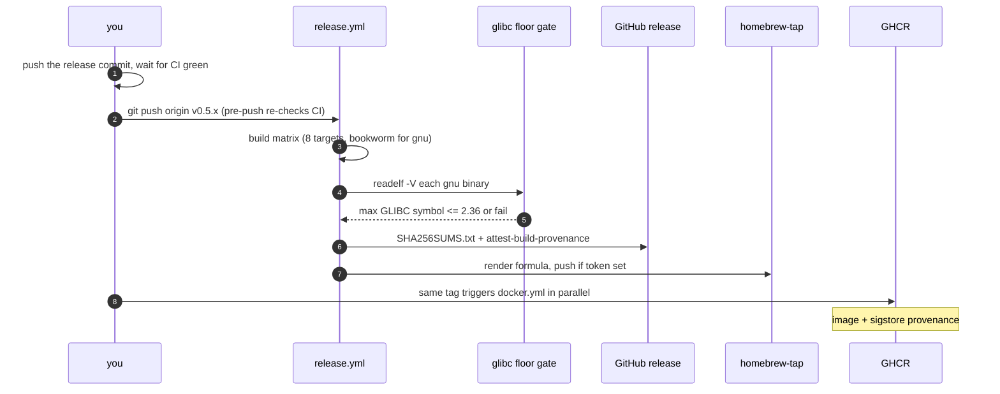
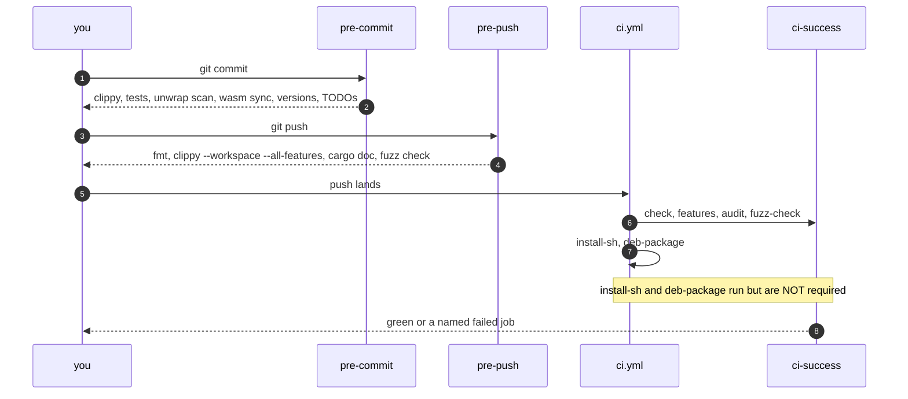

# Build, CI and release

This page covers four things:

- What compiles.
- What gates a merge.
- What runs on a tag.
- Which of those you can safely ignore.

## Features

`Cargo.toml`'s `[features]` table has fourteen entries.

- The thirteen named features below.
- Plus `default`, which is `native, tui, audio, metrics`.

`full` is everything except `wasm` and `bpf`.
That is not the whole story of what ships.

`bpf` sits outside `full` for one reason.

- Building it needs a nightly toolchain and `bpf-linker` for the kernel object.
- This project cannot demand either of a contributor.

The RELEASE has both.

- `release.yml` builds the four `*-linux-gnu` matrix
  entries with `--features full,bpf`.
- It installs the two tools.
- It sets `SIPNAB_BPF_REQUIRED=1`.
  - So a runner missing either tool fails the build.
  - It does not publish a binary that advertises the feature and refuses at runtime.

The musl and macOS artifacts do NOT carry it, for two different reasons.

- musl:
  - `bpf` costs +589,952 bytes.
  - The published 0.5.117 x86_64 musl binary is 12,252,424 bytes.
  - Under the 12 MB ceiling that left 330,488 bytes of headroom, and it did not fit.
  - The ceiling `release.yml` enforces has risen several times since.
    `binary_size_ceiling_mb` in [`website/config.toml`](../../website/config.toml) holds the current figure.
    So it would fit now.
  - musl still excludes it.
    What a static artifact carries is a decision about the artifact, not about bytes.
    Raising a ceiling does not make that decision.
- macOS:
  - `Cargo.toml` declares `aya`
    under `[target.'cfg(target_os = "linux")'.dependencies]`.
  - So the feature would compile to nothing while `--version` claimed it.

On those binaries `--uprobe-backend bpf` still refuses.

- `sipnab --version` is how you tell which build you hold.
- It lists every compiled feature, `bpf` and `plugins` included.

| Feature | Implies | Gates |
|---|---|---|
| `native` | — | Everything that cannot compile to WASM: libpcap capture, clap, the pcap file writer, the tracing subscriber. Most other features imply it. |
| `tui` | `native` | The ratatui/crossterm terminal UI. |
| `tls` | — | TLS/SRTP decryption: `ring`, `rustls`, keylog parsing, and `zeroize` for key material. **Does not imply `native`** — decryption is useful in the WASM analyzer too. |
| `hep` | `native` | HEP/EEP capture source, with HMAC auth. |
| `metrics` | `native` | The standalone Prometheus `/metrics` listener. Raw TCP and threads, deliberately independent of `api` — you can ship metrics without the axum stack. |
| `audio` | — | The `sipnab-audio` plugin loader for TUI playback. **Does not imply `native`**; it is a `dlopen` of a separate cdylib. |
| `api` | `native` | The axum REST API. |
| `mcp` | `native` | The MCP server over stdio. |
| `mcp-http` | `mcp` + `api` | Streamable-HTTP MCP transport; depends on `api` so both share one axum stack rather than duplicating it. |
| `plugins` | `native` | The `wasmi` WASM plugin host. **Non-default on purpose** — someone who does not want an interpreter inside their capture tool does not get one. See [`../design/wasm-plugin-api.md`](../design/wasm-plugin-api.md), which measures the cost at +1.56 MB and 15 crates. |
| `wasm` | — | The browser analyzer bindings. Lib-only: its test and bin targets are meaningless on the host. |
| `vcon` | `native` | vCon export: one observed dialog as an unsigned OBSERVER conversation container. **Non-default on purpose** — the stock build gains no conversation-container writer at all. It sits INSIDE `full`, so the pre-commit hook's `cargo test --features full` covers it. sipnab writes the container as an observer: nothing signed, a party `name` only from a `From` or `To` display name and never vouched for, and no `url` — retained audio travels INLINE as base64url or not at all, under a measured size budget the emitter refuses out loud. |
| `bpf` | `native` | The eBPF uprobe backend — the only one that can report the peer address a TLS session went out to, because it pairs each write with its `tcp_sendmsg`. **Outside `full`**: the kernel half needs nightly and `bpf-linker`. Shipped on the four `*-linux-gnu` release artifacts, not on musl or macOS. |
| `full` | everything but `wasm` and `bpf` | What the pre-commit hook and most local testing use. The released gnu binaries add `bpf` on top. |

The implications that surprise people:

- **`tls` and `audio` do not pull in `native`**.
- `mcp-http` pulls in *both* `mcp` and `api`.

So a green `--features full` says nothing about whether `--features tls` alone
compiles.
That is exactly why CI has a feature matrix.

## The eighteen workflows

| Workflow | Trigger | What it does |
|---|---|---|
| `ci.yml` | push, PR | The merge gate. See below. |
| `cert-expiry.yml` | daily at 07:10 UTC, and on changes to itself | Reads the EDGE and the ORIGIN certificates for sipnab.com and fails with three weeks to spare. Both, because the public name resolves to the CDN: on 2026-09-11 the edge certificate was healthy with 85 days left while the origin had expired and every visitor got a 526. It also refuses a CNAME that disagrees with `base_url`, which is what had been dropping the certificate on every deploy |
| `quality.yml` | push to main, PR, weekly cron (Wednesdays 04:23 UTC) + manual | Line coverage (`cargo-llvm-cov`), clippy SARIF upload, and the prose gates below on push and PR. Branch coverage (nightly) runs on the schedule, where it is the only job, and on a manual run, alongside the rest. Not required by `ci-success`. |
| `codeql.yml` | push to main, PR, weekly cron (Tuesdays 02:34 UTC) | GitHub's static analysis. |
| `fuzz.yml` | weekly cron (Mondays 05:17 UTC) + manual | Coverage-guided `cargo-fuzz` runs; crash reproducers upload as artifacts. |
| `clusterfuzzlite.yml` | daily (batch 02:23 UTC, pruning 05:23 UTC), weekly (coverage Sundays 06:23 UTC) + manual | Continuous fuzzing with a corpus that survives between runs, which `fuzz.yml` cannot do: batch fuzzing grows it, pruning keeps it minimal, and the coverage job reports which code it reaches. Builds in the OSS-Fuzz Rust builder image from `.clusterfuzzlite/`, which compiles the targets the way ClusterFuzzLite runs them. No pull-request fuzzing: without continuous builds on every push it would report pre-existing crashes as though the change introduced them. |
| `docker.yml` | push to main, `v*` tags | Builds and pushes the image to GHCR with sigstore provenance. |
| `pages.yml` | push to main (path-filtered) | Builds and deploys the Zola website, with the homepage test count taken from CI's run of the same commit. |
| `scorecard.yml` | push to main, weekly cron (Mondays 07:20 UTC), branch-protection change | OpenSSF Scorecard posture analysis → Security tab. Report-only. |
| `wiki-sync.yml` | push to main (path-filtered) | Regenerates the wiki from `docs/` via [`scripts/build-wiki.py`](../../scripts/build-wiki.py). |
| `release.yml` | `v*` tags | The release. See below. |
| `sanitizers.yml` | weekly cron (Tuesdays 06:11 UTC) + manual + on its own path | ThreadSanitizer over the threaded integration suites. Nightly as a tool, not as the toolchain. |
| `memcheck.yml` | weekly cron (Wednesdays 07:23 UTC) + manual + on its own path | Runs sipnab under Valgrind across its offline, archive, HEP, MCP and REST paths, built with `--cfg sipnab_tsan` so it allocates through the C library's heap, the only heap Valgrind sees. A definitely or indirectly lost block, or an invalid read, write or free, fails the job ([`scripts/memcheck-verdict.py`](../../scripts/memcheck-verdict.py)), and so does a log with no leak summary. Valgrind must first report a probe program's one known 4,096-byte leak, or the job fails. Runs on the local runners. |
| `self-hosted-smoke.yml` | manual (`workflow_dispatch`) | Proves the self-hosted runner can build sipnab before any production job runs on it. Fires on no automatic event, so no PR can execute on the box. |
| `pr-text.yml` | `pull_request_target`: PR opened, edited, reopened or pushed to | Checks the text a pull request publishes for the lab's private identities and for AI attribution with [`scripts/check-message-identity.sh`](../../scripts/check-message-identity.sh), the script the `commit-msg` hook runs. The `Commit messages and PR title name no private identity` job reads the title, the branch name and every commit message in the pull request's range, which is what a merge puts on `main`, and fails on a finding. The `PR description names no private identity (advisory)` job reads the description, which stays on the pull request page, and reports a finding as a warning without failing. Both jobs check out the base branch (no checkout names a ref, which Scorecard's Dangerous-Workflow check would report), so main's workflow, script and test judge the pull request, and the job fetches the pull request's commits from `refs/pull/N/head` as data and never checks them out or runs them; the fetched head must equal the event's head SHA. `contents: read` at the workflow level and no cache, because a `pull_request_target` run otherwise holds a write token and a cache it saves is restorable on main. Every value from the event reaches the shell only through `env:`. The pull request that added the workflow was not checked by it, because main had no `pr-text.yml` yet. Not required by `ci-success`. |
| `osv-scanner.yml` | push to main, PR, weekly cron (Wednesdays 05:41 UTC) + manual | Vulnerability matching against osv.dev for EVERY lockfile, not just the crate graph. Not redundant with `cargo audit`: that reads Cargo.lock and RustSec only, so advisories against the Actions pins, the Dockerfiles or the fuzz workspace are invisible to it. It also queries a service rather than keeping a local advisory clone, so it does not share the stale-cache failure that broke every `cargo audit` for a day on 2026-08-09. |
| `bench.yml` | daily cron (03:29 UTC) + manual | 4-core offline reconstruction against the baseline in [`bench/baseline.json`](../../bench/baseline.json), failing below 80% of it. Exists because a 40% regression shipped in four releases with every test green. Nightly and wide-banded on purpose: the reference host also serves CI, so a per-push wall-clock gate would measure contention. |
| `reproducible.yml` | weekly cron (Thursdays 04:37 UTC), manual, and PRs touching the build's inputs | Builds the aarch64 gnu release binary twice from one commit, in two directories with two `$CARGO_HOME`s, on the self-hosted runner, and fails unless the stripped binaries and symbol files are identical. See [Reproducible builds](#reproducible-builds). |

### ThreadSanitizer

`sanitizers.yml` runs the threaded integration suites under
`-Zsanitizer=thread`, weekly.
It exists because nothing else in the suite can see a data race.

- The tests exercise the capture thread, the channel, and the
  processing thread.
- But to `cargo test`, a test that passes and a test that raced are
  indistinguishable.

The borrow checker does not help here either.

- It stops at `unsafe`.
- Most of this crate's 136 `unsafe` blocks are libc FFI.
- They concentrate in privilege dropping ([`privilege.rs`](../../src/privilege.rs)
  and [`process_isolation.rs`](../../src/process_isolation.rs)) and capture setup.
- Recount with `grep -rc 'unsafe {' src/` rather than trusting that figure.
  This sentence said 49 until 2026-09-06, when the tree held 92.

Three things about it are deliberate.

**Nightly is a tool, not the toolchain.**

- `-Zsanitizer` is nightly-only, and so is `cargo-fuzz`.
- Both run in their own workflow.
  The release build stays on the pinned stable version.
- Moving the build to nightly would break three things:
  - the toolchain pin
  - the MSRV promise
  - the reproducibility of a released binary

**`-Zbuild-std` is mandatory, not optional.**

- Without it, the standard library is not rebuilt with instrumentation.
- Then TSan sees `std`'s synchronization as opaque.
- It reports the channel itself as a race.
- That noise is what gets a race detector switched off.

**The scope is a sample, and the workflow says so.**

- Five suites run:
  - the REST API and its token path
  - HEP
  - MCP stdio
  - the CLI behavior tests
- Nothing finds a race in a path outside that list.
- Add the suite rather than assuming coverage.

[`ops/tsan/suppressions.txt`](../../ops/tsan/suppressions.txt) silences libpcap, libasound and the dynamic loader.
TSan cannot instrument them.

- Each entry carries the reason it is not a real race.
- An unexplained suppression turns a race detector into a race ignorer.

**The sanitizer build drops mimalloc.**

- `RUSTFLAGS` carries `--cfg sipnab_tsan`.
- [`src/main.rs`](../../src/main.rs) skips its `#[global_allocator]` under that cfg.
- Why:
  - mimalloc is C compiled by the `cc` crate.
  - So `-Zsanitizer=thread` does not instrument it.
  - TSan sees neither its alloc/free (no shadow reset on a recycled block)
    nor its internal cross-thread synchronization.
  - Every block handed from one thread to another reads as a data race.
- The 2026-07-29 run reported exactly that.
  - Its stacks named `read` and `Vec::append_elements_unreserved`.
  - They had no allocator frame anywhere.
  - So a suppression could not have matched it.
- `docs/design/backlog.md` records the bisect.
- The shipped binary keeps mimalloc.
  Only the sanitizer build differs.

**The verdict reads every process, and classifies.**

The step greps rather than trusting the exit code.
TSan can report a finding and still exit 0 when the test passes.
Two things make that grep mean something.

- `log_path` gives each process its own `tsan.<pid>`.
  - The suites spawn the `sipnab` binary and consume its stderr.
  - Before this, a report from a child reached the log only if some
    test happened to print the child's stderr into an assertion message.
  - The first run's "0 races" meant "nothing printed".
- The verdict names the finding it actually matched.
  - It does not call everything a data race.
  - An earlier draft would have reported a thread leak as one.

`thread leak` is in the fatal set.

- It was briefly written off as expected.
  The reasoning: sipnab exits fail-fast paths through `std::process::exit`,
  which joins nothing.
- That had it backwards.
  - `bootstrap::launch` spawns the capture thread *before* the readiness hand-shake,
    the chroot, and the privilege drop.
  - So every failure from there on abandoned a thread still holding an open
    capture source.
  - `sipnab -I /nonexistent.pcap`, a mistyped filename, was enough to do it.
- Those paths go through `capture::stop_and_join`.
  - It sets the shutdown flag, drops the receiver, and joins.
- The suites report zero leaks.
  The fatal classification is what keeps it that way.

A missing `__tsan_init` in the built binary fails the job outright.
Otherwise a build that quietly lost its instrumentation would report a clean run
forever.

All of that lives in [`ops/tsan/verdict.sh`](../../ops/tsan/verdict.sh), not inline in the workflow.

- [`ops/tsan/test-verdict.sh`](../../ops/tsan/test-verdict.sh) sits beside it.
- A `tsan-verdict` job in `ci.yml` runs it on every push.

The inline version had to move because it was wrong in the direction nobody checks.

- `run:` blocks execute under `bash -e -o pipefail`.
- So its bare `grep … | while read` warning loop exited 1
  on a tree with **no** findings.
- That killed the step before it could report.
- The job failed silently when clean and passed while a thread leak was present.

The instrumentation guard had the mirror of it.

- `grep -q` closed the pipe on a still-writing `nm`.
- It read SIGPIPE as "not instrumented".

Nothing could have caught either without running the logic against a fixture.
That is the whole argument for it being a script.

### The prose gates

`quality.yml`'s `Docs` job runs three tools over `docs/`, [`website/content/`](../../website/content/) and
`README.md`:

- Vale with the Google style package
- codespell
- lychee twice:
  - once over the Markdown
  - once over the site Zola builds from it

The built-site pass matters.

- It is the only place the generated pages get checked.
- It cannot run on this project's own aarch64 hardware, where no Zola binary exists.

`.vale.ini` carries the whole policy, and reading it beats re-deriving it.
It records:

- which rules fail the build
- which ones sit disabled, with the alert count each produced
- which ones a measurement rejected, because the advice did not survive contact
  with this corpus

Five rules fail the build today.
Four more sit off, with their reasoning recorded rather than left for the next reader to rediscover.

**This repo pins the style package to an exact release.**

- `Packages = Google` resolves through the registry to `releases/latest/download`.
- CI runs `vale sync` on every job.
- So that spelling makes every prose gate depend on
  whatever upstream published last.
- A local styles tree is only as fresh as the last manual sync.
  So a green local run says nothing about CI.

Google v0.7.0 landed 2026-07-30 13:43 UTC and rewrote one rule's regex.

- A gate measured and enabled against the older package reported 0 alerts locally and 35 in CI.
- main went red.

`vale_style_package_is_pinned_to_a_release` holds the pin.
To upgrade:

- Change the version.
- Run `vale sync`.
- Re-run Vale and read the diff in alert counts before committing.

### Coverage, and running it before CI does

The `Quality` workflow's coverage job runs `cargo llvm-cov`.
It enforces a line floor with `--fail-under-lines`.

- The floor sits just under the measured figure.
  So it ratchets against decline without failing on noise.
- The workflow comment carries the measurement and the commit it came from.
- Raise it when the real number rises.
- Never lower it to make a build pass.

[`scripts/coverage.sh`](../../scripts/coverage.sh) reproduces that job locally, before a push:

Collect, summarize and enforce the floor:

```bash
scripts/coverage.sh
```

Report the last collection without re-running it:

```bash
scripts/coverage.sh --report
```

It **reads the floor and the scope out of the workflow** rather than repeating them.

- The scope is the workflow-level `COVERAGE_TEST_SKIPS` and
  `COVERAGE_IGNORE_REGEX` in `quality.yml`.
  The workflow states it once, and every `cargo llvm-cov` call there uses it.
- Two copies of a threshold is how a gate and its local rehearsal come to disagree.
  - The rehearsal is the one that gets trusted, because it is the one that answered first.
- [`tests/coverage_gate_test.rs`](../../tests/coverage_gate_test.rs) fails in three cases:
  - the script grows its own floor
  - the two skip different tests
  - someone walks the floor backwards

It is deliberately **not** in the pre-push hook.

- An instrumented build plus the full suite is 30-60 minutes.
  The hook is already around fifteen.
- A gate nobody waits for is a gate people bypass.
- And the claim that one exists is what stops someone adding a real check later.
- A test asserts it stays out.

The two `--skip` flags are technical rather than preferences.

- `cli_goldens` spawns the instrumented binary as 13 parallel child processes.
  They collide on the llvm-cov merge-pool `.profraw`.
- `wasm_plugin_` shells out to a wasm32 build.
  wasm32 ships no `profiler_builtins`, so the nested build fails `E0463`.

Both run in full under the plain `cargo test`.
So the run loses only their coverage contribution.
That is why this total falls short of the whole suite by design.

### Branch coverage

The line job cannot count branches.

- `cargo llvm-cov --branch` needs rustc's `-Z coverage-options=branch`.
- Only nightly accepts that.
- The line gate stays on the pinned stable toolchain.

So `quality.yml` has a second job, `coverage-branch`.

- It runs weekly (Wednesdays 04:23 UTC) and on a manual run only.
- It uses the same nightly pin `fuzz.yml` and `sanitizers.yml` use.
- It collects under the same scope as the line job.
- It uploads to Codecov under the flag `branch`, beside the line report rather than over it.

`cargo llvm-cov` has `--fail-under-lines`, `-regions` and `-functions` but no branch floor.
[`scripts/branch-coverage.py`](../../scripts/branch-coverage.py) reads the
`--json --summary-only` export instead.

- It fails a report that holds no branches at all.
  That means `--branch` never took effect.
- It enforces `--floor` when the job passes one.
- The job passes none yet.
  - The first measurement was a local aarch64 run on 2026-09-30 over the job's scope.
  - It was **77.46%** (13221 of 17069 branches), under OpenSSF Gold's 80%.
- Once the real number clears 80, set the floor just under it.
  This is the same ratchet as the line floor.

### What actually gates a merge

`ci-success` requires every other job in `ci.yml` — thirteen of them: **`check`,
`install-sh`, `deb-package`, `rpm-packaging`, `homebrew-formula`,
`tsan-verdict`, `bench-scripts`, `features`, `crate-package`, `audit`,
`fuzz-check`, `code-scanning-clean`, `symbol-split`**.

`ci_success_gates_every_job` in
[`site_journey_test`](../../tests/site_journey_test.rs) holds the list to that.

- It once named only the four below.
- The comment above it claimed "every other job" at the time.
- So `install-sh` and `deb-package` could both fail with the
  one required check on main still green.

The rest of this section describes four of them.
Their contents are worth spelling out.

- **`check`** (per-OS matrix):
  - `cargo build --all-features`
  - `cargo test
    --all-features`
  - `cargo clippy --workspace --all-features --all-targets -D warnings`
  - `cargo fmt --check`
  - `cargo doc --no-deps --all-features --workspace`
  - plus the `--ignored` PTY TUI end-to-end tests
  - On Linux it also compiles the Python clients under `clients/python/`.
    It runs `pytest` over their tests and `scripts/tests`.
- **`features`**: `cargo check --no-default-features --features X --tests`
  across fifteen feature sets.
  - The sets: each of `native`, `tls`, `api`, `mcp`, `hep`,
    `metrics`, then `tls,api`, `native,tui,audio`, `native,tui,tls,hep,api`,
    `native,hep,api,mcp,mcp-http`, `bpf`, `vcon`, `audio`, `plugins`, and `wasm`
    (lib-only).
  - `vcon` is in `full`, so `--all-features` already builds it.
    This leg is what proves it also builds without `tui`, `tls`, `api` or `mcp`.
  - The documented headless server recipe (`native,hep,api,mcp,mcp-http`) gets a full `cargo
    test`, not just a compile check.
  - Three legs also run the tests that exist only where a feature is absent.
    No `--all-features` or `--features
    full` run can compile those.
    - `native` runs `feature_gate_test` (no `mcp`, no `hep`).
    - `mcp` runs `app_servers_test` (no `mcp-http`).
    - `native,tui,tls,hep,api` runs `tui_snapshot_test` (no `audio`).
  - `bpf` is here because every published `*-linux-gnu` binary carries it.
    - This leg compiles its userspace half and its test files.
    - `build.rs` takes its degrading default here (no nightly, no
      `bpf-linker` on this runner).
    - The release job is where the kernel half is actually built, under `SIPNAB_BPF_REQUIRED=1`.
  - `--tests` is what makes any of these real.
    Without it the check compiles no test file at all, and every leg
    goes green over nothing.
- **`audit`**: `cargo-audit` and `cargo-deny`.
- **`fuzz-check`**: the `fuzz/` workspace compiles.

### Dependabot bumps fail on a generated file, not on an API break

**Every Dependabot pull request fails the same way, and it is almost never a
code break.**

- A script generates `THIRD-PARTY-NOTICES.md` from the dependency graph.
- The `third_party_notices_are_current` gate in [`tests/docs_drift_test.rs`](../../tests/docs_drift_test.rs)
  re-runs [`scripts/build-third-party-notices.py`](../../scripts/build-third-party-notices.py).
  It fails when the committed file differs.
- Dependabot moves `Cargo.lock` and never regenerates what derives from it.

**Merging a batch multiplies this, and the fix moves.**

- Regenerating on one branch does not help the four merged after it.
  - Each merge changes the graph again.
  - The file is only correct for the graph that produced it.
- The shape that works: merge five updates, then regenerate once, at the end, on `main`.
- Doing it per branch and then merging them all leaves `main` red anyway.

The fix is one command on the branch:

```bash
python3 scripts/build-third-party-notices.py
```

**Read the failure signature before you believe the job names.**

- Exactly the jobs that *execute* the suite fail:
  - `check` on both platforms
  - `coverage`
  - the single `features` combination that runs `cargo test`
- Every check-only `features` combination stays green.
- A real compile break fails those too.
- `check` runs the tests, and its name reads like "compiles".

On 2026-08-02 this presented as three pull requests each failing five jobs.

- It looked exactly like three simultaneous major-version API breaks.
- `wasmi` 0.51 to 1.1, `rmcp` 2.2.0 to 3.0.1, and a three-crate group each needed
  **zero** code changes.
- Verifying that cost three separate investigations.
  That is why this section exists.

One caveat on `rmcp` specifically.

- A major bump can be genuinely wide and still touch nothing sipnab uses.
- Diff the actual MCP wire traffic rather than reading the changelog.
  That is what tells you whether behavior moved.

Branch protection sets `required_status_checks.strict: true`.

- So a green pull request shows `BEHIND` whenever `main` moves.
- Arm auto-merge per pull request rather than racing a manual rebase against your own pushes.

**`install-sh` and `deb-package` are in that list.**

- They run on every push:
  - the installer test suite plus shellcheck
  - the `.deb` build for both the full and `noaudio` variants
- A failure in either turns `CI success` red.
  So it blocks a merge like any other job.
- This paragraph used to say the opposite.
  It dates from before `ci_success_gates_every_job` added them.

**`crate-package`** runs `cargo package --locked -p sipnab-bpf-types -p sipnab-g729 -p sipnab`.

- That builds each crate from its own `.crate` file.
- So a file the build reads but the `include` allowlist in `Cargo.toml` does not ship
  fails here rather than at `cargo publish`.
- [`tests/crate_package_test.rs`](../../tests/crate_package_test.rs) is the fast half.
  It packages without compiling on every test run.

## Hooks

Activate once per clone: `git config core.hooksPath .githooks`.

[`pre-commit`](../../.githooks/pre-commit) runs thirteen numbered gates,
starting at 0, in order:

- `cargo fmt --all -- --check`
- vale and codespell over the paths CI gives them
- clippy (`--workspace --all-features --all-targets`, `-D warnings`)
- the full test suite, its binaries run side by side by
  [`scripts/parallel-tests.py`](../../scripts/parallel-tests.py)
  - `SIPNAB_TEST_JOBS` sets how many.
  - `1` runs them one at a time.
- the `sipnab-bpf-types` crate's own tests and doctests (gate 2b)
  - The suite leaves them out because it tests the sipnab package only.
- no `unwrap()`, `expect()` or abort macro (`panic!`,
  `unreachable!`, `todo!`, `unimplemented!`) in production code, as
  [`scripts/check-unwrap.py`](../../scripts/check-unwrap.py) reads it
  - A `// gate: <macro> because <reason>` line above an abort macro excuses that one site.
  - The four macro names are the only ones that marker takes.
- a generated file staged with the inputs it derives from
- every feature declaring what its own modules import
- the privilege-drop path still dropping privileges
- WASM exports in sync with the site's JS
- the homepage test count still generated, not written into the template,
  plus the site version matching `Cargo.toml`
- no TODO stubs
- an advisory notice when a commit touches a file `docs/internals/` cites without
  touching `docs/internals/` itself

Gate 0 is first because it is the cheapest check in either hook (~1.4s
against clippy's minutes).

- So an unformatted tree fails in seconds rather than after a full lint and test run.
- `pre-push` still checks formatting.
  That copy is the one guaranteeing nothing unformatted reaches the remote.
- What it cannot do is catch the slip early.
  A formatting-only failure discovered at push time costs a whole commit-and-push cycle to undo.

Gate 0b is here for that same reason and arrived the same way.

- The prose gates ran only in `pre-push`.
- So work that satisfied every gate here met them at the push, with the commit already made.
- Each rejection cost a full cycle to redo.
  That happened twice on 2026-08-22, once blocking a release push over a single passive clause.
- Both tools take about a second against gate 2's minutes.
- `pre-push` keeps its copies.
  So the guarantee stands where it did, and this gate is the early warning.

Neither hook restates how those gates work.

- Tool resolution, the version pin and both path lists live in [`scripts/prose-gates.sh`](../../scripts/prose-gates.sh).
- `pre-commit`, `pre-push` and [`scripts/preflight.sh`](../../scripts/preflight.sh) source it.
- Each caller keeps only its own rendering, because the three have different room to print in.

The script returns:

- 0 for a clean run
- 1 for findings
- 2 when the tool did not run at all

Return 2 never renders as a pass.
A missing tool does not block the commit.

- CI still enforces it.
- Blocking would make the hook unusable without both installed.
- But the run says so rather than staying quiet.

Both hooks skip the prose gates entirely when the branch does not carry that
script, and report the skip.

- `core.hooksPath` once held an absolute path into one worktree's `.githooks/`.
- While it did, every worktree and every branch ran that one hook FILE.
- The script it sources is branch CONTENT.
- So a branch cut before the script existed could not commit at all.

The same absolute path let whichever branch that one worktree had checked out
gate every commit, from any worktree.

- On 2026-09-29 that branch's pre-commit lacked the `sipnab-bpf-types` step.
- Commits on `main` went through without it.
- So both hooks now open by checking that they belong to the tree they are checking.
  - They refuse otherwise, naming the fix: `git config core.hooksPath
    .githooks`.
- `SIPNAB_HOOK_ANY_TREE=1` turns that check off and says so.
  - The hook test scripts need it, because they run the repository's hooks against throwaway trees.

[`commit-msg`](../../.githooks/commit-msg) opens with the same check.

- It then runs [`scripts/check-message-identity.sh`](../../scripts/check-message-identity.sh)
  on the commit message.
- That script runs the private-identity rules of
  [`tests/private_identity_test.rs`](../../tests/private_identity_test.rs) over each line.
- It skips with `NOT CHECKED` on a branch that does not carry the script.
- [CONTRIBUTING.md](../../CONTRIBUTING.md#git-hooks) describes:
  - what it checks
  - what `pr-text.yml` checks again in CI
  - how to check a pull request description the same way

Two of the thirteen cannot fail the commit.

- Gate 6 prints `WARN: N TODO/FIXME comments` and falls through.
  It is a count, not a veto.
- Gate 8 prints `REVIEW` and a list and returns zero.
  It is a reminder to check the developer pages still read true, not a claim that they don't.

The gate that *does* fail is [`dev_docs_drift_test`](../../tests/dev_docs_drift_test.rs) in gate 2's test run.
It is broader than dead links: twenty-six tests, covering:

- cited paths that no longer exist
- a `()`-suffixed symbol in link text with no matching `fn` left in the workspace
- an absolute GitHub URL where a relative path belongs
- a page missing from `build-wiki.py` (which would silently never publish)
- three mermaid conventions:
  - `sequenceDiagram` only
  - no markdown links inside a fence
  - a prose line above every one

What it cannot catch is prose that has quietly become false.
That is still a human's job.

A failing gate names what failed.

- Gate 1 prints every clippy diagnostic with its file and line.
- Gate 2 prints, in order:
  - the name of each failing test
  - the panic location and assertion message for the first three
  - the `test result: FAILED` summary
  - a command that re-runs one test on its own

Both gates write the whole capture to a log and print that path.

- The logs are `.git/sipnab-pre-commit-clippy.log` or
  `.git/sipnab-pre-commit-tests.log`.
- Both cap what reaches the terminal at twenty diagnostic lines and twelve lines of panic.
- When the suite fails to compile, gate 2 prints the compile errors instead.
- When it dies without naming a test at all, gate 2 prints the last twenty lines rather than nothing.
- A passing run still prints one line per gate.

Both gates capture their tool's output rather than let it stream.

- Gate 5 reads the test run back to check the homepage count's rule still counts it.
- A streamed clippy would bury the per-gate summary.

Capturing without reporting swallows the answer.
The naming above prevents that.

- A failure that prints only `FAIL` and a "run it yourself" line costs whoever hit it
  a second full suite run to learn the name of the test.
- Until that run finishes, they cannot tell whether the
  break is theirs or already on `HEAD`.
- Settling that one question once cost an extraction of a pristine `HEAD` into a scratch directory.

That means **every commit runs clippy and the whole test suite** and takes
minutes.

The homepage's automated-test count is not in the template.

- It used to be: a number in [`website/templates/index.html`](../../website/templates/index.html)
  that gate 5 held to the run.
- So every pull request that added a test edited the same line.
- Any two such pull requests conflicted on it.

It is now generated at deploy time:

- `ci.yml`'s Check job on Linux runs `cargo test --all-features`.
  - It applies [`scripts/published-test-count.py`](../../scripts/published-test-count.py)
    to the output (step "Derive the published test count").
  - That step fails CI when the script cannot count the run.
  - On a push to `main` it uploads the output as the `suite-output` artifact.
- `pages.yml` waits for that artifact from CI's run of the commit it deploys
  ([`scripts/fetch-ci-suite-output.py`](../../scripts/fetch-ci-suite-output.py)).
  - It applies the same script to it, and writes `website/data/test-count.toml`.
  - It then runs `zola build`.
  - It fails the deploy if the built homepage does not state that number.
- The template loads the file with `load_data(..., required=false)`.
  - A local `zola build` has no file.
  - So it renders "Every PR" on the tile and a sentence with no number in the feature table,
    instead of a stale count.

The script is the one counting rule.

- It sums the `passed` figure of every line that starts with `test result`.
- It refuses a run with a `FAILED` binary, with no result line, or with a total of zero.

Gate 5 checks the mechanism:

- the script still counts the gate 2 run
- the template still loads the file
- no literal count has come back

The data file is in `.gitignore`.
Adding a test needs no edit to the site.

Two checks stay out of the PRE-COMMIT hook on purpose: the feature matrix and
rustdoc.

- That hook already costs minutes, and each of those adds more.
- [`pre-push`](../../.githooks/pre-push) picks up rustdoc before anything leaves the machine.
- CI's Features job builds the matrix.
- Moving them into the pre-commit hook buys nothing.
  It is the same wait, on every commit instead of every push.
- The prose pair used to sit here too, and moved.
  Vale and codespell cost about a second each.
  So gate 0b runs them at the commit, and `pre-push` keeps its copies.

The matrix has moved twice.

- Pre-push once checked three of the combinations and CI ran the rest.
  That left a class of break with a push-and-wait feedback loop.
- [`scripts/check-feature-matrix.py`](../../scripts/check-feature-matrix.py) then ran all of them in the hook.
  - It reads both the combo list and `RUSTFLAGS` out of
    [`.github/workflows/ci.yml`](../../.github/workflows/ci.yml), so the two cannot drift.
- Since 2026-09-29 the Features job runs on the project's aarch64 self-hosted runners.
  - So the wait is minutes rather than a hosted queue.
  - The hook no longer repeats it on every push.
- The script still runs it by hand.
- Pre-push keeps the reduced combinations.
- Pre-push and CI also run clippy on the library with no features:
  `cargo clippy --no-default-features --lib -- -D warnings`.
  - The main clippy gate runs `--all-features`, so a lint that fires only with every feature off never reaches it.
  - On 2026-10-14 main carried one: a `..Self::default()` that does nothing once the feature-gated fields are absent.

The self-hosted jobs keep their builds between runs.

- `actions/checkout` deletes untracked files at the start of every job (`clean: true`, which runs
  `git clean -ffdx`).
- An in-workspace `target/` is untracked.
- So until 2026-10-08 every leg recompiled 279 to 701 crates from nothing.
- The clean stays, because several gates read the disk and must not see another branch's leftovers.
- The build directory moved instead.
  - [`.github/actions/runner-target`](../../.github/actions/runner-target/action.yml)
    sets `CARGO_TARGET_DIR` to `$HOME/.cache/sipnab-ci/<runner name>/target`.
  - That is outside the workspace and one per runner.
  - Cargo locks its build directory, and four runners on one directory would build one at a time.
- Before each build, [`scripts/ci-target-cap.sh`](../../scripts/ci-target-cap.sh) removes that
  directory when it is over 64 GiB.
  - The action's header gives the measurements behind the number.
- The Features job, the Linux leg of the Check job, the Coverage job, `bench.yml` and
  `self-hosted-smoke.yml` use it.
- Coverage passes `dir: coverage-target`.
  - `cargo llvm-cov` compiles every crate with `-C instrument-coverage`.
  - So its build has its own capped directory beside `target`, and does not invalidate the plain builds.
- `reproducible.yml` does not use the action.
  It exists to build twice in fresh trees.
- [`tests/ci_runner_target_test.rs`](../../tests/ci_runner_target_test.rs) holds
  both the use and that exemption, and drives the cap script.

The Linux leg of the Check job and the `Quality` workflow's Coverage job run on the self-hosted runners.

- On GitHub's runners they were two of the three jobs that set the length of a pull request's run.
  - On pull requests #411 and #410 the Linux Check took 20.2 and 22.1 minutes.
  - Coverage took 15.3 and 21.2 minutes.
- The Linux leg ran on the self-hosted runner once before, and left it on 2026-08-10 for two reasons.
  Each is now handled.
- **One job per runner instance.**
  - With one instance, 21 jobs queued one after another.
  - There are four instances now.
  - A pull request gives them the eighteen feature legs, the Linux Check and Coverage.
  - Measured on three pull requests on 2026-10-09, the feature legs took 25.4 to 27.4 runner-minutes in total.
    The longest leg took 7.7 to 10.2 minutes.
  - With Check and Coverage on one runner each, the feature legs on the other two need about 14 minutes (27.4 / 2).
- **Concurrent `apt-get install` raced for the machine-wide `dpkg` lock.**
  - Every package step goes through `.github/actions/system-deps`, described below.
  - It installs nothing on the self-hosted machine, and serializes any install it must run.
  - The workflow-shape test refuses a bare `apt-get`, `dpkg -i` or `debconf-set-selections` in a self-hosted job.
- A self-hosted runner skips the steps written for a disposable GitHub VM.
  - `free-disk` deletes preinstalled software, which on the self-hosted machine other work uses.
  - The cargo cache restore and save run on hosted runners only.
  - Steps that read the build read it from `CARGO_TARGET_DIR`.
- Measured on the self-hosted machine on 2026-10-09, with a load average of 20 to 35 on its 14 cores from other work:
  - The Check job's Test step (`cargo test --all-features`) took 9.9 and 11.9 minutes with a warm build directory.
    It used 30 CPU-minutes and 16.4 GiB peak resident memory.
  - Coverage's collection step took 8.6 minutes warm and 16.0 cold.
  - The directories it left were 31 GiB for the plain builds and 35 GiB for the coverage build.
- The macOS leg of Check stays on GitHub.
  It took 20.8 and 24.3 minutes on those two pull requests, so it now bounds the run.

System packages come from `.github/actions/system-deps`.

- It asks `dpkg -s` first and installs only what is missing.
- The self-hosted machine already has every package its jobs name.
  So there the action does nothing.
- Four runner instances share that machine.
  `dpkg` and `debconf` each hold one machine-wide lock.
- So when a package is missing, the action holds a `flock` on one lock file for the whole install.
  Concurrent jobs take turns.
- It waits at most 15 minutes for the lock.
  Then it fails the job with an error that says so.
- A `debconf` answer is an input of the action.
  - An example is the Check job's answer for `wireshark-common`.
  - The action applies it inside the same lock, and only when it installs something.
- No workflow step runs `debconf-set-selections` itself.

The GitHub-hosted jobs restore their cargo builds from `actions/cache`.
It keeps at most 10 GB per repository and evicts the least recently used entry past that.

- On 2026-10-09 the entries totaled 15.1 GB.
- The Check jobs' caches missed on 11 (Linux) and 12 (macOS) of 14 runs.
  - The Cargo.lock hash in their keys never changed.
  - Every miss saved the entry again and evicted another.
- Pull request runs saved entries that only the same pull request can read.
- The Coverage job saved a 5.0 GB entry that did not shorten the job.
- The x86_64 jobs restored the aarch64 Check leg's entry through a shared restore-key.

Now:

- Each hosted cargo job restores with `actions/cache/restore`.
- It saves with `actions/cache/save` only on `refs/heads/main` and only after a miss.
- Before the save, [`scripts/ci-cache-prune.sh`](../../scripts/ci-cache-prune.sh) removes the
  executables built from the workspace crates.
  Any change to the sources rebuilds them.
- Each key names the OS, the architecture, the toolchain and Cargo.lock.
- Each restore-key is a prefix of the job's own key.
- The Coverage jobs keep no cargo cache.
- [`tests/ci_cache_policy_test.rs`](../../tests/ci_cache_policy_test.rs) holds those rules.
  It lists the cache families with their measured sizes, and drives the prune script.

Python packages in CI come from PyPI through `pip install` in hash-checking
mode, each from a hash-pinned requirements file.

- `ci.yml` sets `PIP_TIMEOUT` to 60 seconds and `PIP_RETRIES` to 8 at the workflow level.
  So every install in it uses them.
- pip's own defaults are 15 seconds and 5 retries.
- On 2026-10-01 a wheel download that stalled for longer than 15 seconds failed the Check job
  with `ReadTimeoutError`.
- The comment above the two settings gives the
  worst-case time they allow before an unreachable index fails the job.
- [`tests/ci_pip_network_test.rs`](../../tests/ci_pip_network_test.rs):
  - finds every `pip install` in the workflows and composite actions
  - works out which values reach it from a flag or the step, job or workflow `env:`
  - requires both to be above pip's defaults and the same everywhere

CI pulls no container image from Docker Hub.

- Every such pull was anonymous.
- Docker Hub limits anonymous pulls by source address, which GitHub's hosted runners share.
- On 2026-10-09 it failed two workflows on main with
  `429 Too Many Requests` and timeouts from `auth.docker.io`.

Four places pulled from it, and each now does something else:

- The codespell step in `quality.yml`:
  - It was a Docker container action whose image builds `FROM python:3.13-alpine`.
  - It is now a step that installs codespell into a Python virtual environment from the hash-pinned
    [`scripts/requirements-codespell.txt`](../../scripts/requirements-codespell.txt).
  - It runs it through `prose_codespell_run` in
    [`scripts/prose-gates.sh`](../../scripts/prose-gates.sh), the function the hooks call.
  - That file is also where the hooks read the version from.
  - A local codespell of another version reports `NOT CHECKED`, because its
    dictionary is not the one CI uses.
- `docker/setup-buildx-action` in `docker.yml`:
  - It pulled its BuildKit engine, `moby/buildkit:buildx-stable-1`.
  - `driver-opts` now names that engine on `mirror.gcr.io`, pinned by version and digest.
- BuildKit resolved the `Dockerfile`'s `FROM rust:...` and
  `FROM debian:...` against Docker Hub.
  - A `[registry."docker.io"]` mirror in `buildkitd-config-inline` sends those pulls to `mirror.gcr.io`,
    Google's cache of Docker Hub.
  - The change leaves the `Dockerfile` text and its digests as they were.
  - So Dependabot and `rust_toolchain_pins_agree` read what they read before.
  - The image content is the same bytes.
- `release.yml` names its `rust:1-bookworm` build containers as
  `mirror.gcr.io/library/rust:1-bookworm` with Docker Hub's digest.

[`tests/ci_docker_hub_test.rs`](../../tests/ci_docker_hub_test.rs) holds all of it:

- no job or service image on Docker Hub
- no action that runs in a container from Docker Hub
  - with a table of what each action runs as, read from its `action.yml` at the pinned commit
- a digest-pinned engine and the mirror on every `docker/setup-buildx-action` step
- no Docker Hub image in what `cross` builds in
- one codespell pin that CI and the hooks share

[`pre-push`](../../.githooks/pre-push) adds fourteen hard gates that `cargo test`
does not cover:

- a check that every pushed commit carries a good signature
- `cargo fmt --check`
- `cargo clippy --workspace --all-features --all-targets
  -D warnings`
- `cargo doc` with `RUSTDOCFLAGS=-D warnings`
- `cd fuzz &&
  cargo check`
- the release-delivery tests
- a check of the reduced feature combinations `tls`, `api` and `wasm`
- the full fifteen-combination matrix with CI's flags
- a non-Linux compile of the whole tree
- a YANG validation of the `sipnab-diagnosis` module
- a `zola build` of the website
- the two prose linters, Vale and codespell
- for a `v*` tag, a check that a trusted key signed the tag

The commit-signature gate runs first, before the hook looks for `cargo`.

- Branch protection on `main` requires signed commits.
- GitHub applies that only at merge time.
- Pull request #333 carried four unsigned commits.
  It stayed blocked with every check green and no reason shown.

[`scripts/commit-signature-check.sh`](../../scripts/commit-signature-check.sh)
reads the hook's input, one `<local ref> <local sha> <remote ref> <remote sha>`
line per ref.

- A deleted ref pushes nothing to check.
- Any other ref pushes the commits no remote-tracking branch has.
  For an update, they must also be commits that the old remote commit does not reach.
- A commit already on the remote is not the push's to sign.
  - A branch rebased onto a newer `main` reaches main's squash merges.
  - GitHub signs those with its own key.
- For each commit, the letter that `git log --format=%G?` prints decides.
  - The script checks it the way [`scripts/tag-signature-check.sh`](../../scripts/tag-signature-check.sh)
    verifies a tag, against [`.github/allowed_signers`](../../.github/allowed_signers):

| `%G?` | Meaning | Verdict |
|---|---|---|
| `G` | good signature from a listed key | passes |
| `U` | good signature from a key the file does not list | passes, and the hook names the key |
| `N` | no signature | refused |
| `B` | bad signature | refused |
| `E` | signature this machine cannot check | refused |
| `X`, `Y`, `R` | expired signature, expired key, revoked key | refused |

`U` passes for one reason.

- GitHub marks a commit verified from the keys on the GitHub
  account that owns its committer email.
- No file in the repository lists those keys.

The hook names each refused commit and prints both fixes:

- `git commit --amend -S --no-edit` for the last commit
- `git rebase --exec 'git commit --amend --no-edit -S' <base>` for a range

[`tests/commit_signature_gate_test.rs`](../../tests/commit_signature_gate_test.rs)
signs commits with throwaway SSH keys and drives both the script and the hook.

The YANG gate, [`scripts/check-yang.py`](../../scripts/check-yang.py), exists
because a test generates the module under `yang/`.

- [`tests/yang_module_test.rs`](../../tests/yang_module_test.rs)
  proves the committed file is what the analysis's tables produce.
- Only a YANG implementation that did not write it can say the text is valid YANG.

What the gate runs:

- `pyang --lint` and `yanglint` from `libyang` compile it.
- `yanglint -t data` validates every [RFC 7951](https://www.rfc-editor.org/rfc/rfc7951.html) document the CLI, REST and MCP
  doors write for each fixture.
- `pyang --check-update-from` holds each new revision to the last under
  [RFC 7950 section 11](https://www.rfc-editor.org/rfc/rfc7950.html#section-11).

A machine without either tool reports `NOT CHECKED` and names the fix.

- CI's `check` job installs both (`libyang2-tools`, and `pyang` from the hashed
  [`scripts/requirements-yang.txt`](../../scripts/requirements-yang.txt)).
- It runs the script with `SIPNAB_YANG_REQUIRED=1`.
- So the one place that must check cannot skip.

The release-delivery tests are here for a reason the others are not: nothing
earlier can answer them.

- They compare the tree against the newest tag.
- At pre-commit time the commit under judgement does not exist yet.
- So every one of them reports "nothing past the tag" and passes without looking.

The hook also sets `SIPNAB_RELEASE_GATES_STRICT=1`.

- That turns "git could not tell me" from a skip into a failure.
- Skipping is right in a shallow clone.
- It is wrong here, where git has everything it needs.
- A gate that still cannot answer has a bug rather than a limitation.

Rustdoc lints and the separate fuzz workspace compile independently of the test build.
No cargo command reads prose at all.
So these are exactly the failures that otherwise appear ten minutes later in CI.

The site build arrived on 2026-08-27, for the same kind of cause the prose pair did.

- A Zola template is neither Rust nor prose.
- So a malformed macro in `website/templates/` passed every other gate in this hook and reached CI.
- That happened twice in one afternoon.
  The second error only appears at render, and the first one masked it.

CI does catch it.

- `quality.yml` runs `zola build`.
- Its Build site step is what went red both times.
- The gap this closes is local, not in CI.
  It is the ten-minute round trip, paid twice, for an error a build finds in
  four hundred milliseconds.

Zola publishes no aarch64 Linux binary.

- So on some machines here the gate reports `NOT CHECKED`.
- It names the `cargo install --git` line that fixes it.

The prose pair arrived last, and for cause.

- On 2026-08-03 Vale turned main red with 12 passive-voice errors.
- codespell followed with two spelling hits in `src/` doc comments.
- Only a push found each one.

A missing Vale or codespell binary reports `NOT CHECKED` rather than passing.
So does one whose version is not the one CI pins.
A gate that goes quiet when its tool is absent is worse than no gate.

`SKIP_FMT_HOOK=1` bypasses all of them.
If you use it, expect CI to notice.

After those ten comes one gate that is not hard.
It is the corpus gate below, which runs only when the machine holds the capture corpus.

Those gates let their tool write straight to the terminal instead of capturing it.

- So a failure arrives with the rustfmt diff, the clippy lint or the rustdoc
  warning already on screen.
- Nothing to withhold, and nothing to fix there.

The reduced-combination gate is the least obvious of them.

- Every other check in that hook builds with `--all-features`.
- That cannot see `#[cfg]`-gating rot at all.
- An item that needs a feature-gated module compiles perfectly until
  someone builds without that feature.

It has bitten twice.

- The `features` job below records "at one point 7 of 8 reduced combos failed to build".
- It happened again on the 0.5.61 release commit.
  - A test reflecting over `Cli` (behind `native`) took a whole test target out of every build without it.

Three combinations, not fifteen.

- `tls` and `api` are the ones that *exclude* `native`, where the breakage lives.
- `wasm` is the most distant target.
- The full matrix stays in CI.
- CI skips a combination the crate does not define, the way the
  fuzz gate skips a missing `fuzz/`.

The non-Linux gate sits directly beneath it.
It answers the same question one axis over.

- Feature gating is one way to write a `#[cfg]` nobody local ever compiles.
- `target_os` is the other, and it is worse.
  CI holds the only non-Linux build in this project.

Two macOS breaks reached it hours apart on 2026-08-07.

- First `cannot find value FANOUT_HASH_WITH_ROLLOVER`.
- Then `unused
  variable: fanout_group` under `-D warnings`.
- Every gate above said OK on both.

[`scripts/check-non-linux.sh`](../../scripts/check-non-linux.sh) works on a copy:

- It copies the tree to `target/nonlinux-shim/tree`.
  - It leaves out build output, `.git`, and any checkout nested in the tree, such as a linked worktree under `.claude/worktrees/`.
  - It counts the `target_os` values by the same rule, so another checkout's files are never copied or counted.
- It swaps the `target_os` values there, so that `"linux"` names nothing and `"macos"` names the host.
- It runs CI's own macOS invocation over the result.
- The Linux arms drop out, and the `not(target_os = "linux")` arms compile.
- Both breaks fail the gate by name and line.

It runs **rustdoc** over that shim tree as well as clippy.
That half covers a gap neither CI nor a Linux developer can reach.

- Broken intra-doc links never fire under build or clippy.
- `ci.yml` guards its Docs step with `if: runner.os == 'Linux'`.
- So a doc link into a `#[cfg(target_os = "linux")]` module was visible to exactly one kind of machine.
  - A Mac, at push time.
  - As a hard block on every push, including the one that would have fixed it.
- Links to `capture::uprobe` in [`src/capture/native.rs`](../../src/capture/native.rs) did precisely that.
  They were green in CI the whole time.

The clippy pass costs 50 seconds the first time and 10 seconds after that.

- It touches only the copy, so an interrupt leaves the working tree alone.
- The rustdoc pass is newer than those figures and is not included in them.

Its `target/nonlinux-shim` directory holds 1.3 GB after that first run.

- Then it grows with the number of **distinct source states** it has checked.
- Cargo keeps the artifacts of every version it has already built.
- Across a day of commits it reached **78 GB** on 2026-08-08 and exhausted the disk
  mid-release.
- Delete the directory as routine maintenance, not only when space is tight.
  It is disposable, and the next run rebuilds it in 50 seconds.

The script's header records the four alternatives it replaced and the evidence
against each.

- The FreeBSD cross-check cannot escape mimalloc's C build.
- The wasm check never compiles `capture/` at all.

Two things keep it honest.

- It counts `target_os` predicates before and after the rewrite.
  It refuses when the numbers disagree.
  A pattern that quietly matches nothing would compile an unmodified tree and print OK forever.
- On a non-Linux host it prints `NOT CHECKED` instead of running.
  There, your ordinary `cargo clippy` already is the non-Linux build.

### The corpus gate

The corpus gate differs from the eight hard
gates above in one way: it runs only when it can.

- `SIPNAB_CORPUS` names a directory of real captures.
- These are traffic recorded off live networks, with PII in every packet.
- The rule for that corpus is 100% validation.
- Anything short of 100% counts as a critical failure.

Nothing enforced that rule between one manual run and the next.

- On 2026-08-03 a corpus test turned out to have failed on every real capture for weeks.
- Nobody knew, because no automation ever ran it.

CI cannot close that gap.

- Nobody commits, uploads, or caches those captures.
- They never leave the machine that recorded them.
- So a hosted runner has nothing to validate against.
- The moment before a push is the only enforcement point that remains.
- That is why this one gate lives in a hook and has no CI counterpart
  anywhere in the thirteen workflows above.

**What runs.** One `cargo test` invocation, all features, under the `corpus` profile.

- It covers every top-level `tests/*.rs` that names `SIPNAB_CORPUS`.
  That is twenty-one targets today.
- The ones with `corpus` in the name are not all of them.
  `input_set_accounting_test`, `rtp_quality_provenance_test` and
  `vacuous_success_test` read the corpus too.

The hook greps the tree for that list instead of carrying its own copy.

- A hand-kept list cannot catch a *new* corpus binary.
  That is the one thing this gate exists for.
- The first draft did hand-keep the list.
  It went stale inside an hour, when a twelfth binary landed mid-review.

**When it runs.** Last, after the fourteen hard gates.

- Each of those fails in seconds.
- Spending a minute on the corpus only to hear that the tree does not
  compile wastes the minute.

The gate then reaches one of five states: a run, or one of the four reasons not to run.
Each prints its own line:

- **`SIPNAB_CORPUS` resolves to a readable directory.**
  - The gate runs the suite and prints `corpus: N test binaries against <dir> ... VALIDATED`.
  - Push allowed.
- **The same, but a corpus test fails.**
  - The gate prints `FAIL` and names the binary and test that broke.
  - It **blocks the push**.
- **`SIPNAB_CORPUS` unset.**
  - Push allowed.
  - The gate prints `corpus: NOT VALIDATED -- SIPNAB_CORPUS is unset`.
- **`SIPNAB_CORPUS` set to anything other than a readable directory.**
  - Push allowed.
  - The gate prints `corpus: NOT VALIDATED -- SIPNAB_CORPUS is not a readable directory`.
- **No `tests/*.rs` names `SIPNAB_CORPUS`.**
  - Push allowed.
  - The gate prints `corpus: NOT VALIDATED -- no corpus test targets in this crate`.
- **`SKIP_CORPUS_HOOK=1`.**
  - Push allowed.
  - The gate prints `corpus: BYPASSED (SKIP_CORPUS_HOOK=1) -- real captures NOT validated`.

Silence is not one of the options.

- Whoever lacks the corpus still pushes.
- The output still says which of those happened.
- `VALIDATED` and `NOT VALIDATED` are different words on purpose.
  - Silence in a column of `OK` lines reads as a pass.
  - A skipped check nobody knows about is the hole this gate closes.

A directory the process cannot read counts as unreadable, not as empty.

- An unreadable directory walks to zero files.
- A corpus test over zero files passes while proving nothing.

**Naming what failed.** This gate captures cargo's output rather than letting it stream.
So it follows the same discipline as pre-commit gates 1 and 2:

- It prints the binary and test name for each failure.
- It prints the panic location and assertion message for the first three.
- It prints the `test result: FAILED` summary.
- It writes the whole capture to `.git/sipnab-pre-push-corpus.log` and prints that path.
- It caps the terminal at ten names and twelve lines of panic.
- It also prints a single-test reproduce command.
  The alternative costs whoever hit it another full pass over 8.8 GB just to learn which test broke.

That log describes the **last** run and nothing before it.

- A validated run deletes it.
- So a file present in `.git/` always means the most recent corpus gate failed.
- Its absence means the most recent one passed.
- Without that removal, a failure written weeks ago outlives every green push after it.
  - A reader who finds it has no way to date it.
  - That happened, twice, with a `... FAILED` line that no run of the real corpus had ever produced.

**Why the `corpus` profile.** Measured on a 14-core machine against an 8.8 GB
corpus of 137 files with a warm page cache.
The first measurements used the targets of the day under the `profiling` profile:

- every corpus binary, one `cargo test` invocation, `profiling` — **87 s**
- the same binaries, one `cargo test` invocation *each*, `profiling` — **379 s**
- the nine `*corpus*` binaries, one invocation, **dev** profile — **460 s**
- a `profiling` rebuild after a library change, then the run — **413 s**

Three decisions come out of those numbers.

- One invocation rather than a loop.
  - The in-process `finished in` times sum to 86 s either way.
  - So the extra 293 s is cargo re-resolving the dependency graph on every start,
    and queueing on the shared package-cache lock.
- An optimized profile rather than dev.
  - 8.8 GB of packets makes the parsers the entire workload.
  - The dev profile pays 460 s of run time on *every* push without ever amortizing anything.
- An unwinding profile rather than `release`.
  - `[profile.release]` sets `panic = "abort"`.
  - An aborting test process dies before the test harness prints its `failures:` list.
  - So the gate would block a push and then fail to name what broke.
  - `[profile.corpus]` inherits release and restores `panic = "unwind"`.

That also settles the question of a subset.

At about three minutes for everything, dropping a binary saves seconds.
It gives up a whole class of real-capture regression:

- diagnosis claims and message retention
- ICMP evidence for signaling and for media separately
- conformance-rule hit rates
- `nat_mismatch` and `no_media` firing only where the capture supports them
- detector clocks against the capture's own timeline
- every documented filter field and alias
- behavioral scanner alerts backed by an outcome
- the two silent-loss fixes
- `-I` input-set accounting
- RTP-quality provenance

Losing any one of those is how the failure above survived for weeks.

The build, not the run, made this gate slow.

- Under `profiling`, release's `lto = true` and `codegen-units = 1` relinked every corpus binary
  with full LTO whenever the library changed.
- `[profile.corpus]` keeps the optimization and drops both.

Measured on 2026-09-29 with the 21 targets:

- rebuild after a library change — `profiling` **827 s**, `corpus` **83 s**
- run, everything already built — `profiling` **161 s**, `corpus` **174 s**

LTO bought 13 s of run and cost 12 minutes on every push that touched the library.

- [`tests/pre_push_build_profile_test.rs`](../../tests/pre_push_build_profile_test.rs)
  holds the gate to a profile that unwinds and skips full LTO.
- `target/corpus` persists between pushes.
  So a push that touches no source pays only the run.
- Building under the `corpus` profile while working moves even the 83 s off the push.
- The gate's own comment in [`.githooks/pre-push`](../../.githooks/pre-push) carries the exact build-only command.

**How to bypass.** `SKIP_CORPUS_HOOK=1 git push` drops this gate and leaves the
other five standing.

That is a second variable rather than a reuse of `SKIP_FMT_HOOK`, and deliberately so.

- `SKIP_FMT_HOOK=1` switches off formatting, clippy, rustdoc, fuzz, and the feature combinations as well.
- That is far too much to give up because a corpus is temporarily unavailable.
- It is also not a variable anybody already has in their shell history.
- Either way the output names the bypass, so a push that took it stays on the record.

Both hooks have their own test scripts:

- [`test-pre-commit.sh`](../../scripts/test-pre-commit.sh)
- [`test-pre-push.sh`](../../scripts/test-pre-push.sh)

CI runs both, in the `Git hook scenarios` job.

[`install-from-source.sh`](../../scripts/install-from-source.sh) has nothing to do with the hooks.

- It is the developer-facing source install (`cargo install --path .
  --bin sipnab`, then `--setup-caps` on Linux).
- It passes `--bin` deliberately.
  Without it, `gen_fixture` also satisfies its `required-features` and lands in
  the caller's `~/.cargo/bin`.

## The toolchain

**Rust 1.99.0**, pinned across seven files and enforced in none of them
locally:

| Location | Form |
|---|---|
| `ci.yml` (5 jobs), `quality.yml` (3 jobs), `release.yml` | `dtolnay/rust-toolchain@<sha> # 1.99.0` |
| `Cargo.toml`, [`crates/sipnab-audio/Cargo.toml`](../../crates/sipnab-audio/Cargo.toml), [`crates/sipnab-bpf-types/Cargo.toml`](../../crates/sipnab-bpf-types/Cargo.toml) | `rust-version = "1.99"` (MSRV) |
| `Dockerfile`, [`harness/sipnab/Dockerfile`](../../harness/sipnab/Dockerfile) | `FROM rust:1.99-slim-trixie@sha256:<digest>` |

A commit SHA pins the action, so the **version lives in the trailing comment**.
That makes the comment load-bearing rather than decorative.

- `rust_toolchain_pins_agree` reads it.
- It also asserts the ref really is a 40-hex SHA.
  Otherwise an edit dropping back to `@1.98.0` would contribute
  nothing to the comparison instead of failing it.
- The Dockerfiles keep the tag beside the digest for the same reason.
  That gate parses `FROM rust:X.Y`.

There is **no `rust-toolchain.toml` governing the crate**.

- So your local `rustup default` is whatever you last set.
- Nothing in the repo corrects it.

[`bpf/rust-toolchain.toml`](../../bpf/rust-toolchain.toml) is the one exception.

- It selects a dated nightly rather than the pin above.
  The kernel half needs `-Z build-std`.
- Dated, not `nightly`, because the release binary embeds the object it builds
  (see [Reproducible builds](#reproducible-builds)).
- It sits inside `bpf/`, so it governs that directory alone and cannot reach a host build.

This is not hypothetical.

- The changelog records CI pinned at 1.94.1 while local development ran 1.97.1.
- Clippy consequently validated against a different compiler than the one gating merges.
- If you add a `rust-toolchain.toml`, update every row above in the same change.

## Releases

**The site advertises the last PUBLISHED release, not the crate version.**
[`website/config.toml`](../../website/config.toml) carries both:

- `version`: the Pages step overwrites it from `Cargo.toml` on every build.
- `published_version`: every download link and version badge draws from it.

They are different facts, and conflating them broke the download page in production.

- The release *commit* bumped the crate version.
- Pages redeployed.
- The whole of `/download` pointed at a tag nobody had pushed yet.
- Every link 404ed, including `SHA256SUMS.txt` and the checksum column.
- On 0.5.61 the release commit went red in CI.
  The v0.5.61 tag went on the commit that fixed it, 31 minutes after the release commit.

So `published_version` moves **after** a release finishes publishing, in its
own commit.
It never moves while cutting one.

The same split applies to the docs.

- `docs/install.md`'s `SIPNAB_VERSION=`, `e.g. <version>` and `rpm -i sipnab-<v>`
  lines are download instructions.
  - So they track `published_version` too.
  - They must NOT move when the crate version does.
- A blanket `sed s/<old>/<new>/g` over `docs/install.md` at a release commit is exactly the mistake.
  - `docs_current_version_markers_match_cargo` splits its list on this.
  - It fails the commit rather than shipping a documented `curl` that 404s.
- The `sipnab <version> (<hash>)` samples in the same file are the opposite case.
  - They show what a build *of this tree* prints, so they follow `Cargo.toml`.
- `site_advertises_only_a_released_version` requires a matching `v<x.y.z>` tag.
  So getting this wrong fails the suite instead of the visitor.

The **Since** column of [`docs/cli-reference.md`](../cli-reference.md) moves
in the release commit itself.

- A flag that is in no release tag reads `Unreleased` while `CHANGELOG.md`'s first `## [` heading is
  `[Unreleased]`.
- The release commit renames that heading to `[x.y.z]`.
  It sets `Cargo.toml` to the same version.
  From then on the flag reads `x.y.z`.
- Tagging the commit changes nothing, because the tag's history gives the same `x.y.z`.
- So run `python3 scripts/flag-since.py --write` in the release commit,
  after the rename and the version bump.
- If you forget, `the_since_column_is_what_tagged_history_says` in
  [`tests/cli_flag_since_test.rs`](../../tests/cli_flag_since_test.rs) fails that
  commit in the pre-commit hook, not a later pull request.
- The script refuses a first heading that names a version other than `Cargo.toml`'s.
- The script reads [`src/cli.rs`](../../src/cli.rs) at every `vX.Y.Z` tag.
  - So it needs the tags in the clone (`git fetch --tags`).
  - Without them it refuses rather than calling every flag `Unreleased`.

**Tag a commit whose CI is green.** A tag is not a request to build.
It publishes immediately and irreversibly, whatever that commit contains:

- fourteen installable artifacts (six `.tar.gz`, four `.deb`, four `.rpm`)
- a `.sha256` beside each tarball
- eight symbol files (one per build, see [Symbol files](#symbol-files))
- a combined `SHA256SUMS.txt`
- two SBOMs
- a provenance attestation
- a GHCR image
- a Homebrew formula

That is thirty-one release assets in all.
The order is therefore:

- Land the release commit.
- Wait for CI.
- Tag the commit that passed.

**crates.io gets the release from the `crates-io` job in `release.yml`, after
the GitHub release exists.**

- A tag push starts every tag workflow at once.
- A crates.io version is permanent.
  `cargo yank` only stops new dependency resolution from choosing it, and nothing removes it.
- So the job `needs: release`.
  A tag whose build fails never reaches crates.io.
- It runs [`scripts/publish-crates.py`](../../scripts/publish-crates.py).

The script:

- checks the tag against `Cargo.toml`
- asks crates.io about every publishable crate before uploading any
- uploads only the versions crates.io answers 404 for
- uploads `sipnab-bpf-types` first, because `sipnab` depends on it

So a re-run after a partial or hand-made publish uploads only what is missing.

The job holds no stored credential.

- `rust-lang/crates-io-auth-action` trades the job's OIDC identity for a crates.io token.
- It revokes the token when the job ends.
- This is crates.io trusted publishing, and crates.io checks two things.
  - The workflow file must be the one that STARTED the run.
    So a workflow that waits for this one through `workflow_run` cannot publish.
    crates.io refuses those outright.
  - The environment must match too.
    - The job runs in the `crates-io` GitHub environment.
    - That environment takes deployments from `v*` tags only and has no required reviewer.
    - So the publish follows a successful release without anyone approving it.
      Pushing the tag is the decision.

Each crate carries this trusted-publisher entry on crates.io (Settings, Trusted
Publishing).
crates.io refuses a token that does not match it:

| Field | Value |
|---|---|
| Repository owner | `NormB` |
| Repository name | `sipnab` |
| Workflow filename | `release.yml` |
| Environment | `crates-io` |

[`tests/crates_io_publish_test.rs`](../../tests/crates_io_publish_test.rs) holds
this table to the workflow.

- Renaming the workflow or the environment fails the suite until this table,
  and the entry on crates.io, change with it.
- Reading crates.io's entry back needs the owner's login.
  So a change made only there shows up when crates.io refuses the next release's job.

To publish by hand, for instance while that entry is missing:

- Run `python3 scripts/publish-crates.py --tag v<version>` from a clean checkout of the tag.
- It needs a token in `~/.cargo/credentials.toml`.

**The site says whether a release landed, and one command says why it has
not.** A green deploy is not the same fact.

- On 2026-09-11 the origin certificate expired.
- The CDN refused an origin it could not validate.
- Every visitor got a 526 while the deploy stayed green.

The step for this used to be

```text
curl -s https://sipnab.com/download/ | grep -c <version>
```

That prints `0` for a page advertising the wrong version.
It also prints `0` for five other situations:

- DNS failure
- a refused connection
- an expired certificate
- an empty body
- a 503

Only one of those answers is about the release. Run

```sh
sh scripts/verify-site-advertises.sh <version>
```

instead.

- It names which of the six is happening.
- It gives each its own exit code.
  "Land the advertisement commit" and "go and change a CDN setting" are different jobs.
- [`scripts/check-cert-expiry.sh`](../../scripts/check-cert-expiry.sh) answers the other half.
- [`.github/workflows/cert-expiry.yml`](../../.github/workflows/cert-expiry.yml) runs both daily,
  so neither waits for somebody to notice a release.

**`main` requires a pull request and a green `CI success`, and the owner
cannot bypass either.**

- Branch protection on `refs/heads/main` asks for a pull request and the `CI success` check.
- `enforce_admins` is ON.
- Measured against the API on 2026-09-29:
  - `required_pull_request_reviews` present
  - `required_status_checks.contexts` `["CI success"]`
  - `enforce_admins.enabled` **true**
- GitHub refuses a direct push to `main`, the owner's included.
- So every change, the release version bumps included, lands through a pull request whose
  `CI success` run is green.

This reverses the earlier decision to leave `enforce_admins` off.
The backlog records that decision under GATE2.

- Admin enforcement was on from 2026-08-23.
- It was off by 2026-08-26.
- It was back on from 2026-09-29, for the OpenSSF Baseline control
  that asks a project to stop direct pushes to its primary branch.
- [`tests/branch_protection_drift_test.rs`](../../tests/branch_protection_drift_test.rs)
  fails if the setting and this page disagree again.

`required_linear_history` is off, and that one is correct.

- `main` carries 176 merge commits.
- Merging feature branches is how this repository works.
- So the rule never described it.

None of this is what protects a release. The `pre-push` gate below is.

- It refuses a `v*` tag whose commit has a failed run, has runs still in flight, or
  has no runs at all.
- It runs on the machine doing the pushing, rather than on a setting somebody can switch off.

None of this touches tags.

- Branch protection targets `refs/heads/main`.
- A release is a pushed `refs/tags/v*`.
- The `pre-push` gate below is still what stands between a red commit and thirty-one published artifacts.

A hook enforces this rather than merely advising it.

- [`pre-push`](../../.githooks/pre-push) refuses a `v*` tag whose commit has a failed run,
  has runs still in flight, or has no runs at all.
- It skips with a warning when `gh` is unavailable, rather than blocking.
  - Forcing `SKIP_FMT_HOOK=1` would switch off every other gate too.
  - That turns one missing optional tool into running no checks at all.

Before the CI check, the same hook refuses a `v*` tag that is not signed by a trusted key.

- [`scripts/tag-signature-check.sh`](../../scripts/tag-signature-check.sh)
  passes only an annotated tag with a good SSH signature from a key listed in
  [`.github/allowed_signers`](../../.github/allowed_signers).
- It refuses a lightweight tag, an unsigned tag and a tag signed by any other key, and says which.
- Signing needs `tag.gpgSign true` with SSH signing configured, so `git tag -a` signs.
- The trusted keys live in the repository.
  - So the check answers the same on every machine.
  - Adding a signer is a reviewed change.

It exists because the manual version failed once already.

- The 0.5.61 release commit went red in `Features (tls)`.
- The only thing between that and a published broken release was somebody happening to look.

Once that gate passes, the hook prints the phase-two step.

- A tag is phase one: it builds the artifacts.
- The release is not finished until `published_version` names it and a visitor is actually offered it.
- Between the tag going up and the next commit, no suite runs.
  So nothing is watching that window.

It stayed a prompt rather than becoming an eleventh gate.

- At tag time the site *should* still advertise the previous release.
  The new artifacts do not exist yet.
- A refusal there would block the correct state.

A release is a pushed `v*` tag. `release.yml` then runs a matrix of eight builds:

- `x86_64` and `aarch64` for `linux-gnu`
  - each also in a `noaudio` packages-only variant, shipping a `.deb` and an `.rpm` but no tarball
  - the static musl tarballs already cover the no-audio tarball case
- `x86_64` and `aarch64` `linux-musl`
- both macOS architectures

Eight builds, six tarballs — the number of builds is not the number of artifacts.

- Counting matrix rows answers the first and says nothing about the second.
- That is how a hand-restated count comes to be wrong on the day someone types it,
  rather than drifting there later.
- `release_artifact_counts_match_the_build_matrix` derives every count on this
  page from the matrix itself.

The gnu targets build inside a `rust:1-bookworm` container, so their glibc floor is 2.36.
The aarch64 gnu target cross-compiles inside that
same container via Debian multiarch rather than cross-rs, for the same reason.

Every gnu binary then passes a `readelf -V` gate.

- It fails the build if the binary links a `GLIBC_` symbol newer than 2.36.
- It is a regression guard on the build environment, not on the code.

Artifacts are checksummed into `SHA256SUMS.txt` and attested with `actions/attest-build-provenance`.
So a downloader can run `gh attestation verify <file> --repo NormB/sipnab`.

The macOS builds carry the same kind of floor, arrived at the other way round.

- `release.yml` pins `MACOSX_DEPLOYMENT_TARGET` per build:
  - 11.0 for `aarch64-apple-darwin`
  - 10.12 for `x86_64-apple-darwin`
- `published_macos_floors_match_the_toolchain` holds [`website/config.toml`](../../website/config.toml) to what
  the workflow pins.
- Both values are what the pinned rustc defaults to.
  So the pins describe the binaries rather than change them.

Leave the variable unset and each tarball still floors wherever rustc lands.

- That is a real constraint no file in the repository names.
- That is how `/download` came to say "macOS 12+" for both.
- It was wrong for each, and it concealed that they differ.

That gate also refuses a floor pinned *below* the compiler's own default.

- The config and the workflow would agree.
- But the published number would still be an OS the binary cannot run on.
- To move real support, change the two `floor=` lines and let the gate
  walk the published numbers to match.

Two CycloneDX SBOMs ship with each release.
Both the checksum file and the attestation cover them:

- `sipnab-<version>.cdx.json` for the binary
- `sipnab-audio-<version>.cdx.json` for the playback plugin

Two, not one, because the plugin is a separate workspace crate loaded with `dlopen`.

- It pulls in seven dependencies the main crate's graph does not contain at all:
  `alsa`, `alsa-sys`, `cpal`, `dasp_sample`, `num-bigint`, `num-rational`,
  `rodio`.
- A single main-crate SBOM would omit precisely the C-library-adjacent
  dependencies a vulnerability scan is looking for, while looking complete.

The binary SBOM uses `--features full,bpf` on purpose.
That is the union of every feature set the build matrix compiles.

- The `noaudio` and musl artifacts resolve a strict subset of that graph.
  - Measured on 0.5.54, `full` and `noaudio` differ by exactly one component, `libloading`.
- The gnu artifacts add `bpf`.
  - It brings in four crates `full` alone never reaches (`aya`, `aya-obj`, `object`,
    `assert_matches`).

`THIRD-PARTY-NOTICES.md` comes from that same set.

- [`scripts/build-third-party-notices.py`](../../scripts/build-third-party-notices.py)
  names it once, as `RELEASE_FEATURES`.
- Suppose that constant says `full` while the gnu binaries ship `full,bpf`.
  Then `third_party_notices_are_current` cannot see it.
  - It compares the committed file against that same generator.
  - So both sides of the gate agree while both are wrong.

`the_notices_and_sbom_cover_every_released_feature_set` guards this.

- It runs the release workflow's own feature-computing step for every matrix entry.
- It fails if either the SBOM flag or `RELEASE_FEATURES` stops covering the union.
- So one document over-covers rather than under-covers every binary published.
  That is the safe direction.

`cargo-cyclonedx` has no `--package` flag.

- One workspace-level invocation emits a document per member into that member's own directory.
- The release step renames them apart on the way into `artifacts/`.

Finally the `tap` job renders the Homebrew formula and pushes it to `NormB/homebrew-tap`.
It skips with a warning if the token is absent.

The tag is what starts it, and everything after is automatic.



Version strings live in several places:

- `Cargo.toml`
- [`website/config.toml`](../../website/config.toml)
- [`man/sipnab.1`](../../man/sipnab.1)
- [`fuzz/Cargo.lock`](../../fuzz/Cargo.lock)
- several docs

Committing with any of them out of step fails.
So bumping a version is one edit plus the ones the gates point you at.

That enforcement lives in **one** place.

- `docs_current_version_markers_match_cargo`
  and `man_page_version_and_license_match_cargo` in
  [`tests/docs_drift_test.rs`](../../tests/docs_drift_test.rs).
- The hook runs them via `cargo test`, and CI runs them again.
- One place, not two.
  - A shell re-implementation in the hook carried its own file list.
  - It diverged from the Rust one.
  - It rejected a correct release commit over a deliberately historical version reference.
- If you need to change which docs carry a marker, change the Rust list.

Note which files are deliberately *excluded*.

- The benchmarks pages record the release that a **measured** figure came from.
- They must not track the crate version.
- A marker forcing them to is what kept a stale benchmark claim looking
  freshly checked for twenty-nine releases.

The homepage's test count is not a marker.

- The deploy generates it from CI's Linux run (see [Hooks](#hooks)).
- It is Linux-only.
  - Platform-gated tests mean the macOS leg runs a handful fewer.
  - So one advertised number cannot be true of both.
  - The figure describes the Linux run.

### Symbol files

The release strips every binary it publishes.

- So a crash report from a user carries frame addresses and a build ID, not function names.
- The symbols that resolve those addresses come from the compile that produced the binary.
- A rebuild of the tag reproduces them only with the release's exact toolchain (see
  [Reproducible builds](#reproducible-builds)).
  That is tens of minutes and a pinned container away from anyone reading a crash report.

The release therefore publishes them with the binary, one symbol file per build:

- `sipnab-<version>-<target><suffix>.debug` for each Linux build
  - `-noaudio` builds included, since their binaries ship in the `-noaudio` packages
- `sipnab-<version>-<target>.dSYM.zip` for each macOS build

The split happens in the step `Split the debug symbols from the shipped binary`.
It runs [`scripts/split-debuginfo.sh`](../../scripts/split-debuginfo.sh) straight after
the build:

- **Linux.**
  - The build appends `-C strip=none` to `RUSTFLAGS`.
  - So the linker keeps `.symtab` and the line tables `[profile.release] debug = "line-tables-only"`
    produces.
  - The script copies them into the `.debug` file with compressed sections.
  - It strips the binary in place.
  - It adds a `.gnu_debuglink` naming the `.debug` file.
  - The GNU build ID pairs the two.
    `build.rs` asks the linker for one on every Linux build.
  - Stripping removes only non-allocated sections.
    So the code and data that load are the ones the linker wrote.
- **macOS.**
  - The build appends `-C strip=none -C split-debuginfo=unpacked`.
  - So the binary keeps its debug map, and the DWARF stays in the object files it names.
  - The script runs `dsymutil` itself.
  - It checks that the bundle's UUID is the binary's.
  - It zips it and strips the binary in place.
  - It checks that the stripped binary kept its UUID and lost its debug map.
  - It used to rely on rustc's `split-debuginfo=packed` leaving a `.dSYM` behind.
    The first CI run of the macOS leg found none.

**Why `rustflags` and not the profile.** Setting `profile.release.strip = false`
works, and changes the code.

- Cargo hashes the profile into every crate's `-C metadata`.
  That reseeds symbol hashes.
- On an aarch64 build of the same tree, `.text` came out 8,064 bytes smaller than the linker-stripped build.
- Cargo keeps `rustflags` out of that hash.
- rustc obeys the last `-C strip` on its command line.
- So the profile keeps `strip = true`, and the `rustflags` entry overrides it at the link.
- `.text`, `.data`, `.eh_frame` and the program headers of the split
  binary match the linker-stripped build byte for byte.

**Appended to `RUSTFLAGS`, never only `--config`.**

- A `RUSTFLAGS` variable set anywhere replaces `build.rustflags` entirely.
- `ci.yml` sets `RUSTFLAGS: -Dwarnings` for the whole workflow.
- So the first CI run passed the flags as `--config` and built both legs without them.
  Both splits refused binaries with no line tables.
- Both release build steps therefore build through `scripts/reproducible-build.sh build`.
  - It appends `$(bash scripts/split-debuginfo.sh --rustflags <target>)` to `RUSTFLAGS`.
  - It keeps whatever was already set.
- The `cross` build also passes the same flags as `--config` (from `--cargo-config`).
  Whether `cross` forwards `RUSTFLAGS` into its container is its choice.
- The build and the split read one rule, the flag list in the script.
- The script uses `llvm-objcopy` from the `llvm-tools` `rustup` component, which the workflow installs.
  - The host's GNU `objcopy` cannot read an aarch64 binary on an x86_64 runner.
  - That is the same failure that made the old `strip || true` step a silent no-op on every cross build.

The step comes before every step that reads the binary.
So all of these see the file that ships:

- the stripped-binary check
- the smoke test
- the glibc floor
- the size ceiling
- the packages

The size ceiling in [`website/config.toml`](../../website/config.toml) measures the binary alone.
The symbol files are separate downloads and count against no published size.

The script refuses a binary with no build ID or no line tables.
It does not publish a symbol file nothing can use.

- [`tests/split_debuginfo_test.rs`](../../tests/split_debuginfo_test.rs) drives
  it on every commit against a small program built with the release profile's codegen settings.
  - It does so for the host architecture and a foreign one.
  - It resolves an address from the stripped program to its function through the `.debug` file.
- [`tests/release_debug_symbols_test.rs`](../../tests/release_debug_symbols_test.rs)
  holds the workflow to the step order, the uploads and the checksums.
  It runs the split step's own shell.

The release runs only on a tag.
The macOS half of the split runs on no other job there.
So a break in it would first show on a tag that is already public.

The `symbol-split` job in `ci.yml` closes that gap on every push.

- It builds the release profile with the same `--rustflags` flags on
  `x86_64-unknown-linux-gnu` and `aarch64-apple-darwin`.
- It runs the split.
- It checks the result with the platform's own tools:
  - On Linux: the `.debug` build ID equals the binary's, and the binary has no `.symtab`
    and has a `.gnu_debuglink`.
  - On macOS: the `.dSYM.zip` exists, and the bundle's UUID from `dwarfdump --uuid` is the binary's.
- The release-workflow tests run that step's own shell against real and deliberately broken splits.

The crash report records what the symbol file needs:

- the build ID or UUID of the executable
- its load base
- the target triple
- the raw address of every frame as `sipnab+0x…`

The number after `+` is the address inside the file.
That is the form `addr2line`, `llvm-symbolizer` and `atos` take.
[Send us a crash report](../troubleshooting.md#send-us-a-crash-report) is the
user's side of it.

### Reproducible builds

The same commit builds to the same bytes.

- OpenSSF Silver's `build_repeatable` criterion is a MUST at that level.
- It asks exactly that: the project can repeat the build of a release from its sources
  and get a bit-for-bit identical result.
- The release builds through [`scripts/reproducible-build.sh`](../../scripts/reproducible-build.sh).
- `reproducible.yml` builds twice through the same script and compares.

**What varied, measured.**

- Before this, two release builds of one commit gave two different stripped binaries.
  - The setup: aarch64-unknown-linux-gnu, `full,bpf`, the same toolchain, on the same host.
  - They differed only in the directory each clone sat in.
  - Results: sha256 `8ef34f72…` and `7a7f8491…`, 593 bytes apart, with different GNU build IDs.
- After the four fixes below, the same two builds gave one stripped binary (`fe3ce06a…`)
  and one symbol file (`de8a58da…`), build ID `ea4467f7…` in both.
  - The second build also had its own empty `$CARGO_HOME`.

The causes:

- **Absolute paths in the eBPF object.**
  - `build.rs` embeds the kernel programs.
    They keep their debug info because the loader needs the BTF.
  - The BTF named the checkout (`…/bpf/src/main.rs`), `$CARGO_HOME` and the
    `rust-src` of the nightly by absolute path.
  - The nested eBPF build set its own `CARGO_ENCODED_RUSTFLAGS`.
    So nothing from the outer build reached it.
  - `build.rs` now forwards the outer build's `--remap-path-prefix` flags.
    It remaps the directory of that nightly to `/rustc-sysroot`
    ([`build_script/bpf_flags.rs`](../../build_script/bpf_flags.rs)).
- **`$CARGO_HOME` in the binary and in the DWARF.**
  - Panic locations in registry crates name `$CARGO_HOME/registry/src/…`, 784 times in the
    stripped aarch64 binary.
  - Every C object from `ring` and `mimalloc` names it in its DWARF too.
  - The DWARF does not ship.
    But the GNU build ID is a hash the linker takes over the whole output, DWARF included.
  - `.gnu_debuglink` carries the CRC of the symbol file.
  - The script remaps `$CARGO_HOME` to `/cargo` and the checkout to `/sipnab`.
    - For rustc it does this through `RUSTFLAGS`.
    - For the C compiler it does this through `-ffile-prefix-map` in `CFLAGS`.
    - Both come from one list in the script.
- **A path hash in the eBPF object's symbols.**
  - With the paths remapped, the objects still differed in every mangled symbol of the kernel crate:
    `_RNvCs4NQPM85LhFw_10sipnab_bpf15try_tcp_sendmsg` in one,
    `_RNvCsh7SSX6Ne1ig_…` in the other.
  - Cargo hashes a path dependency outside the workspace root into `-C metadata` by its ABSOLUTE path.
  - [`bpf/Cargo.toml`](../../bpf/Cargo.toml) reached `crates/sipnab-bpf-types` as `../crates/…`.
  - It now reaches it through the symlink [`bpf/sipnab-bpf-types`](../../bpf/sipnab-bpf-types).
    That symlink is inside its own workspace root and excluded from that workspace.
  - So cargo hashes the relative path.
- **The time of the build.**
  - With the first three fixed, 28 bytes still differed:
    the 20 of the build ID, and `11:45:13` against `12:07:23`.
  - mimalloc's `options.c` prints `__DATE__` and `__TIME__`.
  - GCC takes both from `SOURCE_DATE_EPOCH` when the environment sets it.
  - The script sets it to the time of the commit.

Two more inputs needed pinning rather than fixing.
They move with time rather than with the builder.

- The eBPF nightly was `rustup toolchain install
  nightly`, a different compiler every day.
  - [`bpf/rust-toolchain.toml`](../../bpf/rust-toolchain.toml) now names a dated nightly.
  - `build.rs` runs that channel.
  - The release installs it with `rustup toolchain install` in `bpf/`.
- The build runs with `--locked`.
  So a lockfile that no longer matches the manifests fails the build instead of being re-resolved.

Checked and not a cause:

- sipnab's Rust code embeds no build time.
- Its own `file!()` paths are relative to the workspace.
- It does embed the commit hash and, on a tagged commit, the tag (`sipnab --version`).
  - Those are the same for every build of one commit when the build runs in a git checkout of it.
  - A source tarball without `.git` embeds neither, and so builds a different binary.

**What a rebuild must hold fixed besides the source.**

- Rust 1.99.0
- the eBPF nightly [`bpf/rust-toolchain.toml`](../../bpf/rust-toolchain.toml) names
- bpf-linker 0.11.0 (pinned by sha256 in `release.yml`)
- the linker, C compiler and C runtime objects
  - For the gnu targets those come from the `rust:1-bookworm` image `release.yml` pins by digest.
  - The aarch64 gnu leg also installs `gcc-aarch64-linux-gnu` from Debian's bookworm archive.
    A Debian point release can move it.
    So rebuilding an older aarch64 gnu release needs the cross compiler version its release log shows.
  - The musl legs build in the `cross` images pinned by digest in `docker/cross/`.
    The release installs `cross` itself from git, unpinned.
  - The macOS legs build on `macos-latest`, whose Xcode moves.

**What the check proves, and does not.**

`reproducible.yml` runs weekly and on pull requests that touch the build's inputs:

- the manifests and lock files
- `build.rs` and `build_script/`
- `bpf/`
- both scripts
- the release workflow

On the aarch64 self-hosted runner it runs
`bash scripts/reproducible-build.sh check aarch64-unknown-linux-gnu full,bpf <dir>`:

- two clean clones of the commit in two directories
- the second with its own `$CARGO_HOME`
- each built with the script's `build`
- each split with the same stem
- the stripped binaries and symbol files compared byte for byte

On a difference it prints both hashes, the first differing offsets and the strings
that differ, and fails.

- It proves independence from the directory and from `$CARGO_HOME`
  for the gnu build with the eBPF object in it.
- It does not vary the `rustup` home.
  The remap of the toolchain's own directory covers it, unmeasured.
- It does not vary the host or the container.
- It does not build the musl or macOS legs.

**Reproducing a published binary.** [Rebuild a release and compare it](../install.md#rebuild-a-release-and-compare-it)
is the user's side.

- The symbol file name is part of the binary (`.gnu_debuglink` names it).
- So the split must use the release's stem, `sipnab-<version>-<target>`,
  for the stripped binary to match the published one.

### The changelog

`CHANGELOG.md` follows [Keep a Changelog](https://keepachangelog.com/en/1.1.0/)
and says so in its header.

- Entries sit under `Added` / `Changed` /
  `Fixed` / `Removed`.
- The project uses a few extra headings where those four
  do not fit what a release actually did.

sipnab is pre-1.0.
So the header states the versioning policy rather than claiming strict Semantic Versioning.

- The public API and CLI surface are not stable.
- A breaking change may land in any release.
- Say so in the entry that carries one.

Work that has landed but not shipped goes under a `## [Unreleased]` heading.
Cutting a release renames it to `## [x.y.z] - <date>`.

- That heading is load-bearing rather than decorative.
- `no_changelog_entry_precedes_its_version_heading`
  requires every `###` section to sit under some `## [...]`.
- So entries added without one are orphans and fail.
- The gate accepts `Unreleased` precisely so work can accumulate between releases without doing that.

It exists because an edit whose anchor included the heading destroyed it.

- That left two sections under the file header.
- It survived a commit, a push and a full CI run.
- The sibling gate searches for the heading naming the *current site version*.
  That heading was still present further down.

Nothing gates the changelog's prose, which is deliberate.
Prose would satisfy a gate on prose.
Two checks read it all the same.

- The release date must match [`website/config.toml`](../../website/config.toml).
  `site_release_date_matches_changelog` asserts it.
- The notes must name everything a release adds.
  - [`release_surface_test`](../../tests/release_surface_test.rs) reads the
    command-line flags, MCP tools and REST routes at every release tag.
  - It requires the notes to name each addition in its release's section or a later one.
  - Whatever the working tree adds over the last tag, the notes must name above that tag's section.
    Before a release, that means under `[Unreleased]`.

### Re-measuring the benchmarks

The published throughput numbers are **not** gated by CI, deliberately.

- Shared runners are too noisy for a throughput threshold.
- Such a gate fails randomly and gets muted.
- A muted gate is worse than no gate.
  It reports safety it is not providing.
- `quality.yml` therefore executes the criterion suites without timing them.
  That means "the benchmarks still run", not "performance has not regressed".

Detecting a real regression is a release-time step on the reference host.
That is the only place the numbers mean anything:

```sh
# Run all of these, in order.
gh release download vX.Y.Z -p 'sipnab-*-aarch64-unknown-linux-gnu.tar.gz*'
sha256sum -c sipnab-*-aarch64-unknown-linux-gnu.tar.gz.sha256   # never a dev build
tar xzf sipnab-*.tar.gz

python3 bench/carrier.py --calls 5000 --out corpus.pcap
bench/scaling.sh ./sipnab-*/sipnab corpus.pcap 535000 --cores 1,2,4,8 --runs 5
```

Run it on an otherwise idle machine.

- If the numbers moved, A/B the previous release artifact against the same corpus
  in the same session before concluding anything.
- A corpus or session difference looks exactly like a regression.
  One occasion fooled a reader into calling it one,
  as [the benchmarks page](../benchmarks.md) records.
- Update both benchmark doc trees and the homepage tiles together.
  Gates enforce that they agree.

Everything a change passes through, in the order you meet it:


