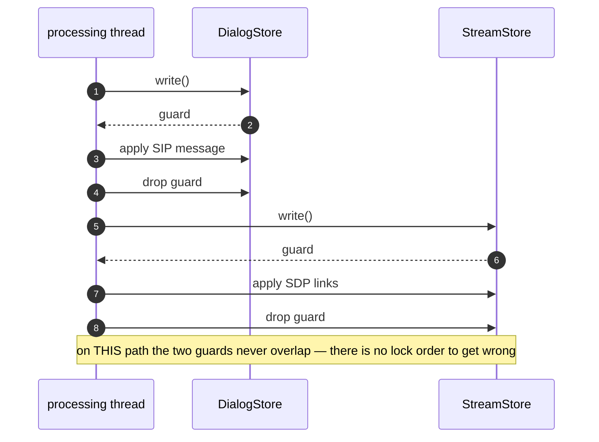
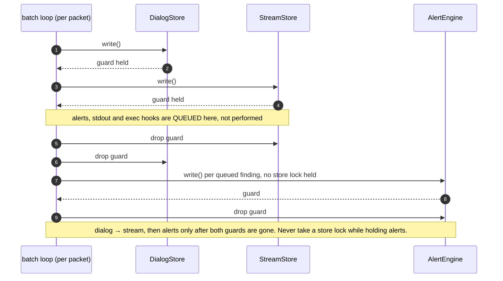
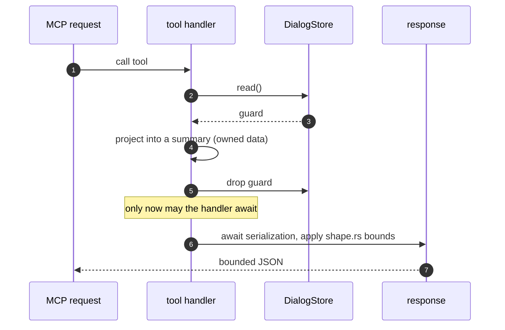

# Invariants

The rules that must not break. Each entry states four things:

- the rule
- why it exists
- what enforces it
- how it fails when broken

If you are about to violate one, the enforcement usually catches you.
But knowing *why* is faster than reading a CI failure.

- Threading detail belongs to [Threading](threading.md).
- Failure semantics — what sipnab does when something goes wrong — belong to
  [the fault model](../fault-model.md).
- This page links out rather than restating.

## One writer per store, per run mode

**Rule.** Exactly one thread writes `DialogStore` and `StreamStore` in a given
run. Everything else reads.

- `tui-processor` in TUI mode
- the main thread in batch mode
- thread-local stores in `--cores` mode

**Why.**

- Single-writer discipline is what makes `try_read()` on the render path
  safe and cheap.
- It also means adding a reader cannot introduce a data race.
- Only adding a writer can.

**Enforced by.** Structure rather than a lint.
The spawn moves the stores into the processing thread's closure.

**The two exceptions**, and the reason this page documents them rather than
forbidding them:

- Opening a pcap from inside the TUI spawns `pcap-load`.
  - It is a second writer against the live stores.
  - Its whole design exists to make that safe:
    - progress via `async_messages`
    - never a blocking read on the render side
  - See [Threading](threading.md).
- The second is the same shape with a different poller.
  - `open_capture` spawns `mcp-pcap-load` ([`mcp/load.rs`](../../src/mcp/load.rs)).
  - An agent polls `capture_status` where the TUI polls its event loop.
  - Two conditions admit it. The tool enforces both before it spawns anything:
    - The source must be a file rather than a live interface.
    - It must already have drained, so the first writer has stopped for good.
  - The tool refuses a live source outright, because its writer never finishes.

**Fails as.**

- A second writer turns every `try_read()` contention into a dropped frame.
- The UI appears to stall under load rather than degrade.

## Dialog before stream, then alerts — one consistent order

**Rule.**

- When a path needs both stores, take the **dialog store first, then
  the stream store**.
- If it also needs the alert engine, take that **last**.
  - Never take a store lock while already holding `alerts`.
- Prefer not to overlap the two store guards at all.
  - Where they do overlap, the order above is what makes it safe.

**Why.**

- Two locks acquired in opposite orders on two threads is the textbook
  deadlock.
- Non-overlapping guards make the question moot.
- A single consistent order answers it when the code cannot keep them disjoint.

> **Corrected 2026-08-03.** This rule used to read *"never hold both write
> locks simultaneously"*. It claimed *"the batch and `--cores` appliers hold
> their stores by `&mut` and so have no ordering to get wrong."*
>
> - Half of that was false.
> - It was false about the path that carries almost all of sipnab's packets.
>
> `--cores` workers really do own their stores outright
> (thread-local `DialogStore`/`StreamStore`, no locks at all —
> [`parallel.rs`](../../src/parallel.rs)).
>
> The **batch** applier does not:
>
> - It takes `dialog_store.write()` and `stream_store.write()` back to back, once
>   per packet.
> - It holds **both** guards across the whole per-packet body
>   ([`batch.rs`](../../src/app/batch.rs)).
>
> There is no deadlock, because the order is consistent everywhere.
>
> - But the page described a discipline the main path does not follow.
> - That is worse than describing none.
> - This page restates the rule above to say what is actually true and actually load-bearing.

**Enforced by.** Convention, in three shapes:

- **Disjoint guards**
  - [`process_packet()`](../../src/pipeline.rs) on the live path.
  - [`run_pcap_load()`](../../src/tui/controllers/file_open.rs) on the
    TUI file-open path ([rule 1](#one-writer-per-store-per-run-mode)'s documented exception).
  - Each locks a store once, briefly, and releases it before touching the other.
  - This is the shape to copy.
- **Overlapping guards in the documented order**
  - The batch applier ([`batch.rs`](../../src/app/batch.rs)): dialog then stream, held across
    `process_parsed_packet`.
  - Every other thread that wants both takes them in the same order.
  - So the cycle never closes.
- **No guards at all**
  - The `--cores` workers ([`parallel.rs`](../../src/parallel.rs)).
  - They own their stores by `&mut` and merge at EOF.

Nothing rejects a fourth lock-taking applier that gets it backwards.
That is exactly why this page writes the rule down.

**The `stores → alerts` edge — closed on the batch path, and the rule stays
anyway.**

- Until `LK1`, the batch loop took `alert_engine.write()` *inside* the locked body.
  - So the real order on that path was dialog → stream → alerts.
  - Nobody had written it down.
- That is no longer so.
  - Findings, per-message output and
    the `--alert-exec` / `--on-dialog-exec` / `--on-quality-exec` spawns queue up
    while the code holds the guards.
  - `DeferredEffects::drain` replays them after both
    guards drop ([`batch.rs`](../../src/app/batch.rs)).
  - The alert engine's write lock is now taken with **no** store lock held.

The ordering rule above still says "alerts last".

- Nothing enforces that.
- The edge is one line away from coming back.
- What made it survivable before was luck rather than design.
  - `security_findings` ([`mcp/server.rs`](../../src/mcp/server.rs)) takes `alerts.read()` and **no**
    store lock.
  - So the reverse edge that would have closed the cycle never existed.
  - That was a property of which tools somebody happened to write.

- The first MCP tool or REST handler that reads an alert and *then* a dialog creates
  `alerts → stores`.
- The first packet-path change that re-nests the alert lock
  recreates `stores → alerts`.
- Either alone is harmless. Both together deadlock the capture thread.
- Written down here because nothing else says it.
- Background: `LK1` in [`backlog.md`](../design/backlog.md), analyzed as R2 in
  [`process-isolation-and-hot-path-cost.md` section 4, "Verdict"](../design/process-isolation-and-hot-path-cost.md#4-verdict).

**The sub-rule `LK1` leaves behind: decide under the guard, perform after it.**

- Nothing that can block runs under a store guard.
  - no `fork`/`exec`
  - no `write(2)`
  - no third lock
- A packet's side effects are *decided* while the code holds the guards.
  - That is where the store is.
- They are *performed* once the guards drop.
  - That is where nothing waits on them.

[`DeferredEffects::drain()`](../../src/app/batch.rs) is what carries them
across.

- The output, the alert findings and the queued hook commands travel out
  of the locked body as data.
- [`EventExecEngine::dispatch_pending()`](../../src/output/event_exec.rs) spawns
  the children afterwards.

A rate limit survives the split in half.

- A decision parked between the two halves reaches the window at the moment
  it happens — [`TumblingWindow::allows_with_reserved()`](../../src/security/alerting.rs).
- So `--exec-rate-limit N` still means N and not N plus whatever was in flight.

A regression here does not announce itself. It is one line:

- a `fire_*` call, an `alert_engine.write()` or a `sink.write_str` reappearing inside
  [`process_parsed_packet()`](../../src/app/batch.rs)
- The capture's answer is byte-identical either way.
  - So no output test can see it.
- The only thing that notices is `side_effects_are_raised_under_the_guards_and_performed_after_them`.
  - It asserts on *when* rather than *what*.
  - Both guards are still unreadable (`try_read().is_none()`) while nothing has spawned yet.
  - The queue holds the decision.

**Fails as.** A hang, not a crash. There is no error anywhere.

- The TUI stops repainting.
- The REST API stops answering.
- The capture thread never takes another packet.

The disjoint shape is short enough to state exactly, and `pcap-load` repeats it
packet for packet.

The batch applier is the other shape. It is the one to check a new lock against.

- Both guards stay live for the whole per-packet body.
- Everything with a side effect queues up inside it.
- It replays once they lift:

## All four paths classify through one function

**Rule.** Protocol behavior lives in
[`classify_packet()`](../../src/pipeline.rs). Appliers apply a `PacketAction`.
They do not decide what a packet means.

**Why.** Before the unification the four paths had drifted.

- Heuristic RTP discovery and WebSocket-SIP unwrap worked on some and not others.
- So the same capture gave different answers depending on which path read it.

**Enforced by.**

- The `PacketAction` enum. An applier that ignores a new variant
  fails to compile.
- [`pipeline_test`](../../tests/pipeline_test.rs)
- [`parse_path_test`](../../tests/parse_path_test.rs)

**Fails as.** Silent divergence.

- `--cores 4` and `--cores 1` report different stream counts for the same file.
- Neither is obviously wrong.

**One function is not enough on its own.**

- `classify_packet()` may hold the only decision about what a packet means.
- Someone can still write the wire rule it decides *with* twice.
- `pipeline::is_rtcp_packet` kept its own copy of RTCP's length framing.
- `rtp::rtcp::looks_like_rtcp` then gained [RFC 3550](https://www.rfc-editor.org/rfc/rfc3550.html)
  section 6.1's padding rule in 0.5.164. The copy did not.
  - So the rule applied to a function nothing on the capture path calls.
  - Meanwhile the release note told operators it applied to the classifier every media datagram reaches.

A duplicate agrees with the original right up to the moment the original moves.

- [`rtcp_one_rule_test`](../../tests/rtcp_one_rule_test.rs) fails on a second
  site computing that arithmetic.
- `the_muxed_verdict_is_the_public_classifiers_verdict` fails if the two ever
  answer differently.

## Every attacker-keyed map has a bound and a stated eviction policy

**Rule.** Any collection keyed by something a remote party controls has a cap
and a defined behavior at that cap.

- Such keys include Call-ID, SSRC, IP and reassembly key.

**Why.**

- Otherwise a flood of unique keys is a remote OOM.
- A capture tool is by definition exposed to attacker-chosen input.

**Enforced by.**
[`resource_bounds_test`](../../tests/resource_bounds_test.rs).
It floods each map with unique keys and asserts the cap holds.

The dialog store offers both policies explicitly:

- `rotate=true` evicts LRU.
  - It evicts in batches.
  - One-at-a-time removal from the index is O(n) under sustained pressure.
- `rotate=false` drops new arrivals once full.

Other stores:

- The stream store evicts oldest-out at `max_streams`.
- TCP/IP reassembly caps entries, per-datagram size
  and per-stream buffered bytes in [`reassembly.rs`](../../src/capture/reassembly.rs).

An archive named with `-I` is attacker-shaped input of the same kind.
Its walk in [`archive`](../../src/capture/archive/mod.rs) stops rather than evicts:

- Every gzip layer's output counts against `--max-gunzip-bytes`.
  - The count sums across the layers of one input.
- Nesting stops at `MAX_DEPTH` (4) wrappers.
- An archive stops at `MAX_ENTRIES` (10,000) entries.
- When a ceiling hits, the walk throws away whole the member it was writing.

Inside the tar reader ([`tar.rs`](../../src/capture/archive/tar.rs)), `MAX_META_BYTES` (1 MiB) caps
one thing.

- It is the one thing held in memory in proportion to the input.
- That thing is the text of a long name or a pax header.

A ZIP ([`zipped.rs`](../../src/capture/archive/zipped.rs), the `archive`
feature) has these bounds:

- It counts every member it inflates against the same ceiling.
- Every trial decryption with a password that has not yet proven itself counts too.
- A ZIP nested inside another layer gets copied out for reading.
  - That copy stops at the ceiling as well.

The password layer has bounds of its own in
[`password.rs`](../../src/capture/archive/password.rs):

- `MAX_PASSWORD_BYTES` (4096) per password.
  - sipnab refuses a longer password whole and never truncates it.
- `MAX_PASSWORD_FILE_BYTES` (64 KiB) per password file.
- `MAX_COMMAND_OUTPUT` (64 KiB) and `COMMAND_TIMEOUT` (120 s) for `--archive-password-command`.
- `PROMPT_ATTEMPTS` (3) prompts per archive.

A 7z's key derivation costs `2^NumCyclesPower` SHA-256 rounds.

- The archive chooses that number.
- The `sevenz-rust2` crate refuses a power above 24, 7-Zip's own ceiling.
- [`sevenz.rs`](../../src/capture/archive/sevenz.rs) reports the refusal as
  `bound_exceeded (7z key derivation)`.

The REST wrong-password limiter in [`api.rs`](../../src/output/api.rs) keys on a client and an archive
name.

- A client chooses both of them.
- So it holds at most `WRONG_PASSWORD_KEYS` (4,096) pairs.
- To admit a new pair, it forgets the pair whose last wrong password is oldest.

The digest detector in [`digest_leak.rs`](../../src/security/digest_leak.rs)
remembers at most `MAX_NONCE_ENTRIES` (10,000) challenge nonce values.

- It keeps each value with the transaction that carried it.
- It drops an arbitrary one to admit the next.

The per-source maps of the other four security detectors are
[`LruMap`](../../src/lru.rs)s:

- `MAX_SOURCE_ENTRIES` (10,000) sources in the
  registration flood detector.
  - `MAX_PENDING_PER_SOURCE` (1,024) open transactions under each.
- `MAX_BEHAVIORAL_ENTRIES` (10,000) in the scanner detector.
- `MAX_PATTERN_ENTRIES` (10,000) in the fraud detector.
- `MAX_COOLDOWN_ENTRIES` (10,000) for both the alert engine's cooldown and
  event maps.
  - `MAX_EXEC_SOURCE_ENTRIES` is the same figure for its per-source exec budgets.

Admitting a key past the cap evicts the least recently used entry in constant time.

- Each of these used to pick its victim with `min_by_key` over the whole map.
- That was ten thousand comparisons per packet once a spoofed-source flood had filled it.
- It ran on the capture thread under both store write locks.

A HEP listener's sender roster
([`hep_roster.rs`](../../src/capture/hep_roster.rs)) holds two such maps.

- The sender table:
  - It keys on the capture id and address a sender claims.
  - It holds at most `[limits] max_tracked_peers` (default 4096).
  - It REFUSES a new sender at the bound rather than evicting one.
  - It is also the per-sender frame ordinal table.
    A recycled counter would mint a second frame 0.
  - The listener still admits a refused sender's packets and counts them as untracked.
- The refused-source table:
  - It keys on address alone.
  - It holds `HEP_REFUSED_SOURCES_TRACKED` (256).
  - It evicts the least recently refused address, so a spoofed flood rotates it.
  - The per-reason refusal totals live outside it, and nothing evicts them.

**Fails as.** Memory growth under a scan that looks like a leak.
The process is often running as a long-lived capture.

## Key material is toxic waste

**Rule.** Anything that can decrypt media is zeroized on drop.
It is never printed, logged, or serialized to any output surface.

- This covers TLS keylog secrets, SDES keys and derived SRTP session keys.

**Why.** D11.

- A capture tool holding decryption material is a high-value target
  on disk, in a core dump, and in swap.
- Zeroizing on drop addresses none of the last one on its own.
  - It clears the RAM copy.
  - It does not clear a page the kernel already wrote to the swap device.
  - That page outlives the process.

**Enforced by.**

- `zeroize` on the keylog material in
  [`capture/tls.rs`](../../src/capture/tls.rs).
  - The `tls` feature pulls the crate in.
- A hand-rolled `Drop` zeroization in [`rtp/srtp.rs`](../../src/rtp/srtp.rs).
  - So non-`tls` builds do not leak session keys to freed heap.
- Redaction on the output paths.
- `privilege::lock_key_memory` (`mlockall(MCL_CURRENT | MCL_FUTURE)`).
  - The same trigger as the core-dump hardening calls it.
  - So the kernel cannot page them out in the first place.

That last one is best-effort and says so.

- A low `RLIMIT_MEMLOCK` is common and not always the operator's to change.
- So it reports whether it succeeded rather than claiming hardening it did not do.

**Archive passwords are key material too.**

- A password that opens a password-protected capture archive decrypts everything inside it.
- So it gets the same treatment and a type that enforces it.

[`ArchivePassword`](../../src/capture/archive/password.rs) holds bytes in a
`zeroize::Zeroizing` buffer.

- It has no `Display`, `Serialize`, `Deref` or `as_str`.
- Its `Debug` prints `[REDACTED]` with no length.
- `compile_fail` doctests pin the missing accessors.
- Every buffer a password passes through gets its size before the read.
  - The copy a reallocation leaves behind is one `zeroize` never reaches.
- A run that holds a password suppresses core dumps.
  - `--allow-coredump` says that a dump would contain it.

The password appears nowhere in output:

- no log line at any level
- no error message
- no stdout or JSON
- no TUI trail, setting, note or export

Error messages name the source and never what it supplied.

- Examples of a source: `--archive-password-file`, or the program `--archive-password-command` ran.
- [`tests/archive_password_test.rs`](../../tests/archive_password_test.rs) runs every source at
  `SIPNAB_LOG=trace`.
  - It requires that no byte of stdout or stderr contains the password.

Decrypted members go to owner-only files, mode 0600.

- Their names look like `m00007.pcap`, and never follow the member's name.
- They sit inside the private 0700 extraction directory.
- The run deletes that directory on exit.

Two copies sit outside that control.
They are in crates sipnab uses unmodified, as its no-forks rule requires.

- The `zip` crate clears the AES key it derives.
  - But it keeps a ZipCrypto archive's three key words in a reader state it never clears.
  - That state dies with the member's reader.
- `sevenz-rust2` takes its password as a `Password` that derives `Debug` and `Clone` and clears nothing.
  - So sipnab builds one only for the call that needs it and drops it straight after.
  - That crate also keeps the last 7z key it derived in a process-wide cache.
  - It never clears that cache.
  - So a 7z key outlives its archive until another 7z replaces it or the process exits.

**Fails as.** Keys recoverable long after the process exited:

- from a crash report
- from a core file
- from a swap device read

It is an exposure with no error message attached to it.

## A bearer token is valid on exactly one surface, and only as far as its scope

**Rule.** A signed token binds on two axes, and verification checks both.

*Which surface* (`aud`):

- The token names the surface it belongs to.
- Each verifier accepts only its own audience.
- A token minted from `--api-signing-key` must never authenticate against HTTP MCP, and vice versa.
  - This holds even when both surfaces share one signing key.

*How much of it* (`scope`):

- `full` reaches everything on that surface.
- `metrics` reaches `GET /metrics` and nothing else.
- A `full` token satisfies every requirement.
- A narrower one satisfies only its own.

**Why.**

- The REST API and HTTP MCP read separate flags and separate environment variables.
  - So an operator putting one secret in both
    `SIPNAB_API_SIGNING_KEY` and `SIPNAB_MCP_SIGNING_KEY` looks like tidy
    configuration.
  - Before audience binding, that silently made every API token a valid MCP token.
  - There was no warning and nothing in the logs.
- For `scope`: sipnab decrypts TLS.
  - So `/v1/dialogs` and `/v1/streams` return message bodies — the call content itself.
  - Without a scope split, a monitoring system that needs one counter must hold the keys to all of it.
  - That is the one division of the surface worth having.
  - The rest of it is a single trust domain.

**Enforced by.** The `aud` check in [`verify_signed()`](../../src/auth.rs).

- It requires an `s2` token's audience to equal the verifier's own.
- Each surface sets its audience once in
  [`resolve_api_verifier_config()`](../../src/app/servers.rs) and
  [`resolve_mcp_verifier_config()`](../../src/app/servers.rs).
  - It also sets it at mint time in [`mint_token()`](../../src/app/bootstrap.rs).
- The version prefix is part of the signed input.
  - So nobody can rewrite an `s2` token as `s1` to shed the binding.
- An empty configured audience matches nothing.
  - So a verifier built without one fails closed.
- Tests pin cross-surface rejection in both directions in
  [`auth.rs`](../../src/auth.rs) and
  [`cli_flag_behavior_test`](../../tests/cli_flag_behavior_test.rs).

The `scope` check sits in the same function, immediately before the expiry test.

- The claim is part of the signed payload.
  - So a holder cannot widen their own token by editing it.
- Routes demand a scope through [`guard_scoped()`](../../src/output/api.rs).
- The plain `guard()` demands `full`. That is the RESTRICTIVE default.
  - Demanding `full` admits only full tokens.
  - Demanding `metrics` admits both.
- A route added later and wired to the plain guard therefore inherits "full tokens only".
  - It does not silently accept a scrape-only credential.

Tests pin enforcement at all three layers:

- the verifier in [`auth.rs`](../../src/auth.rs)
- the CLI flag in [`cli_flag_behavior_test`](../../tests/cli_flag_behavior_test.rs)
- the real routes in [`api_token_test`](../../tests/api_token_test.rs)

The reason: a route wired to the wrong guard passes every unit test.
It still serves the call content to a scrape job.

**Fails as.** A privilege boundary that exists in the documentation but not in the code:

- A token meant for a read-only metrics scrape quietly grants an AI agent full MCP tool access.
- Or it reads dialog bodies on its own surface.

**Coverage.** (Named so rather than "Scope", which now means a claim.)

- The audience check is unconditional.
  - sipnab no longer accepts the pre-`aud` `s1` format.
  - So there is no token version that reaches a surface without an audience.
- The scope check is deliberately *not* symmetric with it.
  - An absent `scope` means `full`.
  - An absent `aud` fails closed.
- `aud` arrived with a format bump that stopped accepting the old tokens outright.
- Tokens minted before `scope` existed are still valid `s2` tokens in the field.
  - Denying them would revoke live credentials on upgrade.
- Static `--api-key` / `--mcp-token` secrets remain audience-less and `full` by design.
  - They name shared secrets, not tokens.
  - An operator who sets the same static secret on both surfaces has deliberately shared one credential.

## MCP tools never edit the analysis, and every response has a ceiling

**Rule.**

- No MCP tool edits a store in place.
- Every response hits a size ceiling before serialization.
- One tool replaces a store wholesale: `open_capture`, behind `--mcp-allow-open-capture`.
  - It rotates the capture identity in the same critical section that clears the stores.
  - So no answer can change meaning without saying so.

One tool accepts a WRITE: `save_findings`, behind `--mcp-allow-save-findings`.

- It does not weaken this rule.
- It appears here so nobody has to discover it by reading the tool list.
- What an agent writes goes to the log and reaches nothing else.
  - no store, no detector, no report, and no other tool
  - So it cannot return later as evidence the agent then cites.

There is no `list_findings`, and that omission is the feature.

- The compiler enforces the dead end, rather than this paragraph.
- The annotation types are `pub(in crate::mcp)`.
  - So no analysis path can name them.
- A reviewer should treat widening that visibility as the change that breaks the invariant.

**Why.** An LLM agent drives the MCP surface.

- It must not be able to change what an operator is looking at *and leave it looking like what they were
  looking at*.
- An unbounded response is a denial-of-service against the
  agent's context window as much as against sipnab.
- The rule used to read "no tool mutates a store".
  - That was true until a capture swap existed.
  - It is the wrong test anyway.
  - What protects the operator is the identity on the wire, not the absence of the verb.

**Enforced by.**

- [`shape.rs`](../../src/mcp/shape.rs): `DEFAULT_LIMIT` 50,
  `HARD_LIMIT` 1000, `DEFAULT_MAX_BODY_BYTES` 4096.
  - [`resolve_limit()`](../../src/mcp/shape.rs) applies them.
  - [`mcp_stdio_test`](../../tests/mcp_stdio_test.rs) and
    [`mcp_http_test`](../../tests/mcp_http_test.rs) check them end to end.
- The identity half is [`provenance.rs`](../../src/provenance.rs).
  - sipnab stamps it on every whole-store response.
  - [`mcp_open_capture_test`](../../tests/mcp_open_capture_test.rs) checks it.

**A wait is a ceiling too.**

- `capture_health` and `runtime_stats` measure a rate.
  - They read the counters twice across a window the caller names.
  - So the caller's own request blocks for exactly that long.
- [`MAX_SAMPLE_SECONDS`](../../src/output/runtime.rs) caps that window at 30
  seconds.
  - That is long enough to smooth a bursty INVITE rate.
  - It is short enough to stay inside the deadline an MCP client gives one call.
- `resolve_sample_seconds()` holds the rule for both surfaces.
  - So a window MCP rejects is never one REST accepts.
- REST narrows it again with `MAX_REST_SAMPLE_SECONDS`.
  - That value comes from subtracting a margin from `REQUEST_TIMEOUT`. It is not written beside it.
  - A window as long as the timeout gets canceled mid-sleep.
  - Then the caller reads a timeout where they asked for a rate.
- Three `const` assertions in [`api.rs`](../../src/output/api.rs) fail the **build** if that derivation ever:
  - collapses
  - widens past the shared cap
  - reaches zero

**Fails as.**

- An agent that quietly truncates or floods, and an operator who cannot tell which.
- For the time ceiling: one tool call that outlives its client.
  - The client reports it as a dead server rather than as a long measurement.

## No lock across `.await`

**Rule.** Never hold a `parking_lot` guard across an await point.

**Why.**

- `parking_lot` guards are not async-aware.
- Holding one across a yield parks the runtime thread with the lock still taken.
- In a current-thread runtime, that is an immediate deadlock.
  - [`servers.rs`](../../src/app/servers.rs) builds a current-thread runtime.

**Enforced by.** `clippy::await_holding_lock = "deny"` in the workspace lint
table. Not a warning: the build fails.

**Fails as.**

- The API and MCP servers stop responding while capture keeps running.
- So the process looks healthy from the outside.

The correct shape is snapshot-then-await, and it is worth seeing in order.

## One wire shape per concept

**Rule.** Every surface that serializes a dialog or a stream projects through
[`output/model.rs`](../../src/output/model.rs). No surface builds its own JSON
object for these.

**Why.** Five call sites implemented it, and they had already drifted:

- MCP said `message_count` where CLI and REST said `msg_count`.
- MCP emitted Debug-formatted `Invite` where the API emitted `INVITE`.
- Consumers wrote per-surface parsers to compensate.

**Enforced by.**
[`summary_consistency_test`](../../tests/summary_consistency_test.rs) and
[`json_schema_test`](../../tests/json_schema_test.rs).

**Fails as.** A field name that means one thing in `--json` and another over MCP.
A user's broken script discovers it, not CI.

## The render pass never mutates and never blocks

**Rule.**

- Every store access on the render path is `try_read()`.
- The render pass computes. It does not mutate.

**Why.**

- A blocking read on the render thread makes the whole UI hostage to capture throughput.
- Skipping a frame is always better than freezing one.

**Enforced by.** [`sync_caches()`](../../src/tui/mod.rs) and
[`draw_frame()`](../../src/tui/mod.rs).

- They fall back to the previous snapshot on contention.
- `draw_frame()` forces a blocking frame after a bounded number of skips.
  - So the display cannot freeze permanently.

**Fails as.** A UI that stutters exactly when the operator most needs it — under
a flood.

## Warn and continue on malformed input

**Rule.** No parser reachable from packet bytes may panic, `unwrap()`, or exit.
sipnab logs malformed input, at most once and rate-limited, then skips it.

**Why.** D17.

- Every byte sipnab parses is attacker-controlled.
- So a panic in a parser is a remote denial of service against a capture process.
- Often nobody is watching that process.

**Enforced by.** Three layers:

- the pre-commit gate that rejects `unwrap()`/`expect()` in production code
- the always-on [`smoke_fuzz_test`](../../tests/smoke_fuzz_test.rs) floor under `catch_unwind`
- the coverage-guided targets in [`fuzz/fuzz_targets/`](../../fuzz/fuzz_targets)

Parsers return typed errors — `ParseError`, `CaptureError` — rather than panicking.
[`error_types_test`](../../tests/error_types_test.rs) pins that surface.

**Fails as.** A single crafted packet ends the capture.
The evidence you were capturing is what you lose.

## A fatal exit never abandons the capture thread

**Rule.** Every fatal exit taken after
[`start_capture()`](../../src/capture/native.rs) goes through
[`stop_and_join()`](../../src/capture/native.rs) before the process ends.

- That means: shutdown flag set, receiver dropped, thread joined.
- A function that cannot reach the handle does not exit where it stands.
  - It returns the failure to one that can.

**Why.**

- [`launch()`](../../src/app/bootstrap.rs) spawns the capture thread
  *before* the readiness hand-shake, the chroot and the privilege drop.
  - The source must be open while the process still holds `CAP_NET_RAW`.
- Every failure from there on happens with that thread running and holding its source.
- `std::process::exit` joins nothing and runs no destructors.
- Nineteen exits in `launch` and four more in
  [`BatchRunner::new()`](../../src/app/batch.rs) abandoned it.
- The trigger was not exotic.
  - `sipnab -I /nonexistent.pcap`, a mistyped filename, was enough.

**Enforced by.**

- ThreadSanitizer, over the five suites `sanitizers.yml` runs.
  - It classes `thread leak` as fatal rather than warning about it.
- [`cli_flag_behavior_test`](../../tests/cli_flag_behavior_test.rs).
  - It exercises both shapes: a source that never opens, and a failure after it opened.
  - So a regression fails on every push instead of waiting for the weekly
    sanitizer run.

**Fails as.** A process that exits while a thread still holds an open capture
device, mid-read.

- It is benign on most exits and invisible without a sanitizer.
- That is why it survived until a sanitizer ran over it.

## Operator notes are output, never input

**Rule.** A note an operator types about a SIP message reaches three places
and no others:

- a pcapng packet comment in a file sipnab writes
- the TUI's note pane
- the notes file the operator saves to resume a session

sipnab never reads a packet comment back.
No dialog, stream, report, wire shape or MCP tool can name a note.

**Why.**

- A note is a person's conclusion.
- sipnab builds the analysis from what was on the wire.
- [Section 2 of the deferred-and-declined record](../design/deferred-and-declined.md#2-write-back-mcp-tools)
  refuses to let an agent's conclusion come back as evidence it can then cite.
  - A person's conclusion is no different once it sits beside the facts.
- And the file leaves the box.
  - sipnab may have decrypted the SIP in it from TLS.
  - So a key pasted into a note would travel in clear where it traveled encrypted.
  - That breaks [Invariant "Key material is toxic waste"](#key-material-is-toxic-waste) with one paste.

**Enforced by.** [`NoteText`](../../src/annotate/mod.rs) keeps its text in a
private field.

- It has no `Deref`, `as_str`, `Display` or `Serialize`.
  - So the text cannot enter any JSON projection ([Invariant "One wire shape per concept"](#one-wire-shape-per-concept))
    or log line.
- Five `compile_fail` doctests pin each missing accessor.
  - Beside them, one doctest compiles to prove the type is reachable.

`NoteText::new` refuses:

- an empty note
- a note over `MAX_NOTE_BYTES` (4096) bytes
  - It refuses it and never cuts it.
  - `pcap-file` writes an option length as a `u16`.
  - So a longer comment would corrupt the file rather than fail.
- a control character other than newline or tab
- an SDES `inline:` key
- a TLS key-log line
- a digest `response=` value

Other limits:

- A session holds at most `MAX_NOTES` (10,000) notes.
- A notes-file line is at most `MAX_LINE_BYTES` long.

The unit tests in the same file pair every refusal with the nearest note it must accept.
So a validator that refuses everything fails as surely as one that refuses nothing.

The module stays out of reach of everything that is not an output.

- [`annotate_import_gate_test`](../../tests/annotate_import_gate_test.rs) fails
  when `crate::annotate`, or the `EnhancedPacketOption` type that carries a
  packet comment, appears anywhere but `src/annotate/`, `src/tui/`, `src/app/`
  and [`src/capture/writer.rs`](../../src/capture/writer.rs).
- It names `src/mcp/`, `src/output/`, `src/sip/`, `src/rtp/`, `src/security/` and
  [`src/analysis.rs`](../../src/analysis.rs) as forbidden outright.

The writer puts a comment on a frame only through `PcapWriter::write_annotated`.

- That takes an `EpbComment` that only the annotate module can build.
- So MCP's `export_capture` has no way to write one.
- The annotate module refuses, rather than cuts, a comment longer than the 16-bit option length, `MAX_COMMENT_BYTES`
  (65,535).

In the TUI:

- The note pane and the editor draw the text from inside the annotate module.
- The action trail records the frame a note is on and never its
  text (`an_operator_note_never_reaches_the_trail`).
- Nothing else in `src/tui/` can read a note.

**Fails as.**

- An operator's guess about a call, read back by a later run or
  an agent as though the capture said it.
- Or a decryption key, typed into a note, arriving at a carrier in a file nobody thought to screen.

## Two cultural norms

No test enforces them, which is precisely why this page writes them down.

**Cite the standard.** A new analysis claim names the RFC or ITU
recommendation it implements.

- The [pull-request template](../../.github/PULL_REQUEST_TEMPLATE.md) asks for it
  directly: *"Any new analysis claim is honest and backed by the implementation
  (cite the RFC/ITU standard where relevant)."*
- Jitter is [RFC 3550 section 6.4.1](https://www.rfc-editor.org/rfc/rfc3550.html#section-6.4.1) signed
  transit deltas, not a variance.
- MOS is an E-model estimate, not a measurement.
- Saying which one you implemented is the difference between a tool an engineer
  can trust and one they have to re-derive.

**Refute your own claims in place.**

- When a performance claim turns out to be wrong, the page that made it says so, on the same page.
  - It does not quietly drop it.
- [Zero-copy payloads](zero-copy-payloads.md) does exactly this.
  - It documents the zero-copy spine.
  - Then it records that the predicted 20–30% hot-path win *did not hold*.
  - The change costs nothing measurable on the workload.
- The architecture is still right for other reasons, and the reader gets to see both.
- A doc tree that only ever records wins is a doc tree nobody can use to make a decision.

## Who reads this?

**Rule.**

- A caveat, a limit or a disclosure belongs where its consumer looks.
- Writing it somewhere else is not disclosure, and it reads as one.

**Why.** Four defects in a single week shared this shape and nothing else:

- `--portrange` dropped a third of the SIP in a capture.
  - The fix printed the loss beside the CLI summary, so a human saw it.
  - the capture-status tools (then `stats` and
    `capture_status`, since folded into one) returned a byte-identical key set whether the run dropped a third of it or
    none of it.
  - So a model driving the MCP tools answered from two thirds of the
    capture with full confidence.
  - It had no way to learn otherwise.
- The SIP-over-WebSocket skip tally repeated the `--portrange` defect above.
  - It happened months after that rule landed, with the fixed field one line away to copy.
  - It reached the operator as a stderr warning and a CLI summary line.
  - It reached an MCP client not at all.
  - Take a capture whose WSS lands on 8081 — Kamailio, OpenSIPS, Janus and any reverse proxy.
    - `capture_status` answered `dialog_count: 0`, `unanalysed_sip_messages: 0` and `degraded: false`.
    - That is character for character what a perfect read of a capture holding no SIP
      produces.
    - Meanwhile an entire WebRTC signaling leg went unreported.
  - Adding a disclosure to one surface is not the fix.
  - The fix is adding it to every surface that answers the question it qualifies.
- `export_capture` re-synthesizes a frame per SIP message rather than writing
  the packets it read.
  - The function's own doc comment said so plainly and
    called the result "honest about the rest".
  - The tool description an MCP client
    reads said "writes the packets sipnab is holding to a pcap file".
- `the_reporter_is_never_the_unreachable_endpoint` asserted its invariant
  against the parser.
  - There the router and the dead host arrive already separated.
  - Swapping them one layer later, in the code that fills the evidence
    a reader sees, left the test green.
- `--hep-send` forwards a whole capture to an operator-named collector.
  - That is a legitimate feature.
  - Nothing said it happens.
  - It sits outside the permit system.
  - So an audit of "what can transmit" finds `TransmitPermit` and stops.

None of these were oversights in implementation.

- In three of the four, someone had written the truth down carefully:
  - in a code comment
  - in a doc paragraph below the example
  - in a test whose name matched the invariant exactly
- The reader who needed it never saw it.

**In practice.** Ask it of the specific consumer, not of "the docs":

| The consumer | Reads | Does not read |
|---|---|---|
| An MCP client | the tool description, once | `docs/`, code comments, stderr |
| A pcap forwarded to a carrier | the bytes | anything sipnab printed |
| An operator scanning a summary | stdout/stderr of that run | the manual |
| A future reviewer | the diff and the test name | your reasoning |
| A test | the layer it asserts against | the layer the bug lives in |

The last row is the one that catches people.

- A test named after an invariant is no evidence that anything guards it.
- Mutation testing tells the two apart.
- Apply the mutation where the code USES the value, not only where it computes it.
