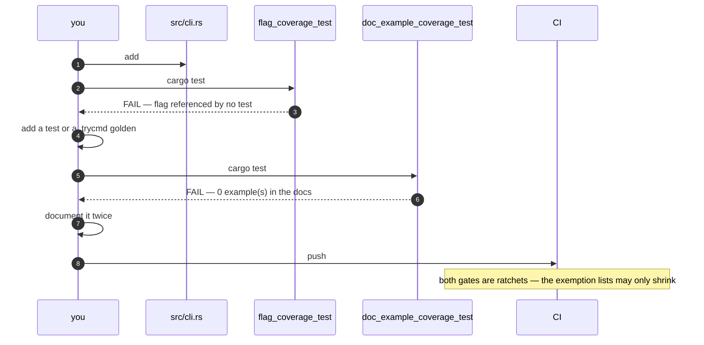
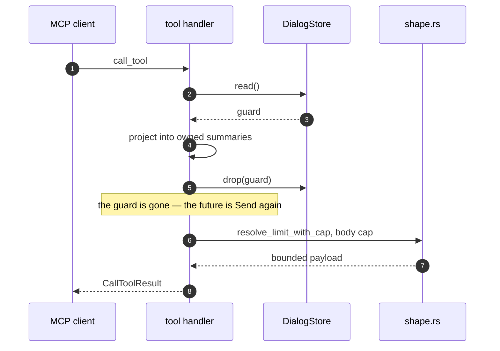

# Contributor walkthroughs

Seven ordered checklists for the changes people actually make.

- Each step names the test that fails if you skip it.
- Where no test enforces a step, it carries **(unenforced)**.
  - That is prose, and prose is what gets forgotten.
  - So those are the steps to be deliberate about.

Checking the enforcement claims here meant making the change and watching the
gate fail. More often than expected, it meant watching it pass.

Where the first draft of this page and reality disagreed, reality won:

- Adding a CLI flag does *not* trip `docs_drift_test`.
- The compiler turns away an MCP tool that holds a lock across an await
  before clippy gets a word in.
- **Three of the six checklists turned out to name gates that do not fire at all**
  for the change they sat beside.
  - Those steps now carry **(unenforced)**.

The pattern behind all three: a gate that hardcodes its subjects cannot see a *new* subject.

- Examples of hardcoded subjects:
  - Three flood scenarios.
  - Two output-flag behaviors.
  - Until it was rewritten to enumerate the directory, a list of schema filenames.
- Such a gate protects what exists from regressing.
- It does not notice an addition.
- Assume nothing enforces a new thing until you have watched it fail.

## Add a CLI flag

- Add the `#[arg]` field to `Cli` in [`cli.rs`](../../src/cli.rs), with a
  `help_heading` matching its group.
  - → [`cli_help_test`](../../tests/cli_help_test.rs) checks the grouping of the
    ~160-flag help output.
- Wire it wherever it takes effect.
  - Usually that is [`plan()`](../../src/app/bootstrap.rs).
  - So the flag becomes part of `RunPlan` rather than at the point of use.
- Give it a row in [`settings.rs`](../../src/settings.rs).
  - The row names the `[section] key` it shares with the config file.
    - It also names how the two combine
      (`Merge::Override`, `Either`, `Union` or `Off`).
  - Or the row names why it has no key
    (`Action`, `Input`, `Secret`, `PerRun`).
  - A standing setting gets a key, added
    to [`config.rs`](../../src/config.rs) beside its peers.
  - → `settings::tests::every_flag_has_exactly_one_row` **fails immediately**
    with `not classified: zzz-gate-probe`.
  - Once the row names a key, the two reference gates in the same module demand two things:
    - `docs/cli-reference.md` says `Config: [section] key`.
    - `docs/config-reference.md` names the flag.
  - `SIPNAB_SETTINGS_APPLY=1 cargo test --features full --lib settings` writes both.
    - Then `python3 scripts/build-site-pages.py` carries them to the site.
  - → [`config_wiring_test`](../../tests/config_wiring_test.rs) catches a config
    key that is never read.
- Add a test that references the flag by name.
  - Any test, anywhere under `tests/`, including a `.trycmd` golden.
  - → [`flag_coverage_test`](../../tests/flag_coverage_test.rs) **fails
    immediately** without one.
    - `zzz-gate-probe` in its message is the flag you just added.
- Document it in at least **two** examples across the docs.
  - → [`doc_example_coverage_test`](../../tests/doc_example_coverage_test.rs)
    fails with `--your-flag: 0 example(s)` until you do.
- Add a default-value case to
  [`cli_defaults_test`](../../tests/cli_defaults_test.rs).
  - **(unenforced — that test does not enumerate the CLI, so a missing case passes silently.)**

A config key with no flag goes in `settings.rs`'s `FILE_ONLY` list with its reason.

- Verified 2026-10-03:
  - A throwaway `zzz-gate-probe` flag failed `every_flag_has_exactly_one_row`.
  - A throwaway `[capture] zzz_probe_key` failed two checks:
    - `every_config_key_is_named_once` (`unclassified key`).
    - `every_config_key_has_a_row_naming_its_flags` (`no row in
      docs/config-reference.md`).

Verified: adding a throwaway `#[arg(long = "zzz-gate-probe")]` had these results.

- It failed `flag_coverage_test` and `doc_example_coverage_test`.
- `docs_drift_test`, `cli_defaults_test` and `config_wiring_test` all stayed green.
- `docs_drift_test` guards the *other* direction.
  - That is a flag named in the docs that the CLI does not have.

The two gates that do fire, in the order you meet them:



## Add a TUI view

Model it on the newest one, `StreamLossMap`.
Its commit touched exactly these places.

- Add the variant to `View` in [`state.rs`](../../src/tui/state.rs).
- Add the renderer.
  - It is a module beside [`loss_map.rs`](../../src/tui/loss_map.rs).
  - Register it in [`render/mod.rs`](../../src/tui/render/mod.rs).
- Keep the computation out of the renderer.
  - `StreamLossMap`'s binning core lives in [`rtp/loss_map.rs`](../../src/rtp/loss_map.rs)
    with its own unit tests.
  - So the view logic is testable without a terminal.
- Add the controller in [`controllers/`](../../src/tui/controllers).
  - Route it in [`controllers/mod.rs`](../../src/tui/controllers/mod.rs).
- Add the key that opens it, in whatever view it opens *from*.
- Document that key in `HELP_TEXT` in [`help.rs`](../../src/tui/help.rs) **and**
  in [`docs/keybindings.md`](../keybindings.md).
  - → [`keybinding_drift_test`](../../tests/keybinding_drift_test.rs) fails with
    `these handled KeyCode::Char keys are neither in the F1 help nor
    allow-listed`.
  - It names both the view and the character.
- Add snapshot coverage in
  [`tui_snapshot_test`](../../tests/tui_snapshot_test.rs).
  - At minimum, the populated case and the empty/degenerate case.
- Mirror the keybinding into [`website/content/docs/keybindings.md`](../../website/content/docs/keybindings.md).
  - **(unenforced for a new key — the mirroring obligation is a convention. See
    CONTRIBUTING.)**

Verified: binding `KeyCode::Char('Y')` in the call-list controller without
touching the help failed two assertions in `keybinding_drift_test`.

## Add an MCP tool

- Add the handler to [`server.rs`](../../src/mcp/server.rs) under the
  `#[tool_router]` impl.
  - Give it a `#[tool(name = …, description = …)]` attribute.
- Write the description as a **statement of what the tool returns**.
  - Never instruct the model to "trust", "verify", "act on" or "ensure" anything about
    the content.
  - That is the prompt-injection rule (D22 in
    [`../design/implementation-plan-phases-8-10.md`](../design/implementation-plan-phases-8-10.md)).
  - **(Enforced by [`tests/mcp_tool_descriptions_test.rs`](../../tests/mcp_tool_descriptions_test.rs),
    which fails on any of those four words in a tool description.)**
  - **(Corrected 2026-08-05.)**
    - This used to call the rule unenforced.
    - It also used to claim `server.rs` cited a `scripts/check-tool-descriptions.sh`
      that does not exist.
    - Both halves are now wrong.
      - `server.rs` no longer carries the citation.
      - The rule shipped as a Rust test rather than the shell script the plan named.
    - That test also carries `every_cited_script_exists`.
      - It fails if the dangling citation ever comes back.
    - It now scans every tracked `.rs` file whole, not the first 40 lines of one.
      - The reason: the narrow version asserted nothing once the citation went away.
- Take the store guard, project what you need into owned data, **drop the
  guard**, and only then `.await`.
- Bound the response with [`resolve_limit_with_cap()`](../../src/mcp/shape.rs).
  - Pass the caller's `limit` and the server's `row_cap`.
  - Also bound it with the body-bytes cap (`--mcp-max-body-bytes` moves it).
  - A tool that pages with a cursor also takes `max_response_bytes`.
    - It passes its serialized page, after any `fields` projection,
      through `SipnabMcp::fit_to_budget`.
    - It passes the cursor that resumes after each row.
    - So the whole response stays inside
      `--mcp-max-response-bytes` ([`budget.rs`](../../src/mcp/budget.rs)).
  - **Not `resolve_limit()`.**
    - That one takes no ceiling.
    - So a tool wired to it silently ignores `--mcp-max-rows`.
    - The operator sets a limit and the tool does not honor it.
    - `shape.rs` says as much at the definition.
      - It is "kept for callers with no configured ceiling".
      - The server is not one of them.
    - This step used to name the wrong function.
      - That is how a recipe written for the reader who does not yet know
        manufactures the very defect it exists to prevent.
- Add an end-to-end case to [`mcp_stdio_test`](../../tests/mcp_stdio_test.rs).
  - For HTTP-visible tools, also add one to [`mcp_http_test`](../../tests/mcp_http_test.rs).

The step that drops the guard is not a style preference.

- The rmcp router requires each handler's future to be `Send`.
- A `parking_lot` guard held across an await makes it non-`Send`.
- So the build fails on the `#[tool]` attribute with *"future cannot
  be sent between threads safely"*.
  - That happens before `clippy::await_holding_lock` (denied at
    the workspace level) is even consulted.
- There are two independent mechanisms. The stricter one is the compiler.



## Add a REST route

- Add the handler to [`src/output/api.rs`](../../src/output/api.rs), register it in `build_router`, and
  give it a `#[utoipa::path]` annotation.
- Give the route a `### METHOD /path` heading in `docs/rest-api.md`, and
  document every query parameter the annotation declares.
  - **(Enforced by `openapi_contract_test`.)** It compares three lists: the
    published document, the live router, and the headings in
    `docs/rest-api.md`. It fails when any two disagree, and when the
    reference never mentions a parameter the document declares.
- Regenerate the published document (next section).
  - **(Enforced by `openapi_contract_test`, which fails on a stale
    [`website/static/openapi.json`](../../website/static/openapi.json).)**
- If the route answers a question an MCP tool also answers, return the same
  shape from the same code. The REST reference states which tool matches each
  route.
  - **(Enforced for listed answers and fields by `surface_parity_test`.)**
    It fails when an answer in its `CAPTURE_ANSWERS` table has an MCP tool
    and no route or the reverse, and when a quality metric, caveat counter or
    provenance field reaches one API and not the other. A new answer is
    checked only once someone adds it to that table **(unenforced)**.
- A route that reads a request body inherits the 1 MiB
  `MAX_REQUEST_BODY_BYTES` cap from the router's `DefaultBodyLimit` layer. A
  larger body answers `413`, and a body that does not parse answers `400`.
  Do not add a second limit.

The REST reference shares these derivations with other surfaces. Change the
shared code, not a copy:

| REST route | Shared with | Code |
|---|---|---|
| `GET /v1/dialogs/{call_id}/report` | `GET /v1/dialogs/{call_id}` | `generate_call_report` in [`src/output/call_report.rs`](../../src/output/call_report.rs) delegates JSON to the one dialog serializer |
| `GET /v1/dialogs/{call_id}/correlated` | MCP `find_correlated` | `CorrelationResult::strategy_and_gap` in [`src/sip/dialog_store.rs`](../../src/sip/dialog_store.rs) |
| `GET /v1/dialogs/{call_id}/tree` | MCP `get_call_tree` | `DialogStore::correlation_tree` in [`src/sip/dialog_store.rs`](../../src/sip/dialog_store.rs) |
| `POST /v1/vcon/validate` | MCP `validate_vcon` | `vcon_schema::validate` in [`src/output/vcon_schema.rs`](../../src/output/vcon_schema.rs) |
| `POST /v1/vcon/analyze` | MCP `analyze_vcon` | `vcon_analysis::analyze_container` in [`src/output/vcon_analysis.rs`](../../src/output/vcon_analysis.rs) |
| `GET /v1/capabilities` | MCP `server_capabilities`, `--version` | `compiled_features` in [`src/cli.rs`](../../src/cli.rs), read from `cfg!`; the `libpcap` block is `pcap_lib_version` asked at runtime |

The `/v1/dialogs` list rows are the compact `DialogSummary` projection shared
with MCP and TUI save. That is why they carry `from_user`/`to_user` while the
single-dialog document carries `from`/`to`.

The live-audio WebSocket closes with code 1002 on a client frame longer than
`MAX_CLIENT_FRAME` (4096 bytes) in [`src/output/websocket.rs`](../../src/output/websocket.rs). A client sends
only control frames, which [RFC 6455](https://www.rfc-editor.org/rfc/rfc6455.html) caps at 125 bytes.

### Regenerate the OpenAPI document

A test step generates [`website/static/openapi.json`](../../website/static/openapi.json). Nobody writes it by hand.
`openapi_contract_test` derives it from the `#[utoipa::path]` annotations on
the handlers in [`src/output/api.rs`](../../src/output/api.rs), and splices in the shared JSON Schemas
under `tests/schemas/` rather than describing those response bodies twice.
Regenerate it after changing a handler:

```bash
SIPNAB_BLESS_OPENAPI=1 cargo test --features full --test openapi_contract_test
```

- The test file compiles only with the `api`, `vcon` and `native` features.
  A build without `vcon` registers no `/v1/dialogs/{call_id}/vcon` and would
  generate a different document, so the published document describes the full
  build.
- [`scripts/check-generated-inputs-staged.py`](../../scripts/check-generated-inputs-staged.py), run by the pre-commit hook,
  refuses a commit that stages the document while one of its inputs has
  changes that are not staged.
- `info.version` is `1`, the `/v1` path version, not the release version. A
  patch release that changes no endpoint must not invalidate a document a
  client already cached.

## Add a security detector

- Add the module under [`src/security/`](../../src/security).
  - Put it beside [`scanner_detect.rs`](../../src/security/scanner_detect.rs) or
    [`reg_flood.rs`](../../src/security/reg_flood.rs).
  - Export it from [`security/mod.rs`](../../src/security/mod.rs).
- Keep detector state bounded and attacker-keyed maps capped.
  - A detector is by definition fed hostile input.
  - **(unenforced — [`resource_bounds_test`](../../tests/resource_bounds_test.rs)
    is three hand-written scenarios over `DialogStore` and `RtpStream`. It has no
    way to discover your module.)**
- Run its check from `run_detectors` in
  [`security/detectors.rs`](../../src/security/detectors.rs).
  - That returns the finding as an `Effect` for the batch loop to file.
  - Emit through the alert engine in
    [`alerting.rs`](../../src/security/alerting.rs) rather than printing.
  - So every sink (CLI, TUI, `fail2ban`, MCP `security_findings`) gets it.
  - A new rule name also belongs in two places:
    - `SECURITY_FINDING_KINDS` ([`mcp/server.rs`](../../src/mcp/server.rs)).
      - This is the vocabulary `security_findings.kinds` accepts.
      - A finding filed under a name missing from it is one no caller can filter for.
    - `DetectionEngines::armed_kinds` ([`batch.rs`](../../src/app/batch.rs)).
      - This is what tells an agent the run armed the detector at all.
  - **(enforced — `security_findings_kinds_match_the_names_the_detectors_file_under`
    reads the `kind:` literals in `batch.rs` and fails on the difference.)**
- Add regression coverage to [`security_test`](../../tests/security_test.rs).
  - Include the false-positive case.
  - A detector that fires on normal traffic is worse than no detector.
  - **(unenforced — nothing requires a new detector to have a
    test.)**

Verified: a new [`src/security/`](../../src/security/) module held an uncapped `HashMap<IpAddr, u64>`.
`mod.rs` exported it.
It left `resource_bounds_test` at 3/3 and `security_test` at 38/38.
Both steps above are real obligations with no gate behind them.
That is exactly why this page writes them down.

- If it can *transmit* anything, it must be opt-in.
  - It must respect the HEP-origin restriction (SN-01).
  - HEP-sourced packets are ineligible for active response without `--hep-allow-kill`.

## Add an output format

- Project through [`output/model.rs`](../../src/output/model.rs).
  - Do not build a bespoke JSON object for a dialog or a stream.
  - **(unenforced for a new surface —
    [`summary_consistency_test`](../../tests/summary_consistency_test.rs) pins
    the three surfaces that already exist, CLI/API/MCP, against
    `DialogSummary`/`StreamSummary`. A fourth writer is invisible to it.)**
- Add the writer beside [`json.rs`](../../src/output/json.rs) /
  [`cli_print.rs`](../../src/output/cli_print.rs).
  - Emit through [`sink.rs`](../../src/output/sink.rs).
- If it is machine-readable, add or extend a schema in
  [`tests/schemas/`](../../tests/schemas).
  - There is no registration step.
  - The `all_schemas_compile` case in
    [`json_schema_test`](../../tests/json_schema_test.rs) enumerates the directory.
  - So a new file becomes a validator the moment it lands.
  - A malformed one fails there.
  - What is still on you is *live-output* validation.
    - That means proving the surface actually emits what the schema describes.
- Add behavior coverage to
  [`output_behavior_test`](../../tests/output_behavior_test.rs).
  - **(unenforced — it is two tests about `--json-pretty` and `--call-report` exit codes.)**

History, and the reason the schema step now reads that way.
A deliberately malformed `zzz_gate_probe.schema.json` was once dropped into
[`tests/schemas/`](../../tests/schemas/).
It left `json_schema_test` at 6 passed, 0 failed.
The test walked a hardcoded list of four filenames and never opened the file.
That experiment is what motivated the switch to directory enumeration.
The test's own doc comment records it.
The model, writer and behavior-coverage steps are still convention with no gate behind them.

- Document it in [`docs/output-formats.md`](../output-formats.md).
  - Mirror it into the website page.
  - The flag that selects it then owes the CLI-flag checklist above.
- A new finding kind or evidence count label in
  [`src/analysis.rs`](../../src/analysis.rs) changes two published contracts.
  - A test holds each one to the table.
  - Give the variant its arm in `ordinal` and `meta` (or `as_str` and
    `description` for a `CountLabel`). The compiler insists.
  - Give it its place in `ALL`, which a `const` assertion checks.
  - Then add it to
    [`tests/schemas/capture_analysis.schema.json`](../../tests/schemas/capture_analysis.schema.json).
    - `json_schema_test` fails until the `kind` enum or the `counts` properties
      name it.
  - Last, the YANG module.
    - Users already hold its current revision, so do not bless over it.
    - Add an entry to `REVISIONS` in
      [`src/analysis/yang.rs`](../../src/analysis/yang.rs) with the day's date.
    - Point `MODULE_TEXT`'s `include_str!` at the new file name.
    - Run `SIPNAB_BLESS_YANG=1 cargo test --features full --test yang_module_test`.
    - Keep the previous file under `yang/` beside the new one.
    - [`yang_module_test`](../../tests/yang_module_test.rs) fails until the
      committed module names the kind.
    - [`scripts/check-yang.py`](../../scripts/check-yang.py) runs
      `pyang --check-update-from` over the pair.

## Add a fuzz target

- Add `fuzz/fuzz_targets/<name>.rs` calling one parser entry point on
  `&[u8]`.
- Register the `[[bin]]` in [`fuzz/Cargo.toml`](../../fuzz/Cargo.toml).
  - **(unenforced, and this is the trap.)**
    - An unregistered file under `fuzz_targets/` is not a broken build.
      It is an invisible one.
    - Cargo never compiles it.
    - So `fuzz-check` and the pre-push `cd fuzz && cargo check` both pass.
    - Your target silently never runs.
- Seed [`fuzz/corpus/`](../../fuzz/corpus) with at least one real input.
  - **(unenforced — despite the name,
    [`fuzz_corpus_replay`](../../tests/fuzz_corpus_replay.rs) never opens
    [`fuzz/corpus/`](../../fuzz/corpus/).)**
    - It has no filesystem access at all.
    - It drives the parsers with an adversarial seed set and a mutation sweep
      defined in the file itself.
- Add the same entry point to
  [`smoke_fuzz_test`](../../tests/smoke_fuzz_test.rs).
  - Coverage-guided fuzzing needs nightly and runs weekly.
  - The smoke floor runs in every `cargo test`.
  - It is what actually catches the regression.
- When a target finds a crash, commit the reproducer into the corpus in the
  same change as the fix.
  - The seeding step's replay does not read the corpus.
  - So add the input to `smoke_fuzz_test` too, if you want it replayed on
    every `cargo test`.

Verified: an unregistered `fuzz/fuzz_targets/zzz_gate_probe.rs` contained a
hard compile error.

- It left `cd fuzz && cargo check` at exit 0.
- Registering the same file made the same error fail the build with exit 101.
- The gate only ever sees registered targets.
