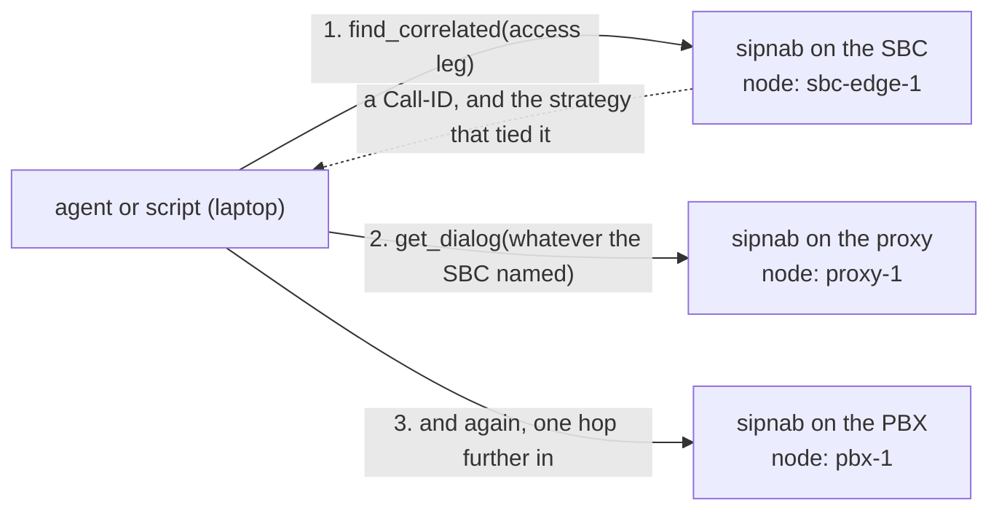

# Run MCP across an estate, not one box

[MCP deployment](mcp-deploy.md) gets one sipnab answering one agent. This page
is what comes after that:

- several SIP servers feeding one capture host,
- an agent that has to reach it from somewhere else,
- one agent holding several capture hosts at once,
- the hardest of them: following a single call as it crosses an SBC, a proxy
  and a PBX that each see a different Call-ID.

These four build on each other in that order. Each one names the SINGLE
sipnab it starts from. So you can stop at whichever answers your question.
Every scenario assumes you have already done
[Install sipnab](mcp-deploy.md#install-sipnab-every-server-once).

---

## Collect captures from several SIP servers in one place

*Central capture host fed by HEP.*

You usually can't (and shouldn't) run a packet-capturing debugger on every
production SIP proxy.

Instead the proxies mirror signaling to one capture host via HEP.
OpenSIPS, Kamailio, and FreeSWITCH all speak it. One sipnab MCP service then
sees calls from the whole estate. The HEP listener is a plain UDP socket:
**no capture privileges, no setcap, fully unprivileged.**

- **[server]** Do [Install sipnab](mcp-deploy.md#install-sipnab-every-server-once)
   and create the user as in the create-the-unprivileged-user step of
   [Keep a capture running between agent sessions](mcp-deploy.md#keep-a-capture-running-between-agent-sessions),
   *without* the `setcap`.

- **[server]** Install `/etc/systemd/system/sipnab-mcp.service`.
   - This variant listens for HEP on udp/9063 and serves MCP on loopback.
   - Pair it with
     [the SSH tunnel](mcp-deploy.md#keep-a-capture-running-without-exposing-a-port).
   - For [the token shape](mcp-deploy.md#keep-a-capture-running-between-agent-sessions)
     instead, use its `--mcp-bind`/token/allowed-host lines:

   ```ini
   [Unit]
   Description=sipnab MCP server (HEP listener)
   After=network-online.target
   Wants=network-online.target

   [Service]
   Type=simple
   ExecStart=/usr/local/bin/sipnab --mcp -N --mcp-transport http \
       --mcp-bind 127.0.0.1:8731 \
       -L 0.0.0.0:9063 --hep-allow 192.0.2.0/24
   User=sipnab
   Group=sipnab
   NoNewPrivileges=true
   ProtectSystem=strict
   PrivateTmp=true
   Restart=on-failure
   RestartSec=5

   [Install]
   WantedBy=multi-user.target
   ```

   Replace `192.0.2.0/24` with the addresses your proxies send HEP from.
   sipnab refuses to start a HEP listener on a routable address unless it
   has one of these:

   - a source allowlist (`--hep-allow`),
   - a shared secret (`--hep-auth-file`).

   ```bash
   sudo systemctl daemon-reload && sudo systemctl enable --now sipnab-mcp
   ```

- **[server]** Open udp/9063 from the proxies' addresses in the host
   firewall.

- **[proxy]** Point each proxy's HEP mirror at the capture host.

   OpenSIPS (3.x) — `opensips.cfg`:

   ```text
   loadmodule "proto_hep.so"
   loadmodule "tracer.so"
   modparam("tracer", "trace_id",
       "[sipnab]uri=hep:capture01.example.net:9063;version=3;transport=udp")
   ```

   and in the main route (traces the dialog's SIP both ways):

   ```text
   trace("sipnab", "t", "sip");
   ```

   Kamailio: use the `siptrace` module with `duplicate_uri` pointed at
   `sip:capture01.example.net:9063` and HEP mode enabled. See the
   [siptrace docs](https://kamailio.org/docs/modules/stable/modules/siptrace.html)
   for the handful of modparams.

- **[server]** Verify HEP is arriving. Place a test call through a
   proxy, then:

   ```bash
   curl -sS http://127.0.0.1:8731/mcp \
     -H "Content-Type: application/json" \
     -H "Accept: application/json, text/event-stream" \
     -d '{"jsonrpc":"2.0","id":1,"method":"initialize","params":{"protocolVersion":"2025-06-18","capabilities":{},"clientInfo":{"name":"curl","version":"0"}}}'
   ```

   Then watch `journalctl -u sipnab-mcp -f`. The listener warns when it
   admits nothing for 30 seconds. The wording tells you which of two
   problems you have:

   - `no packets for 30s` means nothing arrived at all.
     - The HEP sender isn't reaching the `-L` port (firewall, wrong port,
       wrong host).
   - `no packets admitted for 30s ... every one was refused` means the
     sender IS reaching the port and sipnab is turning it away.
     - The line names the reason, such as `auth_mismatch` for a wrong shared
       secret.
     - It also names the peer it came from.
     - Fix the sender's key, `--hep-auth-mode` or the `--hep-allow` list
       rather than the network.

   `--hep-silence-warn` changes the 30 seconds.

   To see each proxy on its own, ask the MCP `hep_senders` tool. It lists:

   - every sender, with its packet count and whether it went silent,
   - every address the listener refused, with the reason.

- **[laptop]** Wire up exactly as the open-the-tunnel and
   register-against-localhost steps of
   [Keep a capture running without exposing a port](mcp-deploy.md#keep-a-capture-running-without-exposing-a-port)
   (or the copy-the-token and verify-the-client-connected steps of
   [Keep a capture running between agent sessions](mcp-deploy.md#keep-a-capture-running-between-agent-sessions)
   for the token shape). Then ask across the
   estate: *"search all proxies' traffic for Call-ID X and render the
   ladder."*

### Coexisting with Homer (or any observability host)

A Homer / heplify-server host already receives HEP from the proxies, so
sipnab can run there. Arrange two things:

- **Port**: heplify-server owns udp/9060. So sipnab takes its own
  (udp/9063 above), and each proxy mirrors to **both** destinations.
  - OpenSIPS: add a second `trace_id` and a second `trace()` call.
  - Kamailio: add a second duplicate destination.
  - If a sender can't dup, put a small UDP fan-out (e.g. socat) in front.
- **Budget**: cap sipnab's footprint with `[limits]` (see
  [Understand the load on a busy server](mcp-deploy.md#understand-the-load-on-a-busy-server)).
  Then the box's primary tenant keeps its headroom.

Other services on the host, such as an OpenTelemetry collector or Prometheus,
need no change. sipnab does not speak OTLP and does not use their ports.

---

## Reach sipnab from outside your network

*Internet-exposed endpoint with nginx TLS in front.*

Use this when agents connect from outside your network and SSH isn't an
option. Keep sipnab on loopback and let nginx own the public endpoint.

- **[server]** Build the loopback service with a token.
   - Use the first three steps of
     [Keep a capture running between agent sessions](mcp-deploy.md#keep-a-capture-running-between-agent-sessions).
   - Then add a unit whose ExecStart binds loopback but keeps auth and allows
     the public hostname. nginx forwards the client's `Host:` header:

   ```ini
   ExecStart=/usr/local/bin/sipnab --mcp -N --mcp-transport http \
       --mcp-bind 127.0.0.1:8731 \
       --mcp-token-file /etc/sipnab/mcp.token \
       --mcp-allowed-host capture.example.com \
       -d eth0
   ```

- **[server]** Install nginx and certbot:

   ```bash
   sudo apt install nginx certbot python3-certbot-nginx
   ```

   Then issue the certificate. certbot does these things:

   - it needs `capture.example.com` already resolving to this host,
   - it asks for a contact address,
   - it rewrites the nginx config in place.

   Run it on its own so you can answer it:

   ```bash
   sudo certbot --nginx -d capture.example.com
   ```

- **[server]** Site config (`/etc/nginx/sites-available/sipnab-mcp`,
   symlink into `sites-enabled`, `sudo nginx -t && sudo systemctl reload
   nginx`):

   ```nginx
   server {
       listen 443 ssl;
       server_name capture.example.com;
       ssl_certificate     /etc/letsencrypt/live/capture.example.com/fullchain.pem;
       ssl_certificate_key /etc/letsencrypt/live/capture.example.com/privkey.pem;

       location /mcp {
           proxy_pass http://127.0.0.1:8731;
           proxy_set_header Host $host;
           proxy_buffering off;          # SSE responses must stream
           proxy_read_timeout 3600s;
       }
   }
   ```

   Set `proxy_buffering off`. The streamable-HTTP transport
   answers with `text/event-stream`, and a buffering proxy stalls it.

- **[server]** Firewall: open tcp/443 only. Port 8731 stays closed to the
   outside.

- **[laptop]** Copy the token as in the copy-the-token step of
   [Keep a capture running between agent sessions](mcp-deploy.md#keep-a-capture-running-between-agent-sessions),
   then:

   ```bash
   claude mcp add --transport http \
     --header "Authorization: Bearer $(cat ~/.config/sipnab/capture.token)" \
     sipnab-prod https://capture.example.com/mcp
   ```

- **[laptop]** Verify with `claude mcp list`. On failure, test the path
   layer by layer:
   - curl against `https://capture.example.com/mcp` from the laptop,
   - then the loopback curl from the verify-locally step of
     [Keep a capture running between agent sessions](mcp-deploy.md#keep-a-capture-running-between-agent-sessions)
     on the server.

---

## Query many capture hosts from one agent

Run one of these on each capture host:

- [the token service](mcp-deploy.md#keep-a-capture-running-between-agent-sessions),
- [the SSH tunnel](mcp-deploy.md#keep-a-capture-running-without-exposing-a-port),
- [the nginx TLS endpoint](#reach-sipnab-from-outside-your-network).

Then give each its own entry in one client config:

- **[each server]** Any persistent wiring above
   ([the token service](mcp-deploy.md#keep-a-capture-running-between-agent-sessions)
   shown here).

- **[laptop]** Register them all. The loop is one command and does nothing
   unless you take the whole of it:

   ```bash
   # Run all of these, in order.
   for h in nyc1 chi1 lax1; do
     claude mcp add --transport http \
       --header "Authorization: Bearer $(cat ~/.config/sipnab/$h.token)" \
       "sipnab-$h" "https://$h.example.net/mcp"
   done
   ```

   Then confirm all three registered:

   ```bash
   claude mcp list
   ```

- **[laptop]** Ask cross-fleet questions. Tool names are namespaced per
   server (`mcp__sipnab-nyc1__list_dialogs`,
   `mcp__sipnab-chi1__list_dialogs`, …). So the agent can fan out:

   > the caller says the 14:02 UTC call dropped. Find its Call-ID on all
   > three sites and compare the ladders.

---

## Follow one call across an SBC and its PBXes

*Federated tracing. Each node keeps its own capture. The agent does the joining.*



The previous section registers several servers. This one is about two things:

- the ORDER to ask them in,
- what the answer is worth.

### Wire up three nodes from one laptop

Three hops means three MCP servers and one client.

- Nothing about the wiring is different from a single node.
  - You register each one.
  - The client namespaces the tools per server.
- What changes is only how the laptop reaches each server.

**The laptop reaches all three directly.** Nothing is between them. So use
[the SSH tunnel shape](mcp-deploy.md#keep-a-capture-running-without-exposing-a-port)
on each node.

- That is a loopback bind plus an SSH tunnel per node.
- It needs no token and opens no port.

Open the tunnels in this order:

- Open the tunnel to the SBC on local port 8811:

   ```bash
   ssh -f -N -L 8811:127.0.0.1:8731 sbc-edge-1.example.net
   ```

- Open the tunnel to the proxy on local port 8812:

   ```bash
   ssh -f -N -L 8812:127.0.0.1:8731 proxy-1.example.net
   ```

- Open the tunnel to the PBX on local port 8813:

   ```bash
   ssh -f -N -L 8813:127.0.0.1:8731 pbx-1.example.net
   ```

The local port differs per node. The remote port does not, because each node
binds its own loopback. Then register the three, in this order:

- Register the SBC:

   ```bash
   claude mcp add --transport http sipnab-sbc   http://127.0.0.1:8811/mcp
   ```

- Register the proxy:

   ```bash
   claude mcp add --transport http sipnab-proxy http://127.0.0.1:8812/mcp
   ```

- Register the PBX:

   ```bash
   claude mcp add --transport http sipnab-pbx   http://127.0.0.1:8813/mcp
   ```

Give each node a `--node-name` that matches how you think of it.

- That string is what comes back in `capture_identity.node`.
- It is the only thing that attributes a fact to a box:

```ini
ExecStart=/usr/local/bin/sipnab --mcp -N --mcp-transport http \
    --mcp-bind 127.0.0.1:8731 --node-name sbc-edge-1 -d eth0
```

**The nodes are behind NAT.** The tunnel commands above still work.

- SSH dials outward from the laptop.
- The tunnel carries the MCP traffic back.
- So there is no inbound rule, no port forward, and no change to the MCP wiring.

One thing does not work against a node behind NAT:
[the token service](mcp-deploy.md#keep-a-capture-running-between-agent-sessions)
(HTTP plus a token). There is no address to put in the URL.

SSH itself may not reach the node. Then the node has to reach out instead.
That means the HEP shape:
[Collect captures from several SIP servers in one place](#collect-captures-from-several-sip-servers-in-one-place).
Then you have one server, not three.

**A jump host sits in the way.** Put the hop in your SSH config rather than in
the sipnab wiring. Every command above then still works word for word:

```text
Host sbc-edge-1.example.net proxy-1.example.net pbx-1.example.net
    ProxyJump bastion.example.net
```

For [the SSH stdio shape](mcp-deploy.md#connect-claude-code-on-your-laptop-to-sipnab-on-a-server), `ssh -J bastion.example.net sbc-edge-1.example.net
/usr/local/bin/sipnab --mcp -N …` does the same thing inline.

The tunnel, NAT and `ProxyJump` steps are the wiring that
[the SSH stdio shape](mcp-deploy.md#connect-claude-code-on-your-laptop-to-sipnab-on-a-server),
[the token service](mcp-deploy.md#keep-a-capture-running-between-agent-sessions)
and [the SSH tunnel](mcp-deploy.md#keep-a-capture-running-without-exposing-a-port)
describe, applied once per node. To try the tracing steps below before you
have three hosts, run three sipnab servers on one machine, each with its own
`--node-name` and capture, as
[Run it against a local server first](mcp-deploy.md#run-it-against-a-local-server-first)
shows.

### Ask the SBC first

The SBC is the only box that saw **both** sides of the call. So its
`find_correlated` result names the core-side Call-ID to look up next.

- Querying the PBXes first means guessing which one took the call.
- It usually means asking all of them.

Following the pointer the SBC returns takes one query per hop. Asking every
PBX takes one query per PBX, and each agent round trip costs model time.

Ask it first even when you expect the box to stay a proxy on this call.

- If it did, `find_correlated` returns nothing. You carry the same Call-ID
  inward, which costs one query.
- If it did not, you now hold the identifier the next hop knows the call by.

[Read what matched, because the topology is not fixed](#read-what-matched-because-the-topology-is-not-fixed)
is about telling those two apart.

### Read what matched, because the topology is not fixed

**An SBC or proxy may act as a back-to-back user agent (B2BUA) on one call
and as a proxy on the next.** Whether it re-originates a call depends on the
call type, the endpoints and its configuration, which can change. Do not choose
a correlation strategy in advance. Ask the same question every time,
`find_correlated` on the leg you have, and read which topology the answer
shows:

- **A call that stayed in proxy mode keeps its Call-ID across the hop.**
  - Nothing correlates, because there is nothing to correlate *to*.
  - The same identifier is simply present on the next node.
  - `find_correlated` returning zero legs is not a failure here. It is the
    finding.
- **A call that went back-to-back gets a new Call-ID**, and `strategy` names what
  tied the two together, or admits to a guess.

Every leg carries the strategy that matched it. The strategies are not
degrees of one thing:

| `strategy` | Crosses a B2BUA? | What a match is worth | `identifier_match` |
|---|---|---|---|
| `session_id` | **Yes, by design** ([RFC 7989](https://www.rfc-editor.org/rfc/rfc7989.html)) | An identifier both ends agreed on | `true` |
| `x_call_id` | Only if the box inserts it | An identifier, by vendor convention | `true` |
| `charging_vector_related_icid` | **Yes** — but only when the B2BUA chose to emit it ([RFC 7315](https://www.rfc-editor.org/rfc/rfc7315.html) makes it a `MAY`) | The intermediary declared the link itself, in the parameter the RFC provides for it | `true` |
| `sdp_origin` | Only if the box forwards SDP untouched | An identifier of the MEDIA session, not the dialog | `true` |
| `charging_vector_icid` | Not by design — an ICID names ONE dialog and a B2BUA is two | An intermediary carried a per-dialog identifier onto a second dialog | `true` |
| `via_branch` | **No** — a B2BUA opens a new transaction | Same transaction, so: same hop, not across one | `true` |
| `timing_heuristic` | No | A guess from endpoint overlap and elapsed time | `false` |

The rows are in descending score. sipnab reports a leg that satisfies two
strategies under the higher-scoring one.

Four fields decide how much of that tree you should act on:

| Field | Read it as |
|---|---|
| `strategy` | Which of the seven above matched, per leg |
| `identifier_match` | `true`: two ends agreed on an identifier. `false`: a guess |
| `heuristic_only` | `true`: **every** returned leg rests on a guess, so the whole tree is a hypothesis |
| `timing_clock` | Present only when the answer contains a time-based match. Absent means no leg needed one |

sipnab omits `timing_clock` when every leg matched on an identifier, because
the clock does not affect an identifier match.

**Check the clock before believing a `timing_heuristic` match across nodes.**
The window is two seconds unless `--leg-correlation-window` says otherwise.
The failure is silent in both directions:

- a fast clock misses legs that belong together,
- a slow one pulls unrelated calls in.

`timing_clock` reports the answering node's NTP discipline at the moment of the
query (`synchronized`, `max_error_us`, `est_error_us`, `available`).
`capture_health` reports the same under `clock`, for any node you want to check
without running a correlation.

- `synchronized: false` means treat the tree as a hypothesis.
- `synchronized: true` with a `max_error_us` approaching the two-second window
  means the same thing.
  - The flag says a time daemon is disciplining the clock.
  - It does not say the clock is accurate to within the window you are
    matching in.

#### Compare the two answers to the same question

Both transcripts below come from the script in
[Drive it from a script](mcp-deploy.md#drive-it-from-a-script), run against
sipnab servers on one host reading
[`tests/pcap-samples/`](https://github.com/NormB/sipnab/tree/main/tests/pcap-samples).

**The hop stayed a proxy.** This run adds a fourth server, a PBX node that
holds the same call as the proxy node:

```bash
./target/debug/sipnab -N --mcp --mcp-transport http --mcp-bind 127.0.0.1:8824 \
    --node-name pbx-2 -I tests/pcap-samples/sip-proxy.pcap &
```

Then query the proxy node and that PBX node for the same Call-ID:

```bash
python3 contrib/mcp/trace-call.py \
    --node proxy=http://127.0.0.1:8822 \
    --node pbx=http://127.0.0.1:8824 \
    --call-id proxied-call-synth@192.0.2.101
```

Zero legs come back, and the Call-ID is present unchanged on the next node.
That is proxy mode, not a lost call:

```text
[proxy] sipnab 0.5.222 node=proxy-1
[pbx] sipnab 0.5.222 node=pbx-2
[proxy] 0 leg(s) correlated to proxied-call-synth@192.0.2.101
  (nothing correlated: a call that stayed in proxy mode keeps its
   Call-ID, so ask the other nodes for the SAME id.)
[pbx] holds proxied-call-synth@192.0.2.101  (node=pbx-2, state=Completed, 11 msgs)
```

**The hop went back-to-back.** The SBC node reads `b2bua-asterisk.pcapng`:

```bash
python3 contrib/mcp/trace-call.py \
    --node sbc=http://127.0.0.1:8811 \
    --node proxy=http://127.0.0.1:8822 \
    --node pbx=http://127.0.0.1:8823
```

A leg comes back. The strategy names a guess from a 3 ms gap and a shared
endpoint. No identifier crossed the box:

```text
[sbc] sipnab 0.5.222 node=sbc-edge-1
[proxy] sipnab 0.5.222 node=proxy-1
[pbx] sipnab 0.5.222 node=pbx-1
[sbc] 1 leg(s) correlated to b2bua-leg-synth@203.0.113.101:5060
  b2bua-caller-synth@203.0.113.1
      via timing_heuristic [GUESS] score 50, gap 3ms
  !! every leg was a timing guess, not an identifier match.
     clock on sbc: synchronized=True max_error_us=724500
     The window is 2s. Skew larger than that invents legs and hides legs.
```

Do not act on the second result as proof. The leg has a Call-ID, a score and a
3 ms gap, but `identifier_match` is `false` and `heuristic_only` is `true`. Two
unrelated calls through the same SBC inside the same window produce the same
output.

Read `max_error_us` on every run. It is the clock's current error bound, and
it changes between runs while `synchronized` stays `True`. When it approaches
or exceeds the 2 s correlation window, the clock error alone can explain the
match.

### Check what federation cannot prove

Take a box that emits no `Session-ID` and no `X-Call-ID`, and re-originates
SDP. Then **nothing in the signaling proves the two legs are one call**.

- sipnab reports such a match as a timing guess, never as an identifier match.
- Configuring the box to insert a correlation identifier is the fix.
  [Choose a correlation identifier](#choose-a-correlation-identifier) covers the
  options.
- sipnab only observes traffic and cannot add a header.

**These answers carry `capture_identity`:** `list_dialogs`, `find_problems`,
`search_messages`, `search_by_time`, `rtp_stats`, `aggregate_dialogs`,
`group_dialogs`, `top_talkers`, `timeline`, `describe_endpoint`,
`runtime_stats`, `get_capture_report`, `capture_status`,
`tail_dialogs`, `await_condition`, `security_findings`, `get_dialog`,
`get_dialog_report`, `get_message`, `get_call_tree`, `get_sdp_timeline`,
`triage_call`, `lint_dialog`, `validate_message`, `find_correlated`,
`check_codec_negotiation`, `diagnose_registration`, `media_diagnostics`,
`siprec_metadata`, `compare_dialogs`, `validate_filter`, `export_vcon`,
`validate_vcon`, `generate_wireshark_filter`, `explain_attribution`,
`reconcile_orphans` and `evaluate_expectations`. Some cases differ:

| Answer | Where the identity is |
|---|---|
| `capture_health` | Nowhere. Its response holds no strings, so that it cannot carry packet content. |
| `get_capture_report` with `format: "yang-json"` | In the second content block, beside the document. RFC 7951 allows no other member at the top of the document. |
| `get_capture_report` or `get_dialog_report` with `format: "markdown"` or `"text"`, and `render_ladder` | Nowhere. These answer with text, not a JSON object. |
| `validate_vcon` with `container` | Nowhere. A container you supply did not come from this capture. With `call_id` the answer carries it. |

With three servers registered, a fact such as "answered 407" needs the node
that reported it. Per-message answers also carry a `frame` pointer
(`tests/pcap-samples/sip-proxy.pcap#0@a57665bcdb62f03a`), which names the
capture file the message came from rather than the node.

### Choose a correlation identifier

The back-to-back transcript above ends in a guess. To get an identifier match
instead, give the call an identifier that survives the hop. There are three
options.

**1. Configure the SBC, proxy and PBX to insert one. Do this.** RFC 7989
`Session-ID` exists for exactly this problem.

- It is a *pair* of UUIDs, one contributed by each endpoint.
- Each side reports the pair from its own point of view.
- So it survives a box that rewrites Call-ID, From tag and Via.

sipnab already reads it. It matches the two halves in either order, because
they swap direction across a B2BUA, and reports `strategy: session_id` with
`identifier_match: true`.

Nothing on the sipnab side needs changing. Enable `Session-ID` on each box,
and later traces return identifier matches.

**2. Use an identifier the network already carries.** This is what `x_call_id`,
`sdp_origin` and the two `P-Charging-Vector` strategies are. sipnab is already
looking for them. You get an identifier match today with no configuration at
all if any of these is true:

- your SBC emits `X-Call-ID` by vendor convention,
- it forwards SDP untouched so the
  [RFC 8866](https://www.rfc-editor.org/rfc/rfc8866.html) origin tuple survives,
- it sits in a carrier network where RFC 7315 charging headers are on the wire
  anyway.

Check before you plan work. Run `find_correlated` on a known B2BUA call and see
what `strategy` comes back.

Three limits:

- `sdp_origin` identifies the *media session* rather than the dialog.
  So it goes away the moment anything re-originates SDP.
- `via_branch` is an identifier match, but it never crosses a B2BUA. A
  back-to-back user agent opens a new transaction by definition.
- `charging_vector_icid` is the weaker of the two charging strategies. The
  reason is the one the note below gives.
  - A conformant B2BUA gives each of its two dialogs its own icid.
  - So plain equality across one is a vendor behavior rather than something
    the RFC promises.

**3. A sipnab-computed identifier on each node is not available.** sipnab only
observes traffic and cannot insert a header. Across a re-originating B2BUA,
Call-ID, From tag, Via branch, Contact and usually the SDP are all new on the
far side, so a value computed from what each node sees can differ between
nodes. sipnab reports such cases as `timing_heuristic` with `heuristic_only`
set, rather than as an identifier match.

> **For IMS and carrier readers: sipnab reads `P-Charging-Vector` in two
> strategies, and the difference between them decides whether it helps you.**
>
> - [RFC 7315 section 4.6](https://www.rfc-editor.org/rfc/rfc7315.html#section-4.6)
>   says the ICID identifies *a dialog*.
> - A B2BUA is two dialogs.
> - So a conformant B2BUA emits a **different** `icid-value` on each side.
> - So plain `icid-value` equality does **not** solve the re-origination case.
>
> What crosses that hop is the separate `related-icid` parameter
> ([RFC 7315 section 4.6.4.1](https://www.rfc-editor.org/rfc/rfc7315.html#section-4.6.4.1)).
>
> - Its value is the icid of the original dialog.
> - The B2BUA *MAY* emit it rather than must.
>
> So:
>
> * `charging_vector_related_icid` (95): the intermediary declared the link.
>   This is the one that crosses a B2BUA, and only when the box chose to send it.
> * `charging_vector_icid` (85): the two legs carry the same `icid-value`.
>   Useful where it happens, and it means some intermediary copied a per-dialog
>   identifier onto a second dialog. No RFC grants that.
>
> Two further limits come from the RFC:
>
> - The first proxy generates the icid
>   ([RFC 7315 section 5.6](https://www.rfc-editor.org/rfc/rfc7315.html#section-5.6)).
>   - So the leg arriving from an endpoint carries none.
>   - So this is useless at the access edge.
> - [RFC 7315 section 4.6.2.2](https://www.rfc-editor.org/rfc/rfc7315.html#section-4.6.2.2)
>   permits the next hop to *"modify the contents"*.
>   - [RFC 7315 section 6.6](https://www.rfc-editor.org/rfc/rfc7315.html#section-6.6)
>     calls that normal behavior.
>   - There is no end-to-end constancy requirement of any kind.
>   - So this is not a substitute for `Session-ID`.
>
> Full argument, including what is still
> unverified: [`docs/design/icid-correlation.md`](design/icid-correlation.md).

### Choose between federated and centralized

Both work. Choose by where packet data may live.

| | Federated (this section) | Centralized (HEP) |
|---|---|---|
| Setup | Register N servers with the client | `--hep-send` on each node into one `--hep-listen` collector |
| Packet data | Never leaves the node | Concentrates on the collector |
| Correlation | Agent joins the answers | One store, `find_correlated` runs unchanged |
| Cost | More round trips, one per node | Bandwidth, and a PII decision |

To centralize, see
[Collect captures from several SIP servers in one place](#collect-captures-from-several-sip-servers-in-one-place).
sipnab can run beside a Homer installation, as
[Coexisting with Homer](#coexisting-with-homer-or-any-observability-host)
describes.