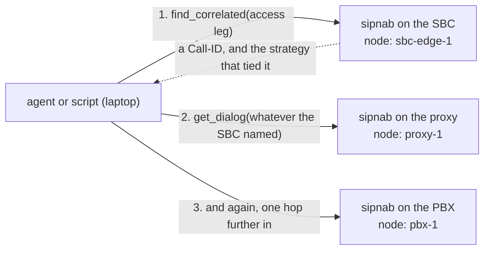

# Run MCP across an estate, not one box

[MCP deployment](mcp-deploy.md) gets one sipnab answering one agent. This page
is what comes after that:

- several SIP servers feeding one capture host,
- an agent that has to reach it from somewhere else,
- one agent holding several capture hosts at once,
- the hardest of them: following a single call as it crosses an SBC, a proxy
  and a PBX that each see a different Call-ID,
- managing the sipnab instances themselves: which build and configuration
  each one runs, and which ones do not answer.

The first four build on each other in that order. Each one names the SINGLE
sipnab it starts from. So you can stop at whichever answers your question.
Every scenario assumes you have already done
[Install sipnab](mcp-deploy.md#install-sipnab-every-server-once).

## Before you start

- **A sipnab binary with the `mcp-http` feature** on every capture host, and
  the `hep` feature on a host that receives HEP. `sipnab --version` lists the
  features, and the release binaries carry both.
- **`curl` and `jq`** on the capture host, for the checks.
- **An MCP client** on the laptop. The steps use Claude Code.
- **Root on each capture host,** to install a systemd unit and a firewall
  rule.

Each scenario changes more than the capture host:

| Scenario | Change on the other system |
|---|---|
| Captures from several SIP servers | Each proxy needs its HEP tracing pointed at the capture host. The firewall of the capture host needs a rule for the HEP port |
| Reach sipnab from outside | DNS needs a name for the capture host. Its firewall needs tcp/443 open. The laptop needs the token |
| Many capture hosts, one agent | The laptop needs one registration and one token for each host |
| One call across an SBC and its PBXes | The laptop needs an SSH account on each node, or a token for each |

---

## Collect captures from several SIP servers in one place

*Central capture host fed by HEP.*

You usually can't (and shouldn't) run a packet-capturing debugger on every
production SIP proxy.

Instead the proxies mirror signaling to one capture host via HEP.
OpenSIPS, Kamailio, and FreeSWITCH all speak it. One sipnab MCP service then
sees calls from the whole estate. The HEP listener is a plain UDP socket:
**no capture privileges, no setcap, fully unprivileged.**

- **[server]** Do [Install sipnab](mcp-deploy.md#install-sipnab-every-server-once)
   and create the user as in the create-the-unprivileged-user step of
   [Keep a capture running between agent sessions](mcp-deploy.md#keep-a-capture-running-between-agent-sessions).
   The unit below has no `AmbientCapabilities=` line: a HEP listener needs none.

- **[server]** Install `/etc/systemd/system/sipnab-mcp.service`.
   - This variant listens for HEP on udp/9063 and serves MCP on loopback.
   - Pair it with
     [the SSH tunnel](mcp-deploy.md#keep-a-capture-running-without-exposing-a-port).
   - For [the token shape](mcp-deploy.md#keep-a-capture-running-between-agent-sessions)
     instead, use its `--mcp-bind`/token/allowed-host lines:

   ```ini
   [Unit]
   Description=sipnab MCP server (HEP listener)
   After=network-online.target
   Wants=network-online.target

   [Service]
   Type=simple
   ExecStart=/usr/local/bin/sipnab --mcp -N --mcp-transport http \
       --mcp-bind 127.0.0.1:8731 \
       -L 0.0.0.0:9063 --hep-allow 192.0.2.0/24
   User=sipnab
   Group=sipnab
   NoNewPrivileges=true
   ProtectSystem=strict
   PrivateTmp=true
   Restart=on-failure
   RestartSec=5

   [Install]
   WantedBy=multi-user.target
   ```

   Replace `192.0.2.0/24` with the addresses your proxies send HEP from.
   sipnab refuses to start a HEP listener on a routable address unless it
   has one of these:

   - a source allowlist (`--hep-allow`),
   - a shared secret (`--hep-auth-file`).

   ```bash
   sudo systemctl daemon-reload && sudo systemctl enable --now sipnab-mcp
   ```

- **[server]** Open udp/9063 to the proxies' addresses in the host
   firewall. With nftables, on a host whose `table inet filter` has an `input`
   chain (Debian's default `/etc/nftables.conf` has one):

   ```bash
   sudo nft add rule inet filter input ip saddr 192.0.2.0/24 udp dport 9063 accept
   ```

   Add the same rule to `/etc/nftables.conf` to keep it after a reboot. A
   packet the firewall drops never reaches sipnab, so the sender roster below
   does not list it, not even as refused. This rule ran on Debian 13 with
   nftables 1.1.3, with the chain's policy set to `drop`: the allowed sender's
   packets arrived, and a sender outside the range sent 10 that never appeared.
   This page tested no other firewall.

- **[proxy]** Point each proxy's HEP mirror at the capture host. Give each
   proxy its own capture id, so the roster tells them apart.

   OpenSIPS (tested with 3.6.9) — `opensips.cfg`. OpenSIPS needs a `hep_udp`
   socket to send HEP from, and refuses to start without one (`No HEP
   listener defined!`):

   ```text
   socket=hep_udp:0.0.0.0:6061

   loadmodule "proto_hep.so"
   modparam("proto_hep", "hep_id", "[sipnab] capture01.example.net:9063; transport=udp; version=3")
   modparam("proto_hep", "hep_capture_id", 102)
   loadmodule "tracer.so"
   modparam("tracer", "trace_id", "[tid]uri=hep:sipnab")
   ```

   and in the main route, to send each transaction's requests and replies:

   ```text
   trace("tid", "t", "sip");
   ```

   OpenSIPS 3.6.9 refuses the one-line form
   `"[sipnab]uri=hep:capture01.example.net:9063;version=3;transport=udp"` with
   `Invalid key <version> in trace id!`: put the address in `hep_id` as above.
   [Add Homer to your voice stack](homer.md) explains each line.
   [Collect and forward HEP](hep.md#have-your-sip-server-send-hep) shows the
   OpenSIPS 4.0 form, which traces each call's whole dialog, and the page
   gives the TCP and TLS forms.

   Kamailio (tested with 6.1.4) — `kamailio.cfg`:

   ```text
   loadmodule "siptrace.so"
   modparam("siptrace", "duplicate_uri", "sip:192.0.2.50:9063")
   modparam("siptrace", "hep_mode_on", 1)
   modparam("siptrace", "hep_version", 3)
   modparam("siptrace", "hep_capture_id", 101)
   modparam("siptrace", "trace_to_database", 0)
   modparam("siptrace", "trace_on", 1)
   modparam("siptrace", "trace_mode", 1)
   ```

   Put the capture host's address in `duplicate_uri`, `192.0.2.50` here.
   Kamailio resolves a name there through DNS: with
   `sip:capture01.example.net:9063` and the name only in `/etc/hosts`, it sent
   nothing and logged `could not resolve hostname: "capture01.example.net"`.
   `trace_mode 1` sends every message with no call in the script. Kamailio
   sends to one `duplicate_uri`: with two lines, only the last one received
   anything in the test.

- **[server]** Verify HEP is arriving. Send any request through a proxy,
   then ask the MCP `hep_senders` tool which senders the listener admitted.
   MCP over HTTP needs a session, so this takes three requests:

   ```bash
   # Run all of these, in order.
   U=http://127.0.0.1:8731/mcp
   H='Accept: application/json, text/event-stream'
   SID=$(curl -sS -D - -o /dev/null "$U" -H 'Content-Type: application/json' -H "$H" \
     -d '{"jsonrpc":"2.0","id":1,"method":"initialize","params":{"protocolVersion":"2025-06-18","capabilities":{},"clientInfo":{"name":"curl","version":"0"}}}' \
     | tr -d '\r' | awk -F': ' 'tolower($1)=="mcp-session-id"{print $2}')
   curl -sS -o /dev/null "$U" -H 'Content-Type: application/json' -H "$H" -H "Mcp-Session-Id: $SID" \
     -d '{"jsonrpc":"2.0","method":"notifications/initialized"}'
   curl -sS "$U" -H 'Content-Type: application/json' -H "$H" -H "Mcp-Session-Id: $SID" \
     -d '{"jsonrpc":"2.0","id":2,"method":"tools/call","params":{"name":"hep_senders","arguments":{}}}' \
     | sed -n 's/^data: //p' | jq -c '.result.structuredContent.senders[] | {source, packets, silent}'
   ```

   One line per proxy that reached the listener, named by the capture id it
   claims and its address. With the Kamailio and OpenSIPS above, each sent one
   OPTIONS and its reply:

   ```text
   {"source":"hep:101@172.31.250.20","packets":2,"silent":true}
   {"source":"hep:102@172.31.250.21","packets":2,"silent":false}
   ```

   The capture id in `source` is the one the sender claims: `hep_capture_id`
   on OpenSIPS and Kamailio, `--hep-id` on a sipnab sender. It is not the
   capture host's `--node-name`, which names the box sipnab runs on in its own
   answers (`capture_identity.node`).

   `silent` is `true` for a sender that has sent nothing for 30 seconds. The
   same answer lists every address the listener refused, under
   `refused_sources`, with the reason. A proxy missing from both lists did not
   reach the port: check its configuration and the firewall.

   The journal says the same in one line when the whole listener goes quiet.
   The listener warns when it admits nothing for 30 seconds
   (`journalctl -u sipnab-mcp -f`), and the wording tells you which of two
   problems you have:

   - `no packets for 30s` means nothing arrived at all.
     - The HEP sender isn't reaching the `-L` port (firewall, wrong port,
       wrong host).
   - A line such as `HEP listener on 0.0.0.0:9060: no packets admitted for 30s — 30 arrived and every one was refused, mostly auth_mismatch (the auth key does not match this listener's secret), the last of those from 192.0.2.7; the sender is reaching this port and being turned away; capture is still listening`
     means the sender IS reaching the port and sipnab is turning it away.
     - The line names the reason, such as `auth_mismatch` for a wrong shared
       secret.
     - It also names the peer it came from.
     - Fix the sender's key, `--hep-auth-mode` or the `--hep-allow` list
       rather than the network.

   `--hep-silence-warn` changes the 30 seconds.

- **[server]** Size the listener for the estate. These are the limits a
   busy estate meets first, with their defaults:

   | Limit | Default | Where it shows when reached |
   |---|---|---|
   | `--hep-rate-limit` | 50000 packets a second, all senders together | `refused_by_reason.rate_limit_global` |
   | `--hep-rate-limit-per-peer` | off | `refused_by_reason.rate_limit_per_peer` |
   | `[limits] max_tracked_peers` | 4096 distinct sender addresses in one second | `refused_by_reason.peer_tracking_full` |

   All three counters are in the `hep_senders` answer above. This page
   measured no packet rate a listener sustains: watch the counters on your
   own traffic, and see [Keep a long-running capture inside a memory
   budget](examples.md#keep-a-long-running-capture-inside-a-memory-budget)
   for what the run holds in memory.

- **[laptop]** Wire up exactly as the open-the-tunnel and
   register-against-localhost steps of
   [Keep a capture running without exposing a port](mcp-deploy.md#keep-a-capture-running-without-exposing-a-port)
   (or the copy-the-token and verify-the-client-connected steps of
   [Keep a capture running between agent sessions](mcp-deploy.md#keep-a-capture-running-between-agent-sessions)
   for the token shape). Then ask across the
   estate: *"search all proxies' traffic for Call-ID X and render the
   ladder."*

### Coexisting with Homer (or any observability host)

A Homer / heplify-server host already receives HEP from the proxies, so
sipnab can run there. Arrange two things:

- **Port**: heplify-server owns udp/9060. So sipnab takes its own
  (udp/9063 above), and each proxy mirrors to **both** destinations.
  - OpenSIPS: add a second `trace_id` and a second `trace()` call.
  - Kamailio's `siptrace` sends to one `duplicate_uri`, and a second one
    replaces the first. [Connect sipnab to Homer](homer-sipnab.md#sipnab-as-a-second-receiver)
    gives the two ways to run sipnab beside Homer with Kamailio.
  - If a sender can't dup, put a small UDP fan-out (e.g. socat) in front.
- **Budget**: cap sipnab's footprint with `[limits]` (see
  [Understand the load on a busy server](mcp-deploy.md#understand-the-load-on-a-busy-server)).
  Then the box's primary tenant keeps its headroom.

Other services on the host, such as an OpenTelemetry collector or Prometheus,
need no change. sipnab does not speak OTLP and does not use their ports.

---

## Reach sipnab from outside your network

*Internet-exposed endpoint with nginx TLS in front.*

Use this when agents connect from outside your network and SSH isn't an
option. Keep sipnab on loopback and let nginx own the public endpoint.

- **[server]** Build the loopback service with a token.
   - Use the first three steps of
     [Keep a capture running between agent sessions](mcp-deploy.md#keep-a-capture-running-between-agent-sessions).
   - Then add a unit whose ExecStart binds loopback but keeps auth and allows
     the public hostname. nginx forwards the client's `Host:` header:

   ```ini
   ExecStart=/usr/local/bin/sipnab --mcp -N --mcp-transport http \
       --mcp-bind 127.0.0.1:8731 \
       --mcp-token-file /etc/sipnab/mcp.token \
       --mcp-allowed-host capture.example.com \
       -d eth0
   ```

- **[server]** Install nginx and certbot:

   ```bash
   sudo apt install nginx certbot python3-certbot-nginx
   ```

   Then issue the certificate. certbot does these things:

   - it needs `capture.example.com` already resolving to this host,
   - it asks for a contact address,
   - it rewrites the nginx config in place.

   Run it on its own so you can answer it:

   ```bash
   sudo certbot --nginx -d capture.example.com
   ```

- **[server]** Site config (`/etc/nginx/sites-available/sipnab-mcp`,
   symlink into `sites-enabled`, `sudo nginx -t && sudo systemctl reload
   nginx`):

   ```nginx
   server {
       listen 443 ssl;
       server_name capture.example.com;
       ssl_certificate     /etc/letsencrypt/live/capture.example.com/fullchain.pem;
       ssl_certificate_key /etc/letsencrypt/live/capture.example.com/privkey.pem;

       location /mcp {
           proxy_pass http://127.0.0.1:8731;
           proxy_set_header Host $host;
           proxy_buffering off;          # SSE responses must stream
           proxy_read_timeout 3600s;
       }
   }
   ```

   Set `proxy_buffering off`. The streamable-HTTP transport
   answers with `text/event-stream`, and a buffering proxy stalls it.

- **[server]** Firewall: open tcp/443 only. Port 8731 stays closed to the
   outside.

- **[laptop]** Copy the token as in the copy-the-token step of
   [Keep a capture running between agent sessions](mcp-deploy.md#keep-a-capture-running-between-agent-sessions),
   then:

   ```bash
   claude mcp add --transport http \
     --header "Authorization: Bearer $(cat ~/.config/sipnab/capture.token)" \
     sipnab-prod https://capture.example.com/mcp
   ```

- **[laptop]** Verify with `claude mcp list`. On failure, test the path
   layer by layer:
   - curl against `https://capture.example.com/mcp` from the laptop,
   - then the loopback curl from the verify-locally step of
     [Keep a capture running between agent sessions](mcp-deploy.md#keep-a-capture-running-between-agent-sessions)
     on the server.

---

## Query many capture hosts from one agent

Run one of these on each capture host:

- [the token service](mcp-deploy.md#keep-a-capture-running-between-agent-sessions),
- [the SSH tunnel](mcp-deploy.md#keep-a-capture-running-without-exposing-a-port),
- [the nginx TLS endpoint](#reach-sipnab-from-outside-your-network).

Then give each its own entry in one client config:

- **[each server]** Any persistent wiring above
   ([the token service](mcp-deploy.md#keep-a-capture-running-between-agent-sessions)
   shown here).

- **[laptop]** Register them all. The loop is one command and does nothing
   unless you take the whole of it:

   ```bash
   # Run all of these, in order.
   for h in nyc1 chi1 lax1; do
     claude mcp add --transport http \
       --header "Authorization: Bearer $(cat ~/.config/sipnab/$h.token)" \
       "sipnab-$h" "https://$h.example.net/mcp"
   done
   ```

   Then confirm all three registered:

   ```bash
   claude mcp list
   ```

- **[laptop]** Ask cross-fleet questions. Tool names are namespaced per
   server, such as `mcp__sipnab-nyc1__list_dialogs` and
   `mcp__sipnab-chi1__list_dialogs`. So the agent can fan out:

   > the caller says the 14:02 UTC call dropped. Find its Call-ID on all
   > three sites and compare the ladders.

---

## Follow one call across an SBC and its PBXes

*Federated tracing. Each node keeps its own capture. The agent does the joining.*



The previous section registers several servers. This one is about two things:

- the ORDER to ask them in,
- what the answer is worth.

### Wire up three nodes from one laptop

Three hops means three MCP servers and one client.

- Nothing about the wiring is different from a single node.
  - You register each one.
  - The client namespaces the tools per server.
- What changes is only how the laptop reaches each server.

**The laptop reaches all three directly.** Nothing is between them. So use
[the SSH tunnel shape](mcp-deploy.md#keep-a-capture-running-without-exposing-a-port)
on each node.

- That is a loopback bind plus an SSH tunnel per node.
- It needs no token and opens no port.

Open the tunnels in this order:

- Open the tunnel to the SBC on local port 8811:

   ```bash
   ssh -f -N -L 8811:127.0.0.1:8731 sbc-edge-1.example.net
   ```

- Open the tunnel to the proxy on local port 8812:

   ```bash
   ssh -f -N -L 8812:127.0.0.1:8731 proxy-1.example.net
   ```

- Open the tunnel to the PBX on local port 8813:

   ```bash
   ssh -f -N -L 8813:127.0.0.1:8731 pbx-1.example.net
   ```

The local port differs per node. The remote port does not, because each node
binds its own loopback. Then register the three, in this order:

- Register the SBC:

   ```bash
   claude mcp add --transport http sipnab-sbc   http://127.0.0.1:8811/mcp
   ```

- Register the proxy:

   ```bash
   claude mcp add --transport http sipnab-proxy http://127.0.0.1:8812/mcp
   ```

- Register the PBX:

   ```bash
   claude mcp add --transport http sipnab-pbx   http://127.0.0.1:8813/mcp
   ```

Give each node a `--node-name` that matches how you think of it.

- That string is what comes back in `capture_identity.node`.
- It is the only thing that attributes a fact to a box.
- This `ExecStart=` captures `eth0`, so it belongs in a unit that grants
  capture, such as the one in
  [Keep a capture running between agent sessions](mcp-deploy.md#keep-a-capture-running-between-agent-sessions):

```ini
ExecStart=/usr/local/bin/sipnab --mcp -N --mcp-transport http \
    --mcp-bind 127.0.0.1:8731 --node-name sbc-edge-1 -d eth0
```

**The nodes are behind NAT.** The tunnel commands above still work.

- SSH dials outward from the laptop.
- The tunnel carries the MCP traffic back.
- So there is no inbound rule, no port forward, and no change to the MCP wiring.

One thing does not work against a node behind NAT:
[the token service](mcp-deploy.md#keep-a-capture-running-between-agent-sessions)
(HTTP plus a token). There is no address to put in the URL.

SSH itself may not reach the node. Then the node has to reach out instead.
That means the HEP shape:
[Collect captures from several SIP servers in one place](#collect-captures-from-several-sip-servers-in-one-place).
Then you have one server, not three.

**A jump host sits in the way.** Put the hop in your SSH config rather than in
the sipnab wiring. Every command above then still works word for word:

```text
Host sbc-edge-1.example.net proxy-1.example.net pbx-1.example.net
    ProxyJump bastion.example.net
```

For [the SSH stdio shape](mcp-deploy.md#connect-claude-code-on-your-laptop-to-sipnab-on-a-server), `ssh -J bastion.example.net sbc-edge-1.example.net
/usr/local/bin/sipnab --mcp -N -d eth0 --quiet` does the same thing inline.

The tunnel, NAT and `ProxyJump` steps are the wiring that
[the SSH stdio shape](mcp-deploy.md#connect-claude-code-on-your-laptop-to-sipnab-on-a-server),
[the token service](mcp-deploy.md#keep-a-capture-running-between-agent-sessions)
and [the SSH tunnel](mcp-deploy.md#keep-a-capture-running-without-exposing-a-port)
describe, applied once per node. To try the tracing steps below before you
have three hosts, run three sipnab servers on one machine, each with its own
`--node-name` and capture, as
[Run it against a local server first](mcp-deploy.md#run-it-against-a-local-server-first)
shows.

### Ask the SBC first

The SBC is the only box that saw **both** sides of the call. So its
`find_correlated` result names the core-side Call-ID to look up next.

- Querying the PBXes first means guessing which one took the call.
- It usually means asking all of them.

Following the pointer the SBC returns takes one query per hop. Asking every
PBX takes one query per PBX, and each agent round trip costs model time.

Ask it first even when you expect the box to stay a proxy on this call.

- If it did, `find_correlated` returns nothing. You carry the same Call-ID
  inward, which costs one query.
- If it did not, you now hold the identifier the next hop knows the call by.

[Read what matched, because the topology is not fixed](#read-what-matched-because-the-topology-is-not-fixed)
is about telling those two apart.

### Read what matched, because the topology is not fixed

**An SBC or proxy may act as a back-to-back user agent (B2BUA) on one call
and as a proxy on the next.** Whether it re-originates a call depends on the
call type, the endpoints and its configuration, which can change. Do not choose
a correlation strategy in advance. Ask the same question every time,
`find_correlated` on the leg you have, and read which topology the answer
shows:

- **A call that stayed in proxy mode keeps its Call-ID across the hop.**
  - Nothing correlates, because there is nothing to correlate *to*.
  - The same identifier is simply present on the next node.
  - `find_correlated` returning zero legs is not a failure here. It is the
    finding.
- **A call that went back-to-back gets a new Call-ID**, and `strategy` names what
  tied the two together, or admits to a guess.

Every leg carries the strategy that matched it. The strategies are not
degrees of one thing:

| `strategy` | Crosses a B2BUA? | What a match is worth | `identifier_match` |
|---|---|---|---|
| `session_id` | **Yes, by design** ([RFC 7989](https://www.rfc-editor.org/rfc/rfc7989.html)) | An identifier both ends agreed on | `true` |
| `th_callid_decoded` | **Yes**, through OpenSIPS `topology_hiding("C")` with the secret configured ([how](opensips-sipnab.md#calls-through-topology-hiding)) | The hidden Call-ID decodes to the other leg's, and the From tags match | `true` |
| `th_callid_mapping` | **Yes**, through OpenSIPS `topology_hiding("C")` with the script change | OpenSIPS named both Call-IDs in an `E_SIPNAB_TH_MAP` event | `true` |
| `x_call_id` | Only if the box inserts a header holding the other leg's Call-ID, **and** `[sip] xcid_headers` names that header ([how](follow-a-call.md#copy-the-callers-call-id-into-a-header)) | An identifier the operator configured | `true` |
| `charging_vector_related_icid` | **Yes** — but only when the B2BUA chose to emit it ([RFC 7315](https://www.rfc-editor.org/rfc/rfc7315.html) makes it a `MAY`) | The intermediary declared the link itself, in the parameter the RFC provides for it | `true` |
| `sdp_origin` | Only if the box forwards SDP untouched | An identifier of the MEDIA session, not the dialog | `true` |
| `charging_vector_icid` | Not by design — an ICID names ONE dialog and a B2BUA is two | An intermediary carried a per-dialog identifier onto a second dialog | `true` |
| `via_branch` | **No** — a B2BUA opens a new transaction | Same transaction, so: same hop, not across one | `true` |
| `timing_heuristic` | No | A guess from endpoint overlap and elapsed time | `false` |

The rows are in descending score. sipnab reports a leg that satisfies two
strategies under the higher-scoring one.

Five fields decide how much of that tree you should act on:

| Field | Read it as |
|---|---|
| `strategy` | Which of the nine above matched, per leg |
| `method` | What sipnab compared the legs on: `decoded`, `mapping`, `header`, `sdp` or `timing` |
| `identifier_match` | `true`: two ends agreed on an identifier. `false`: a guess |
| `heuristic_only` | `true`: **every** returned leg rests on a guess, so the whole tree is a hypothesis |
| `timing_clock` | Present only when the answer contains a time-based match. Absent means no leg needed one |

sipnab omits `timing_clock` when every leg matched on an identifier, because
the clock does not affect an identifier match.

**Check the clock before believing a `timing_heuristic` match across nodes.**
The window is two seconds unless `--leg-correlation-window` says otherwise.
The failure is silent in both directions:

- a fast clock misses legs that belong together,
- a slow one pulls unrelated calls in.

`timing_clock` reports the answering node's NTP discipline at the moment of the
query (`synchronized`, `max_error_us`, `est_error_us`, `available`).
`capture_health` reports the same under `clock`, for any node you want to check
without running a correlation.

- `synchronized: false` means treat the tree as a hypothesis.
- `synchronized: true` with a `max_error_us` approaching the two-second window
  means the same thing.
  - The flag says a time daemon is disciplining the clock.
  - It does not say the clock is accurate to within the window you are
    matching in.

#### Compare the two answers to the same question

Both transcripts below come from the script in
[Drive it from a script](mcp-deploy.md#drive-it-from-a-script), run against
sipnab servers on one host reading
[`tests/pcap-samples/`](https://github.com/NormB/sipnab/tree/main/tests/pcap-samples).

**The hop stayed a proxy.** This run adds a fourth server, a PBX node that
holds the same call as the proxy node:

```bash
./target/debug/sipnab -N --mcp --mcp-transport http --mcp-bind 127.0.0.1:8824 \
    --node-name pbx-2 -I tests/pcap-samples/sip-proxy.pcap &
```

Then query the proxy node and that PBX node for the same Call-ID:

```bash
python3 contrib/mcp/trace-call.py \
    --node proxy=http://127.0.0.1:8822 \
    --node pbx=http://127.0.0.1:8824 \
    --call-id proxied-call-synth@192.0.2.101
```

Zero legs come back, and the Call-ID is present unchanged on the next node.
That is proxy mode, not a lost call:

```text
[proxy] sipnab 0.5.222 node=proxy-1
[pbx] sipnab 0.5.222 node=pbx-2
[proxy] 0 leg(s) correlated to proxied-call-synth@192.0.2.101
  (nothing correlated: a call that stayed in proxy mode keeps its
   Call-ID, so ask the other nodes for the SAME id.)
[pbx] holds proxied-call-synth@192.0.2.101  (node=pbx-2, state=Completed, 11 msgs)
```

**The hop went back-to-back.** The SBC node reads `b2bua-asterisk.pcapng`:

```bash
python3 contrib/mcp/trace-call.py \
    --node sbc=http://127.0.0.1:8811 \
    --node proxy=http://127.0.0.1:8822 \
    --node pbx=http://127.0.0.1:8823
```

A leg comes back. The strategy names a guess from a 3 ms gap and a shared
endpoint. No identifier crossed the box:

```text
[sbc] sipnab 0.5.222 node=sbc-edge-1
[proxy] sipnab 0.5.222 node=proxy-1
[pbx] sipnab 0.5.222 node=pbx-1
[sbc] 1 leg(s) correlated to b2bua-leg-synth@203.0.113.101:5060
  b2bua-caller-synth@203.0.113.1
      via timing_heuristic [GUESS] score 50, gap 3ms
  !! every leg was a timing guess, not an identifier match.
     clock on sbc: synchronized=True max_error_us=724500
     The window is 2s. Skew larger than that invents legs and hides legs.
```

Do not act on the second result as proof. The leg has a Call-ID, a score and a
3 ms gap, but `identifier_match` is `false` and `heuristic_only` is `true`. Two
unrelated calls through the same SBC inside the same window produce the same
output.

Read `max_error_us` on every run. It is the clock's current error bound, and
it changes between runs while `synchronized` stays `True`. When it approaches
or exceeds the 2 s correlation window, the clock error alone can explain the
match.

### Check what federation cannot prove

Take a box that emits no `Session-ID` and no `X-Call-ID`, and re-originates
SDP. Then **nothing in the signaling proves the two legs are one call**.

- sipnab reports such a match as a timing guess, never as an identifier match.
- Configuring the box to insert a correlation identifier is the fix.
  [Choose a correlation identifier](#choose-a-correlation-identifier) covers the
  options.
- sipnab only observes traffic and cannot add a header.

**These answers carry `capture_identity`:** `list_dialogs`, `find_problems`,
`search_messages`, `search_by_time`, `rtp_stats`, `aggregate_dialogs`,
`group_dialogs`, `top_talkers`, `timeline`, `describe_endpoint`,
`runtime_stats`, `get_capture_report`, `capture_status`,
`tail_dialogs`, `await_condition`, `security_findings`, `get_dialog`,
`get_dialog_report`, `get_message`, `get_call_tree`, `get_sdp_timeline`,
`triage_call`, `lint_dialog`, `validate_message`, `find_correlated`,
`check_codec_negotiation`, `diagnose_registration`, `media_diagnostics`,
`siprec_metadata`, `compare_dialogs`, `validate_filter`, `export_vcon`,
`validate_vcon`, `generate_wireshark_filter`, `explain_attribution`,
`reconcile_orphans` and `evaluate_expectations`. Some cases differ:

| Answer | Where the identity is |
|---|---|
| `capture_health` | Nowhere. Its response holds no strings, so that it cannot carry packet content. |
| `get_capture_report` with `format: "yang-json"` | In the second content block, beside the document. [RFC 7951](https://www.rfc-editor.org/rfc/rfc7951.html) allows no other member at the top of the document. |
| `get_capture_report` or `get_dialog_report` with `format: "markdown"` or `"text"`, and `render_ladder` | Nowhere. These answer with text, not a JSON object. |
| `validate_vcon` with `container` | Nowhere. A container you supply did not come from this capture. With `call_id` the answer carries it. |

With three servers registered, a fact such as "answered 407" needs the node
that reported it. Per-message answers also carry a `frame` pointer
(`tests/pcap-samples/sip-proxy.pcap#0@a57665bcdb62f03a`), which names the
capture file the message came from rather than the node.

### Choose a correlation identifier

The back-to-back transcript above ends in a guess. To get an identifier match
instead, give the call an identifier that survives the hop. There are three
options.

**1. Configure the SBC, proxy and PBX to insert one. Do this.** RFC 7989
`Session-ID` exists for exactly this problem.

- It is a *pair* of UUIDs, one contributed by each endpoint.
- Each side reports the pair from its own point of view.
- So it survives a box that rewrites Call-ID, From tag and Via.

sipnab already reads it. It matches the two halves in either order, because
they swap direction across a B2BUA, and reports `strategy: session_id` with
`identifier_match: true`.

Nothing on the sipnab side needs changing. Enable `Session-ID` on each box,
and later traces return identifier matches.
[Pass RFC 7989 Session-ID through](follow-a-call.md#pass-rfc-7989-session-id-through)
says which servers send it.

**2. Use an identifier the network already carries.** This is what
`sdp_origin` and the two `P-Charging-Vector` strategies are. sipnab is already
looking for them. You get an identifier match today with no configuration at
all if either of these is true:

- your SBC forwards SDP untouched so the
  [RFC 8866](https://www.rfc-editor.org/rfc/rfc8866.html) origin tuple survives,
- it sits in a carrier network where RFC 7315 charging headers are on the wire
  anyway.

A header that carries the other leg's Call-ID, such as an `X-Call-ID` your SBC
adds, is the `x_call_id` strategy. It needs one line of configuration: sipnab
reads no such header until `[sip] xcid_headers` names it. See
[Copy the caller's Call-ID into a header](follow-a-call.md#copy-the-callers-call-id-into-a-header).

Check before you plan work. Run `find_correlated` on a known B2BUA call and see
what `strategy` comes back.

Three limits:

- `sdp_origin` identifies the *media session* rather than the dialog.
  So it goes away the moment anything re-originates SDP.
  - It also counts only while both legs were open, and only when no two calls
    used the origin on one hop at once. SIPp's built-in `uac` scenario and some
    endpoints write one origin into every call. See
    [When an SDP origin counts](follow-a-call.md#when-an-sdp-origin-counts).
- `via_branch` is an identifier match, but it never crosses a B2BUA. A
  back-to-back user agent opens a new transaction by definition.
- `charging_vector_icid` is the weaker of the two charging strategies. The
  reason is the one the note below gives.
  - A conformant B2BUA gives each of its two dialogs its own icid.
  - So plain equality across one is a vendor behavior rather than something
    the RFC promises.

**3. A sipnab-computed identifier on each node is not available.** sipnab only
observes traffic and cannot insert a header. Across a re-originating B2BUA,
Call-ID, From tag, Via branch, Contact and usually the SDP are all new on the
far side, so a value computed from what each node sees can differ between
nodes. sipnab reports such cases as `timing_heuristic` with `heuristic_only`
set, rather than as an identifier match.

> **For IMS and carrier readers: sipnab reads `P-Charging-Vector` in two
> strategies, and the difference between them decides whether it helps you.**
>
> - [RFC 7315 section 4.6](https://www.rfc-editor.org/rfc/rfc7315.html#section-4.6)
>   says the ICID identifies *a dialog*.
> - A B2BUA is two dialogs.
> - So a conformant B2BUA emits a **different** `icid-value` on each side.
> - So plain `icid-value` equality does **not** solve the re-origination case.
>
> What crosses that hop is the separate `related-icid` parameter
> ([RFC 7315 section 4.6.4.1](https://www.rfc-editor.org/rfc/rfc7315.html#section-4.6.4.1)).
>
> - Its value is the icid of the original dialog.
> - The B2BUA *MAY* emit it rather than must.
>
> So:
>
> * `charging_vector_related_icid` (95): the intermediary declared the link.
>   This is the one that crosses a B2BUA, and only when the box chose to send it.
> * `charging_vector_icid` (85): the two legs carry the same `icid-value`.
>   Useful where it happens, and it means some intermediary copied a per-dialog
>   identifier onto a second dialog. No RFC grants that.
>
> Two further limits come from the RFC:
>
> - The first proxy generates the icid
>   ([RFC 7315 section 5.6](https://www.rfc-editor.org/rfc/rfc7315.html#section-5.6)).
>   - So the leg arriving from an endpoint carries none.
>   - So this is useless at the access edge.
> - [RFC 7315 section 4.6.2.2](https://www.rfc-editor.org/rfc/rfc7315.html#section-4.6.2.2)
>   permits the next hop to *"modify the contents"*.
>   - [RFC 7315 section 6.6](https://www.rfc-editor.org/rfc/rfc7315.html#section-6.6)
>     calls that normal behavior.
>   - There is no end-to-end constancy requirement of any kind.
>   - So this is not a substitute for `Session-ID`.
>
> Full argument, including what is still
> unverified: [`docs/design/icid-correlation.md`](design/icid-correlation.md).

### Choose between federated and centralized

Both work. Choose by where packet data may live.

| Property | Federated (this section) | Centralized (HEP) |
|---|---|---|
| Setup | Register N servers with the client | `--hep-send` on each node into one `--hep-listen` collector |
| Packet data | Never leaves the node | Concentrates on the collector |
| Correlation | Agent joins the answers | One store, `find_correlated` runs unchanged |
| Cost | More round trips, one per node | Bandwidth, and a PII decision |

To centralize, see
[Collect captures from several SIP servers in one place](#collect-captures-from-several-sip-servers-in-one-place).
sipnab can run beside a Homer installation, as
[Coexisting with Homer](#coexisting-with-homer-or-any-observability-host)
describes.

---

## Manage the fleet

Federation and the central collector both answer questions about calls.
Neither says which build each node runs or which configuration it loaded.
`sipnab fleet inventory` does. [Manage many sipnab instances](fleet.md) is the
full how-to.

- **[each node]** Run the REST API (`--api`) and mint a token with
  `--token-scope inventory`. That token reads `GET /v1/inventory` and nothing
  else: no dialogs, no messages, no audio.
- **[controller]** List the nodes in a hosts file and run
  `sipnab fleet inventory --hosts fleet.toml`. It prints one row per node: the
  build, the SHA-256 of the binary, the effective configuration digest, the
  user id and the uptime. It marks a node that did not answer and exits `1`.
- **[controller]** Include the central collector in the hosts file. The
  report then names every HEP sender the collector receives from whose
  address is not in the hosts file, as the finding `unlisted_hep_sender`.
- **[agent]** An agent connected to one node asks the MCP tool
  `fleet_inventory`. It returns the same record as `GET /v1/inventory` on
  that node.

Every field is the node's own claim. `signature.state` is always `unverified`:
compare `binary.sha256` with the release's attested `SHA256SUMS.txt`, as
[Check a binary against its release](fleet.md#check-a-binary-against-its-release)
shows.

---

## Check that it worked

This check runs on one machine, with no proxy and no root. It proves the two
parts every scenario above builds on: the HEP listener admits a sender, and an
MCP client over HTTP can ask who the senders are. It uses the sample capture
[the MCP page](mcp.md#see-it-work) downloads.

In one shell, start an MCP server with a HEP listener, both on loopback:

```bash
sipnab --mcp -N --mcp-transport http --mcp-bind 127.0.0.1:8731 -L 127.0.0.1:9063
```

In a second shell, send the sample capture to the listener as HEP, with
capture id 102. sipnab warns that the signaling of the capture leaves the
machine. Here it goes to loopback:

```bash
sipnab -N --no-cli-print --quiet -I sip-problem-call.pcap --hep-send 127.0.0.1:9063 --hep-id 102
```

Then ask the server which senders it admitted:

```bash
# Run all of these, in order.
U=http://127.0.0.1:8731/mcp
H='Accept: application/json, text/event-stream'
SID=$(curl -sS -D - -o /dev/null "$U" -H 'Content-Type: application/json' -H "$H" \
  -d '{"jsonrpc":"2.0","id":1,"method":"initialize","params":{"protocolVersion":"2025-06-18","capabilities":{},"clientInfo":{"name":"curl","version":"0"}}}' \
  | tr -d '\r' | awk -F': ' 'tolower($1)=="mcp-session-id"{print $2}')
curl -sS -o /dev/null "$U" -H 'Content-Type: application/json' -H "$H" -H "Mcp-Session-Id: $SID" \
  -d '{"jsonrpc":"2.0","method":"notifications/initialized"}'
curl -sS "$U" -H 'Content-Type: application/json' -H "$H" -H "Mcp-Session-Id: $SID" \
  -d '{"jsonrpc":"2.0","id":2,"method":"tools/call","params":{"name":"hep_senders","arguments":{}}}' \
  | sed -n 's/^data: //p' | jq -c '.result.structuredContent.senders[] | {source, packets, silent}'
```

Expect one line. The sample capture holds 23 SIP messages, and the sender
sent each as one HEP packet:

```text
{"source":"hep:102@127.0.0.1","packets":23,"silent":false}
```

`silent` turns `true` 30 seconds after the last packet. Stop the server with
Ctrl-C.

The test suite runs this check on each build, on ports the kernel picks: it
starts the server, sends the capture and asks `hep_senders` in a session. On
Ubuntu 24.04 (Linux 6.8, aarch64) the answer named `hep:102@127.0.0.1` with
23 packets. The suite sends its requests from Rust, not with `curl`.

## When something does not work

| Symptom | Likely cause |
|---|---|
| `HEP listener refuses to start: --hep-listen 0.0.0.0:9063 is non-loopback but neither a shared secret (--hep-auth / --hep-auth-file) nor a source allowlist (--hep-allow) was configured.`, exit 2 | A HEP listener on a routable address needs a guard. Add `--hep-allow` with the addresses of the proxies, or a shared secret |
| `hep_senders` answers `"senders":[]` | No packet has passed the listener. If `refused_sources` in the same answer names the proxy, the listener turned it away, and the entry gives the reason. If it does not, the packets did not reach the port: check the address and the port in the proxy configuration, then the firewall rule |
| A proxy is in the list with `"silent":true` | It sent nothing for 30 seconds. An idle proxy does that. For a busy one, check that it still runs and still traces |
| The journal holds `no packets admitted for 30s` and a reason such as `auth_mismatch` | The sender reaches the port with the wrong secret. Correct the key on the sender, `--hep-auth-mode`, or the `--hep-allow` list. [Collect and forward HEP](hep.md#when-something-does-not-work) has a row for `auth_missing`, `auth_mismatch`, `hmac_bad_format` and `allowlist` |
| `MCP HTTP refuses to start`, exit 2 | The unit binds an address other than loopback with no token. [The MCP page](mcp.md#when-something-does-not-work) quotes the message and the remedy |
| `claude mcp list` shows the server as failed | Test each layer in turn: the check above on the capture host, then the tunnel or the nginx endpoint from the laptop, as [Reach sipnab from outside your network](#reach-sipnab-from-outside-your-network) describes |
