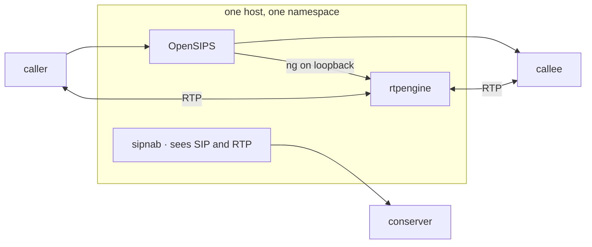
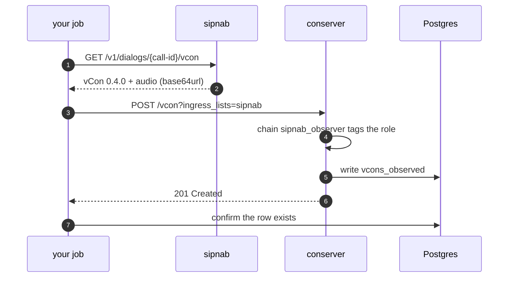
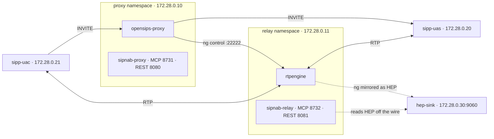
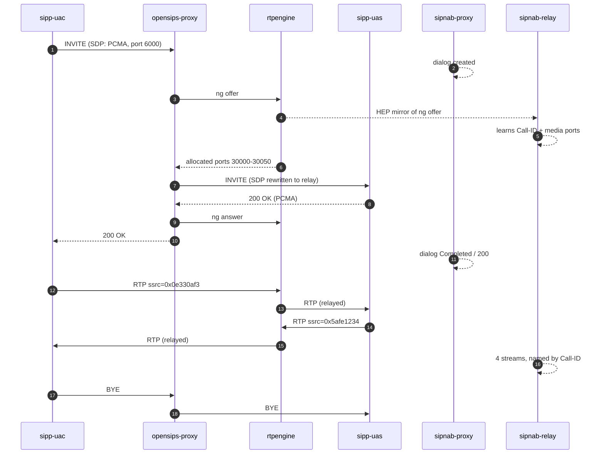

# The vCon capture stack

OpenSIPS routes the call, rtpengine carries the media, sipnab watches both
without taking part, and a conserver keeps what comes out. This page is how to
build that, operate it, prove it works, and recognize the failure modes that
look like success.

Hostnames in the sample output below appear as `<proxy-host>` and
`<relay-host>`.

- Neither is a literal value. Both stand in for something taken out.
- `node` carries whatever hostname the container has.
  - On one side that is a private lab machine.
  - On the other side it is an ephemeral container ID.
- Everything else in those samples is verbatim.

It describes a test harness rather than a production deployment.

- Every command here ran against a real build.
- The addresses belong to a private lab bridge.
- The arrangement is deliberately more separated than a real one needs. So
  each half can prove itself on its own.

## Why two capture points

A proxy and a media relay see different halves of a call.

- `sipnab-proxy` shares the OpenSIPS network namespace.
  - It sees INVITE, 200 OK, ACK, BYE — and no media at all.
- `sipnab-relay` shares the rtpengine namespace.
  - It sees RTP — and never a SIP message.

Neither can answer *“was this call healthy?”* alone.

- Joining them is the thing under test.
- It only works because rtpengine mirrors its `ng` control plane where the
  relay can read it.

The harness gives rtpengine a network namespace of its own. Two sipnab
instances on one interface read the same packets, so they could not show that
a leg seen at the proxy is the leg seen at the relay. In separate namespaces
each instance captures only its own half.

## Choosing one node or two

Answer this before deploying. It decides four other things.

When OpenSIPS and rtpengine run on the same host, **one sipnab is enough and is the simpler build.**

- A single capture point sees the signaling and the media together.
- So it learns which streams belong to which call from the SDP.
- That is the way sipnab does it everywhere else.

Two nodes exist for the case that cannot cover: a relay on separate hardware.

- That relay never sees an INVITE.
- Attribution then has to come from the rtpengine `ng` control plane instead.
- That carries four requirements with it.

|  | Single node (co-located) | Two nodes (separate relay) |
|---|---|---|
| Stream attribution | SDP in the signaling | rtpengine ng control plane |
| `hep` build feature | Not needed | Required |
| HOMER mirroring | Not needed | Required |
| A sink to absorb the mirror | Not needed | Required |
| Control ports in the BPF | Not needed | Required |



Two files. Compose merges them in order:

- The base defines every service.
- The overlay changes only what co-location makes different.

Open either to see exactly what it sets.

| Role | File | What it contains |
|---|---|---|
| Base · always | [`harness/docker-compose.yml`](https://github.com/NormB/sipnab/blob/main/harness/docker-compose.yml) | Every service: OpenSIPS, rtpengine, both sipnabs, the SIPp endpoints and the HEP sink. On its own it stands up the two-node arrangement. |
| Overlay · co-located | [`harness/docker-compose.single.yml`](https://github.com/NormB/sipnab/blob/main/harness/docker-compose.single.yml) | Puts rtpengine back in the proxy's namespace, moves the ng socket to loopback, turns mirroring off, and scales the relay-side sipnab and the HEP sink to zero. |

### MEDIA — rtpengine, co-located — the simple case

On the same host as OpenSIPS, the control socket stays on loopback. **Nothing needs mirroring**.

- sipnab reads the SDP that describes this media.
- So it can attribute streams without ever seeing an ng message.

Set `HOST_IP` to the address rtpengine offers media on:

```bash
HOST_IP=192.0.2.10
```

```bash
rtpengine \
  --interface="$HOST_IP" \
  --listen-ng=127.0.0.1:22222 \
  --port-min=30000 --port-max=30050
```

OpenSIPS then points at `udp:127.0.0.1:22222`. One sipnab watches the interface both use:

```bash
sipnab -N -d eth0 \
  --api 127.0.0.1:8080 \
  --mcp --mcp-transport http --mcp-bind 127.0.0.1:8731 \
  --retain-audio \
  --portrange 5060-5061 \
  "udp and (portrange 5060-5061 or portrange 30000-30050)"
```

This needs:

- no `hep` feature,
- no `--hep-parse`,
- no control ports in the filter.

Everything below this point applies only when the relay runs somewhere else.

### MEDIA — rtpengine on separate hardware — mirroring its control plane

Signaling cannot attribute a relay that never sees an INVITE.

- So the mirror becomes the only link.
- Without it every captured stream is media nobody can name.

Set `RELAY_IP` to the relay's own address. Set `COLLECTOR` to the host running the sipnab that receives the mirror:

- Set the relay's own address:

   ```bash
   RELAY_IP=192.0.2.20
   ```

- Set the address of the host running the sipnab that receives the mirror:

   ```bash
   COLLECTOR=192.0.2.30
   ```

Then start the relay:

```bash
rtpengine \
  --interface="$RELAY_IP" \
  --listen-ng="$RELAY_IP:22222" \
  --port-min=30000 --port-max=30050 \
  --homer="$COLLECTOR:9060" \
  --homer-protocol=udp \
  --homer-enable-ng
```

### SIGNAL — OpenSIPS, anchoring every call

Point the control socket at the relay.

- Co-located that is `udp:127.0.0.1:22222`.
- On separate hardware it is the relay's address.
  - Loopback fails to reach it without saying so.

```
loadmodule "rtpengine.so"
modparam("rtpengine", "rtpengine_sock", "udp:<relay-ip>:22222")

# in the INVITE route
rtpengine_offer();
# in the reply route
rtpengine_answer();
# on dialog teardown
rtpengine_delete();
```

### SIGNAL — sipnab on a separate relay

Only for the split arrangement. The co-located invocation is above.

Build with the features you need:

- `vcon` to produce containers,
- `audio` to carry media,
- `hep` to decode the control plane.

A build without `hep` refuses `--hep-parse` outright.

Build it:

```bash
cargo build --release --features "native,tls,api,mcp,mcp-http,audio,vcon,hep"
```

At the RELAY — media, plus the control plane that names it:

```bash
sipnab -N -d eth0 \
  --api 127.0.0.1:8081 \
  --mcp --mcp-transport http --mcp-bind 127.0.0.1:8732 \
  --hep-parse \
  --retain-audio \
  --portrange 5060-5061 \
  "udp and (portrange 5060-5061 or portrange 30000-30050 \
            or port 22222 or port 9060)"
```

At the PROXY — signaling only:

```bash
sipnab -N -d eth0 --api 127.0.0.1:8080 \
  --mcp --mcp-transport http --mcp-bind 127.0.0.1:8731 \
  --portrange 5060-5061
```

## Check the three settings relay naming needs

> **`--hep-parse` does not name relay media**
>
> It is for HEP-encapsulated *SIP*.
>
> - It unwraps each HEP datagram and reads the payload inside.
> - It neither helps nor stops relay naming.
> - sipnab recognizes mirrored rtpengine `ng` with or without it.
> - Either way, sipnab believes a sniffed mirror only when it went to the HEP port, 9060.
>
> What relay naming needs:
>
> - the `hep` build feature,
> - the control-plane ports in the capture filter.

> **The default filter excludes the control plane**
>
> Port 22222 and the HEP destination port are not in a SIP-and-media filter.
>
> - The kernel drops them where no counter reports it.
> - So the capture looks healthy and names nothing.

> **sipnab discards RTP payloads unless you ask for them**
>
> Without `--retain-audio` the container carries a Dialog Object typed `recording` with no `body` and zero bytes.
>
> - That is the placeholder of draft-ietf-vcon-vcon-core-04 section 4.3.
> - It is a run that kept no audio, not a call that was silent.
> - The completeness caveat is the only thing that says which.
> - Read it before concluding anything about the media.

## Store a call

Post the container through an ingress list, then confirm that the durable
table holds it.



> **Posting without an ingress list stores nothing durable**
>
> `POST /vcon` with no `ingress_lists` writes the cache only.
>
> - It answers **201**.
> - It reads back correctly for about an hour.
> - Then it vanishes. Nothing ever wrote the durable tables.
>
> Name the ingress list, and confirm the row, every time.

Set these:

- `CONSERVER` to the conserver's host and port,
- `TOKEN` to the API token your conserver's configuration sets.

The later commands on this page read the same `TOKEN`:

- Set the conserver's host and port:

   ```bash
   CONSERVER=127.0.0.1:8000
   ```

- Set the API token:

   ```bash
   TOKEN='replace-with-your-conserver-api-token'
   ```

Then post the vCon:

```bash
curl -s -X POST "http://$CONSERVER/vcon?ingress_lists=sipnab" \
  -H "x-conserver-api-token: $TOKEN" \
  -H 'Content-Type: application/json' \
  --data-binary @call.json
```

Query the table, not the API: `select count(*) from vcons_observed where uuid = '<uuid>'`.

- A 201 tells you the store accepted the request.
- Only the row tells you it kept the call.

Concretely, against a running harness:

Set up the variables.

- The Call-ID needs percent-encoding because it contains an `@`.
- A URL parser otherwise treats that as the start of a host.
- `jq -rR
  @uri` does it without a helper script:

```bash
KEY=$(cat secrets/api.key) ENC=$(jq -rR @uri <<<'1-133@172.28.0.21')
```

Ask the node that holds both the Call-ID and the audio for the container:

```bash
curl -s -H "Authorization: Bearer $KEY" "http://127.0.0.1:8081/v1/dialogs/$ENC/vcon" > call.json
```

Post it, naming the ingress list:

```bash
curl -s -X POST "http://127.0.0.1:8000/vcon?ingress_lists=sipnab" -H "x-conserver-api-token: $TOKEN" -H 'Content-Type: application/json' --data-binary @call.json
```

Read it back with its audio. The container names itself in its `uuid` field:

```bash
VCON_UUID=$(jq -r .uuid call.json)
```

```bash
python3 ../clients/python/vcon_view.py "$VCON_UUID" --audio call.wav
```

## User guide

Day-to-day operation once the stack is up. Every task here reads and changes nothing, unless it says otherwise.

### Find the call you care about

The proxy node knows calls by Call-ID and knows nothing about their audio. Start there.

```bash
curl -s -H "Authorization: Bearer $KEY" \
  "http://127.0.0.1:8080/v1/dialogs?limit=50" | jq -r \
  '.dialogs[] | [.call_id, .state, .final_status_code] | @tsv'
```

### See whether sipnab captured its media

The relay node knows streams.

- Once it has decoded the control plane, it also knows which call each belongs to.
- A stream with a null `associated_dialog` is media the relay could not attribute.
  - Usually the control plane, not the media, is what went missing.

```bash
curl -s -H "Authorization: Bearer $KEY" \
  "http://127.0.0.1:8081/v1/streams?limit=50" | jq -r \
  '.streams[] | [.associated_dialog // "UNNAMED", .codec, .packets, .mos] | @tsv'
```

### Build and keep the container

Ask the node that holds both the Call-ID and the audio. On this topology, that is the relay.

Encode the Call-ID for the URL path. The `@` in it would otherwise read as a
host separator:

```bash
ENC=$(jq -rR @uri <<<'1-133@172.28.0.21')
```

Build the container:

```bash
curl -s -H "Authorization: Bearer $KEY" "http://127.0.0.1:8081/v1/dialogs/$ENC/vcon" > call.json
```

Store it, naming the ingress list so it reaches the durable tables:

```bash
curl -s -X POST "http://127.0.0.1:8000/vcon?ingress_lists=sipnab" -H "x-conserver-api-token: $TOKEN" -H 'Content-Type: application/json' --data-binary @call.json
```

### Listen to a stored call

List the containers the store holds:

```bash
python3 ../clients/python/vcon_view.py
```

Show one container's parties, dialog and recording. First set `VCON_UUID` to a `uuid` from that list:

```bash
VCON_UUID=018f3a2b-4c5d-8e6f-9012-3456789abcde
```

```bash
python3 ../clients/python/vcon_view.py "$VCON_UUID"
```

Extract its audio to a WAV:

```bash
python3 ../clients/python/vcon_view.py "$VCON_UUID" --audio c.wav
```

### Answer "did we capture this call properly?"

Three checks, in the order that fails fastest.

| Question | Where to look | A bad answer means |
|---|---|---|
| Did the relay see the control plane? | `caveats.media_creating_commands` on `/v1/stats` | Zero means HEP decoding is off or a filter drops the ports, and no stream ever gets a name. |
| Is the media attributed? | `associated_dialog` on each stream | Null means the container describes a call with no audio. |
| Did the container survive? | A row in the durable table | Present in the API but absent from the table means the store cached it rather than keeping it. |

### Read the caveat before trusting the audio

Every container carries a completeness note built from that run's own counters.

- It states what the capture missed.
- It distinguishes what sipnab failed to see from what an operator chose not to keep.

A container that says `PARTIAL` is not broken. It is telling you which question it can answer.

## Manage what you have stored

| Task | How |
|---|---|
| List what persisted | Query `vcons_observed`. The cache-backed listing route also returns entries that expired and now answer 404. |
| Fetch one | `GET /vcon/{uuid}` |
| Play the audio | Base64url-decode `dialog[].body` where `type` is `recording` and `body` is present — it is a WAV. A `recording` with no `body` is a placeholder and carries no audio. |
| Verify integrity | Check the recording's `content_hash` against the body you hold. |
| Separate roles | Query the role view. An observation and a recording of one call are two UUIDs and stay that way. |

> **Stereo means two sources, or it means nothing**
>
> A relay sees each direction twice, arriving and leaving.
>
> - So a two-party call yields four stream records carrying two SSRCs.
> - A container whose two channels are byte-identical is one leg duplicated.
> - sipnab selects one stream per SSRC to avoid exactly that.
> - If you build containers another way, do the same.

## Topology

Four containers on one bridge. Plus two sipnab sidecars. The sidecars join existing namespaces rather than getting their own.



| Service | Role | Namespace |
|---|---|---|
| `opensips-proxy` | Registrar and stateful proxy; anchors all media through rtpengine | own |
| `rtpengine` | Media relay in userspace; mirrors its ng control plane as HEP | own |
| `sipnab-proxy` | Signaling capture point | joins `opensips-proxy` |
| `sipnab-relay` | Media capture point; decodes HEP to name streams | joins `rtpengine` |
| `sipp-uac` | Places calls, plays caller audio | own |
| `sipp-uas` | Answers, plays *different* callee audio back | own |
| `hep-sink` | Absorbs the HEP mirror so rtpengine keeps sending it | own |

> **hep-sink is not optional**
>
> rtpengine *connects* its Homer socket.
>
> - A destination that answers ICMP port-unreachable makes it give up and send nothing.
> - That looks exactly like the feature not working.
> - Something must absorb the datagrams.
> - That holds even though sipnab reads them passively off the wire rather than receiving them.

## One call, end to end

What each node observes, and the moment the two halves become one call.



> **Read the step "learns Call-ID + media ports" twice**
>
> That is the only step linking the two nodes.
>
> - Signaling never transits rtpengine.
> - So without the HEP mirror every relay stream carries `associated_dialog: null`.
> - No downstream correlation can recover a Call-ID it was never told.

## Setup

From a clone to a running stack.

- Docker and Docker Compose are the only prerequisites.
- The repository builds everything else.

Every command below runs from the `harness` directory.

```bash
cd harness
```

### Mint the credentials

Two secrets:

- a long-lived HMAC key that mints rotating MCP bearer tokens,
- a REST API key.

Both land in the harness `secrets/` directory. The repository ignores it by
pattern. Both targets are idempotent.

```bash
make signing-key
```

```bash
make api-key
```

### Generate the two voices

The caller and callee must play *different* media. Otherwise the two legs are
indistinguishable.

- Use real speech rather than a tone, so a listener can judge the captured
  audio. A male caller counting up and a female callee counting down make
  each leg recognizable.
- The script defaults to:
  - `en_US-ryan-medium` with SSRC `0x0CA11E12` for the caller,
  - `en_US-amy-medium` with SSRC `0x5AFE1234` for the callee.

```bash
./scripts/make-speech-pcaps.sh
```

### Build and start

The sipnab image must carry `vcon`, `audio` and `hep`. Without `hep` the relay
cannot decode the control plane at all.

```bash
docker compose build
```

```bash
docker compose up -d
```

```bash
docker compose ps
```

### Confirm both nodes answer

Different `capture_identity.node` values are the proof. They show two capture
points, not one reached twice.

```bash
KEY=$(cat secrets/api.key)
```

```bash
curl -s -H "Authorization: Bearer $KEY" http://127.0.0.1:8080/v1/stats | jq .capture_identity
```

```bash
curl -s -H "Authorization: Bearer $KEY" http://127.0.0.1:8081/v1/stats | jq .capture_identity
```

### Run the test

The test:

- places calls,
- waits for the relay to name the media,
- queries both nodes over REST and MCP,
- writes a timestamped report to `results/e2e-<UTC>.md`.

`CALLS` sets how many calls to place. It defaults to 3.

```bash
CALLS=3 ./scripts/run-e2e.sh
```

## What a good run looks like

The same call, the same audio, measured on both arrangements. One node or two changes where the evidence lives. It does not change what the evidence says.

### Co-located — one sipnab

```
Successful call: 1        Failed call: 0

node=<proxy-host>  dialogs=1  streams=4
streams=4 named=4 ssrcs=['0x0ca11e12', '0x5afe1234']
  1-13@172.28.0.21   172.28.0.20:6000  -> 172.28.0.10:30034   4500p  mos=4.36
  1-13@172.28.0.21   172.28.0.10:30012 -> 172.28.0.21:6000    4500p  mos=4.36
  1-13@172.28.0.21   172.28.0.21:6000  -> 172.28.0.10:30012   4500p  mos=4.36
  1-13@172.28.0.21   172.28.0.10:30034 -> 172.28.0.20:6000    4500p  mos=4.36
```

One node holds the whole call. Nothing needs correlating, because nothing split it apart.

### Separate relay — two sipnabs

```
Successful call: 1        Failed call: 0

proxy: node=<proxy-host>      dialogs=1  streams=0
relay: node=<relay-host>    dialogs=0  streams=4

Call-ID                  State       Code  Strm  Pkts    Codec   MOS   2-way
----------------------------------------------------------------------------
1-13@172.28.0.21         Completed   200   4     18000   PCMA    4.36  yes

  1 call(s) correlated across both nodes
```

The proxy reports **zero streams** and the relay **zero dialogs**. That asymmetry is the arrangement working.

- Neither node holds the other's half.
- The join is what puts the call back together.

| Measured | What it is |
|---|---|
| **4** | stream records |
| **4 / 4** | named by Call-ID |
| **2** | distinct SSRCs |
| **4.36** | MOS, both arrangements |

Four stream records for two audio streams is correct, not duplication.

- A relay sees each direction arriving and leaving.
- Two SSRCs is the number of voices.

## The three clients

Both run on the host, outside the containers. Read-only.

| Client | Door | What it proves |
|---|---|---|
| [`../clients/python/leg_correlate.py`](https://github.com/NormB/sipnab/blob/main/clients/python/leg_correlate.py) | REST 8080 / 8081 | Joins proxy dialogs to relay streams on `associated_dialog`; reports unnamed media rather than dropping it |
| [`../clients/python/mcp_probe.py`](https://github.com/NormB/sipnab/blob/main/clients/python/mcp_probe.py) | MCP 8731 / 8732 | Drives the door an agent uses; compares both nodes' answers |
| [`../clients/python/vcon_view.py`](https://github.com/NormB/sipnab/blob/main/clients/python/vcon_view.py) | conserver 8000 | Lists stored vCons, renders one, extracts its audio as WAV |

The two capture clients refuse to report on one node reached twice.

- `leg_correlate.py` compares capture instances.
- `mcp_probe.py` compares `capture_identity.instance`.
- Point them both at the same URL and they exit. They do not present a node
  agreeing with itself as corroboration.
- `vcon_view.py` reads the conserver instead. So the check does not apply to it.

## Troubleshoot the harness

Each of these fails without an error in a log, or reports something misleading.

**HEP support requires --features hep**

The build omitted the `hep` feature.

- So the relay could never decode the control plane.
- Every stream stayed orphaned.

**`media_creating_commands: 0`**

Control traffic is on the wire and in the filter, yet nothing decodes. Check the port the mirror goes to:

- sipnab believes a sniffed mirror only on UDP port 9060.
- It logs one refusal naming any other port it saw.

**associated_dialog: null on every stream**

The default capture filter admits SIP and the media range only. The kernel drops the ng port and its HEP mirror where no counter reports it.

**Everything correct, still nothing named**

The symptoms:

- feature built in,
- ports in the filter,
- datagrams on the wire,
- no stream ever gets a Call-ID.

A sipnab older than 0.5.128 with `--hep-parse` on does not name relay media.
Run a current release.

**Correlation empty after a container restart**

A sidecar shares the namespace of the service it watches.

- Recreating that service kills the sidecar.
- A join over the surviving node then reads as "no calls matched".

**Build says "Built", version unchanged**

Three layers set the OpenSIPS ref:

- the Dockerfile ARG,
- the compose `args:` block,
- a git-ignored `.env`.

The last wins. So editing the first two produces a full cache hit.

**Unsupported link-type 12**

SIPp refuses a pcap written with `DLT_RAW` and plays nothing.

**<recv> before <nop> without a mandatory message**

SIPp rejects a `<nop>` that follows an `optional="true"` `<recv>`.

**GET /vcons → 500**

The plural path is in the conserver's OpenAPI schema but fails. That reads as a broken store rather than as a caller using the wrong path.

**Both WAV channels identical**

Both ends replayed the same pcap, SSRC included. So the legs carried byte-identical audio.

**Counts far higher than the calls placed**

A background call loop keeps dialing during a measurement. So every figure is the calls under test plus whatever the loop fit in the same window.

## Reference

Everything the rest of the page refers to, in one place.

### Ports

| Port | Service | Bind |
|---|---|---|
| 5060/udp | SIP — OpenSIPS | loopback unless deliberately exposed |
| 22222/udp | rtpengine ng control | reachable from the proxy only |
| 30000-30050/udp | rtpengine media | reachable from endpoints |
| 9060/udp | HEP mirror destination | a collector, or any UDP sink |
| 8080 / 8081 | sipnab REST — proxy / relay | loopback |
| 8731 / 8732 | sipnab MCP — proxy / relay | loopback |
| 8000 | conserver API | loopback |

### sipnab flags that decide whether this works

| Flag | Default | Without it |
|---|---|---|
| `--hep-parse` | off | For HEP-encapsulated SIP. Not needed for relay naming. sipnab believes mirrored ng on port 9060 only, with or without it |
| `--retain-audio` | off | Containers carry a `recording` placeholder with no bytes |
| `--api <addr>` | off | No REST surface. A non-loopback bind requires an API key |
| `--portrange` | 5060-5061 | Names which ports carry SIP, separate from the capture filter |

### Endpoints

| Endpoint | Purpose |
|---|---|
| `GET /v1/stats` | Node identity, counts, capture quality |
| `GET /v1/dialogs` | Calls this node observed |
| `GET /v1/streams` | Media, with the call it belongs to |
| `GET /v1/dialogs/{call-id}/vcon` | Build a container for one call |
| `POST /vcon?ingress_lists=<list>` | Store durably through a chain |
| `GET /vcon/{uuid}` | Fetch a stored container |

### Real output

A running harness answered `/v1/stats` with this.

```json
{
  "capture_identity": {
    "instance": "118cfa82b3c2df7bc-1",
    "node": "<proxy-host>",
    "dialog_generation": 1089,
    "stream_generation": 0
  },
  "capture_name": "eth0",
  "capture_quality": {
    "degraded": false,
    "kernel_dropped_packets": 0,
    "interface_dropped_packets": 0,
    "undecodable_frames": 0,
    "snapped_frames": 0
  },
  "source": "live"
}
```

`instance` is what tells two nodes apart.

- Compare it before trusting any answer that claims to join them.
- Two clients pointed at one sipnab otherwise agree with each other perfectly.

The `capture_quality` block above shows the keys this page uses. The block
also carries `invalid_timestamps`, `unanswered_nat_requests`,
`lapsed_turn_allocations`, `lapsed_turn_allocation_streams` and
`ice_role_conflicts`. The [REST API reference](rest-api.md) describes each.

```
1-141@172.28.0.21  172.28.0.20:6000  -> 172.28.0.11:30006  PCMA  4500p  jitter=0.00ms  mos=4.36
1-141@172.28.0.21  172.28.0.11:30036 -> 172.28.0.21:6000   PCMA  4500p  jitter=0.01ms  mos=4.36
1-141@172.28.0.21  172.28.0.21:6000  -> 172.28.0.11:30036  PCMA  4500p  jitter=0.34ms  mos=4.36
1-141@172.28.0.21  172.28.0.11:30006 -> 172.28.0.20:6000   PCMA  4500p  jitter=0.34ms  mos=4.36
```

Four rows, two audio streams.

- Each direction appears twice because the relay sees it arrive and sees it leave.
- All four carry a Call-ID. That is what the mirrored control plane bought.
- Without it every row reads `associated_dialog: null`.

A container, trimmed to its parties and its recording. sipnab exported this
one from [`tests/pcap-samples/sip-rtp-g711.pcap`](https://github.com/NormB/sipnab/raw/main/tests/pcap-samples/sip-rtp-g711.pcap) with `--retain-audio`. The
call's audio flowed one way. `<host>` stands for the capturing host's name:

```json
{
  "vcon": "0.4.0",
  "uuid": "0158a120-0392-864f-994e-dce45c3575ca",
  "parties": [
    {
      "sip": "sip:sipp@10.0.2.20:5060",
      "validation": "none",
      "name": "PCMU/8000",
      "sip_display_name": "PCMU/8000",
      "sip_contact": "sip:sipp@10.0.2.20:5060"
    },
    {
      "sip": "sip:test@10.0.2.15:5060",
      "validation": "none",
      "name": "test",
      "sip_display_name": "test",
      "sip_contact": "<sip:test@10.0.2.15:5060;transport=udp>",
      "sip_user_agent": "FreeSWITCH-mod_sofia/1.6.12-20-b91a0a6~64bit"
    },
    {
      "validation": "none",
      "role": "observer",
      "sip_user_agent": "sipnab/0.5.222 (observer; node <host>)"
    }
  ],
  "dialog": [
    {
      "type": "recording",
      "sip_call_id": "1-1966@10.0.2.20",
      "duration": 8.5,
      "parties": [1],
      "mediatype": "audio/x-wav",
      "encoding": "base64url",
      "content_hash": "sha512-GVphUEyrsE9TSwxDIUBOUWDh1xEmmbHbpT5SqrtTVVVOQWy9JUPWgvOtxlFy1Rr-p8gcpy8pRosgohjHBa6uQg",
      "body": "<182022 base64url chars>"
    }
  ]
}
```

Three things to read here:

- Every party carries `validation: "none"`.
  - The wire carried these names, and sipnab identified nobody.
- The third party is sipnab itself, declared as an `observer`.
  - So a consumer can see that something which never took part produced the container.
- The recording's `parties` is `[1]`: its one channel came from the media
  address party 1 advertised in its SDP.
  - On a relay capture, where the audio comes from the relay's addresses,
    the recording has no `parties`.

### Build features

```bash
cargo build --release \
  --features "native,tls,api,mcp,mcp-http,audio,vcon,hep"
```

Drop `hep` and the relay cannot decode the control plane at all. sipnab refuses `--hep-parse` outright.

## What a stereo recording and a 201 do not prove

Both of these produce output that passes inspection and means something other
than it appears to.

### A stereo recording is not proof of two speakers

A relay observes each direction of a call **twice** — once arriving, once leaving.

- So a two-party call reaches an exporter as four stream records carrying two SSRCs.
- The two records of one leg can precede either record of the other.

An exporter that takes the first two streams it finds therefore selects the same voice twice.

- The result is a stereo file whose channels are byte-identical.
- It claims a conversation and carries one side of it.
- Nothing in the file marks the difference.

sipnab selects one stream per SSRC. It falls back to mono when only one source is present.

- If you build containers by another route, apply the same rule.
- To check an existing file, compare the channels.
  - Identical RMS across a whole recording means one leg, not a quiet line.

The same reasoning governs the omission caveat. It counts *sources*, not records.

- Counting records would report two of four streams missing on a call where sipnab captured both parties.

### A 201 from the conserver does not prove it kept the container

A conserver can do all of these while never having written a container to durable storage:

- accept the container,
- answer **201**,
- return it byte-identical on the next request.

Cache-backed writes behave this way by design. The cache commonly expires in about an hour.

A round-trip performed immediately after the write proves acceptance. It says nothing about retention.

- Every check a careful reader runs passes against a container that vanishes overnight:
  - matching UUID,
  - matching content hash,
  - a WAV that decodes and plays.

Two habits close the gap:

- Post through an ingress chain, naming the list explicitly.
  - So the container enters a pipeline that writes durably rather than landing in a cache.
- Then confirm by querying the durable table for the UUID.
  - That asks a different question than the API does and takes no longer.

The listing route deserves the same suspicion.

- An index that only ever grows commonly backs it.
- So it offers UUIDs that expired hours ago and now answer 404.

## Before this carries real calls

- **Check the recording law that applies.**
  - Consent requirements differ by jurisdiction and by who is on the call.
  - Decide what the law lets you keep before building something that keeps it.
- **Give each producer its own scoped key.**
  - The key decides the role.
  - So a shared key is a producer that can claim any role.
- **Audio is the payload, so size the retention.**
  - Ninety seconds of stereo G.711 is roughly a megabyte of base64 per call.
  - Set a retention policy before the first busy day.
- **Bind to loopback unless you mean otherwise.**
  - A SIP service on `0.0.0.0` answers calls from anyone who can route to the host.
  - Scanners find it.
- **The file store's permissions are part of the design.** `0600` files in `0700` directories. Call audio is not world-readable.
- **Never commit the secrets directory.**
  - It holds the signing key, the per-node tokens and the REST API key.
  - Match by pattern. Then a token for a node nobody has added yet is still covered.
- **Captures and results are local artifacts.** A pcap from a shared network may hold traffic that was never yours to publish.

Harness lives in `harness/`. Run `make help` for the full target list.
